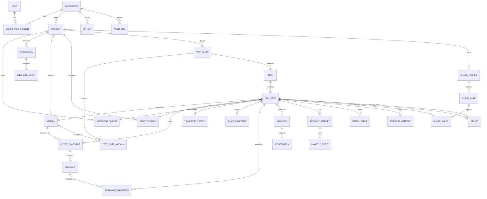

# COMRDY ERD and Data Model

## 1. Data model principles

1. Multi-tenant from day one.
2. Immutable evidence and event history.
3. Versioned intent contracts and policies.
4. Financial identifiers stored separately from secrets.
5. Replays create new records; never mutate original run history.
6. Normalized relational core plus JSONB for external payload snapshots.
7. Large binary evidence lives in object storage, not PostgreSQL.

## 2. Core ERD



## 3. Tables

### users

| Column | Type | Notes |
|---|---|---|
| id | uuid PK | |
| email | citext unique | |
| name | text | |
| avatar_url | text nullable | |
| created_at | timestamptz | |
| last_seen_at | timestamptz | |

### workspaces

| Column | Type | Notes |
|---|---|---|
| id | uuid PK | |
| slug | text unique | public path key |
| name | text | |
| plan | text | free/team/enterprise |
| created_at | timestamptz | |

### workspace_members

Composite unique `(workspace_id, user_id)`.

Columns:
- id uuid PK;
- workspace_id FK;
- user_id FK;
- role enum `owner|admin|member|viewer`;
- joined_at.

### projects

A logical commerce testing project within a workspace.

Columns:
- id;
- workspace_id;
- slug;
- name;
- description;
- default_target_id nullable;
- created_by;
- created_at;
- archived_at nullable.

Unique `(workspace_id, slug)`.

### merchant_targets

Columns:
- id;
- project_id;
- name;
- base_url;
- environment enum `demo|staging|sandbox|production`;
- platform enum `demo|shopify|custom|other`;
- browser_enabled boolean;
- structured_tools_enabled boolean;
- status enum `healthy|degraded|offline|unverified`;
- capabilities jsonb;
- auth_config_ciphertext nullable;
- last_verified_at;
- created_at.

Production targets cannot enable Chaos.

### integrations

Columns:
- id;
- project_id;
- type enum `paypal|kernel|object_storage|webhook|custom`;
- environment;
- status;
- display_name;
- encrypted_config;
- config_fingerprint;
- last_verified_at;
- created_by;
- created_at;
- revoked_at.

Never store raw secrets in logs.

### missions

Columns:
- id;
- project_id;
- name;
- mandate_text;
- variables jsonb;
- tags text[];
- status `draft|active|archived`;
- created_by;
- created_at;
- updated_at.

### intent_contracts

Versioned immutable compiled contracts.

Columns:
- id;
- mission_id;
- version integer;
- schema_version text;
- compiler_provider text;
- compiler_model text;
- compiler_prompt_version text;
- raw_contract jsonb;
- contract_hash text;
- validation_status `valid|invalid`;
- locked_by_user boolean;
- created_by;
- created_at.

Unique `(mission_id, version)`.

### invariants

Columns:
- id;
- intent_contract_id;
- invariant_key text;
- category enum;
- path text;
- operator text;
- expected_value jsonb;
- severity `critical|high|medium|low`;
- hard boolean;
- human_label text;
- metadata jsonb.

Examples:
- `variant.size EQ "M"`
- `total.amount LTE 150`
- `subscription.enabled EQ false`

### agent_profiles

Columns:
- id;
- project_id;
- name;
- runner_type `browser|structured|custom`;
- provider;
- model;
- toolset_version;
- prompt_version;
- config jsonb;
- active boolean;
- created_at.

Do not store provider secrets in profile; reference integration/secret store.

### test_suites

Columns:
- id;
- project_id;
- name;
- description;
- default_agent_profile_id;
- default_target_id;
- chaos_profile_id nullable;
- policy jsonb;
- created_at;
- updated_at.

Policy example:
```json
{
  "min_atr": 0.98,
  "max_false_success_rate": 0.01,
  "max_critical_violations": 0,
  "capture_valid_sandbox_authorizations": true
}
```

### test_suite_missions

Columns:
- id;
- test_suite_id;
- mission_id;
- sort_order;
- enabled;
- overrides jsonb.

Unique `(test_suite_id, mission_id)`.

### runs

Columns:
- id;
- test_suite_id;
- project_id;
- initiated_by_type `user|api|schedule|ci`;
- initiated_by_id nullable;
- status;
- seed bigint;
- started_at;
- finished_at;
- summary jsonb;
- app_version;
- runner_version;
- created_at.

Indexes:
- `(project_id, created_at desc)`;
- `(status, created_at)` for worker recovery.

### run_cases

One mission execution.

Columns:
- id;
- run_id;
- mission_id;
- intent_contract_id;
- agent_profile_id;
- merchant_target_id;
- status;
- classification `pass|hard_failure|false_success_blocked|false_success_captured|indeterminate|infra_failure`;
- gate_decision `allow|review|deny|null`;
- first_drift_checkpoint nullable;
- first_drift_invariant_id nullable;
- expected_total numeric nullable;
- actual_total numeric nullable;
- currency char(3) nullable;
- started_at;
- finished_at;
- duration_ms integer;
- attempt_count integer default 1;
- seed bigint.

### trajectory_events

Append-only sequence of agent/browser/tool activity.

Columns:
- id bigserial PK;
- run_case_id;
- sequence_no integer;
- occurred_at;
- event_type;
- source `agent|browser|tool|system|payment|chaos`;
- summary text;
- payload jsonb redacted;
- screenshot_artifact_id nullable;
- parent_event_id nullable.

Unique `(run_case_id, sequence_no)`.

### state_snapshots

Columns:
- id;
- run_case_id;
- checkpoint enum;
- sequence_no;
- normalized_state jsonb;
- source_payload_hash text;
- captured_at;
- extraction_method;
- confidence_metadata jsonb nullable.

A snapshot's normalized values are used by deterministic rules. Any extraction uncertainty must be explicit; never silently invent a value.

### invariant_evaluations

Columns:
- id;
- run_case_id;
- invariant_id;
- state_snapshot_id;
- result `pass|fail|unknown|not_applicable`;
- actual_value jsonb;
- expected_value jsonb;
- explanation text generated deterministically where possible;
- evaluated_at.

Indexes:
- `(run_case_id, result)`;
- `(invariant_id, result)`.

### violations

Columns:
- id;
- run_case_id;
- invariant_id;
- first_snapshot_id;
- code text;
- category;
- severity;
- title;
- factual_summary;
- expected jsonb;
- actual jsonb;
- created_at;
- resolved_at nullable.

### payment_attempts

Columns:
- id;
- run_case_id;
- provider `paypal`;
- environment `sandbox|live`;
- order_id text;
- authorization_id text nullable;
- capture_id text nullable;
- refund_id text nullable;
- currency char(3);
- authorized_amount numeric nullable;
- captured_amount numeric nullable;
- refunded_amount numeric nullable;
- status;
- request_id_create text;
- request_id_authorize text;
- request_id_capture text;
- created_at;
- updated_at.

Unique provider IDs where practical.

### payment_events

Append-only normalized payment provider events.

Columns:
- id;
- payment_attempt_id;
- event_type;
- provider_event_id nullable;
- occurred_at;
- status;
- amount numeric nullable;
- currency char(3) nullable;
- payload_redacted jsonb;
- payload_hash text;
- source `api_response|webhook|reconciliation`.

### order_events

Columns:
- id;
- run_case_id;
- external_order_id;
- event_type;
- status;
- payload jsonb;
- occurred_at.

### evidence_artifacts

Metadata only; file in object storage.

Columns:
- id;
- run_case_id;
- type `screenshot|dom|trace|har|json|video_fragment|document`;
- storage_key;
- mime_type;
- byte_size;
- sha256;
- checkpoint nullable;
- created_at;
- expires_at nullable.

### chaos_profiles

Columns:
- id;
- project_id;
- name;
- description;
- enabled;
- created_at.

### chaos_rules

Columns:
- id;
- chaos_profile_id;
- name;
- trigger_checkpoint;
- predicate jsonb;
- mutation_type;
- mutation_config jsonb;
- probability decimal default 1;
- once_per_case boolean default true;
- severity_hint;
- enabled.

### chaos_events

Columns:
- id;
- run_case_id;
- chaos_rule_id;
- occurred_at;
- before_state jsonb;
- after_state jsonb;
- seed;
- success boolean;
- details jsonb.

### replays

Columns:
- id;
- source_run_case_id;
- created_run_case_id unique;
- changed_dimension enum `chaos|agent|model|prompt|path|none`;
- old_value jsonb;
- new_value jsonb;
- created_by;
- created_at.

### remediations

Columns:
- id;
- violation_id;
- status `suggested|accepted|rejected|verified`;
- root_cause_summary;
- recommendation;
- generated_by;
- evidence_refs uuid[];
- verified_by_run_case_id nullable;
- created_at.

### webhook_events

Raw webhook envelope with replay protection.

Columns:
- id;
- integration_id;
- provider_event_id;
- event_type;
- received_at;
- verification_status;
- payload_redacted;
- payload_hash;
- processing_status;
- processed_at;
- error nullable.

Unique `(integration_id, provider_event_id)`.

### api_keys

Columns:
- id;
- workspace_id;
- name;
- key_prefix;
- secret_hash;
- scopes text[];
- expires_at nullable;
- last_used_at nullable;
- created_by;
- created_at;
- revoked_at nullable.

### audit_logs

Append-only administrative audit trail.

Columns:
- id bigserial;
- workspace_id;
- actor_type `user|api|system`;
- actor_id;
- action;
- resource_type;
- resource_id;
- metadata jsonb;
- ip_hash nullable;
- occurred_at.

## 4. Normalized commerce state

All adapters produce the same shape.

```json
{
  "merchant": {"id": "demo", "domain": "store.com"},
  "product": {
    "id": "p_123",
    "sku": "OCEAN-SHELL",
    "name": "Ocean Shell"
  },
  "variant": {
    "id": "v_456",
    "attributes": {"color": "blue", "size": "M"}
  },
  "quantity": 1,
  "pricing": {
    "unit": {"amount": "129.00", "currency": "USD"},
    "discount": {"amount": "0.00", "currency": "USD"},
    "shipping": {"amount": "10.00", "currency": "USD"},
    "tax": {"amount": "0.00", "currency": "USD"},
    "total": {"amount": "139.00", "currency": "USD"}
  },
  "subscription": {"enabled": false, "interval": null},
  "availability": {"in_stock": true, "eligible": true},
  "delivery": {"destination_country": "US", "estimated_date": null},
  "order": {"id": null, "status": null},
  "payment": {"provider": "paypal", "status": null}
}
```

## 5. Retention

Hackathon/demo:
- keep evidence 7-30 days;
- allow manual purge.

Cloud beta:
- Free: 7 days.
- Team: 30-90 days.
- Enterprise: configurable.

Contract/run summaries can be retained longer than screenshots/HAR files.

## 6. Tenant isolation

Every project-owned row is reachable from `workspace_id` through FK chain. Prefer adding denormalized `workspace_id` to high-volume event tables if row-level security/performance benefits justify it.

Database policies or repository-layer scoping must make unscoped queries difficult.

## 7. Index priorities

High-value indexes:
- runs project/time;
- run_cases run/classification;
- run_cases first_drift_invariant;
- violations project via run join / materialized reporting table;
- invariant_evaluations run_case/result;
- trajectory_events run_case/sequence;
- state_snapshots run_case/checkpoint;
- payment provider IDs;
- webhook provider event IDs;
- audit log workspace/time.

## 8. Reporting model

Do not calculate all workspace dashboards from raw event tables on every request.

Create incremental aggregates or materialized views for:
- daily reliability metrics;
- violation counts by code;
- prevented invalid value;
- agent profile performance;
- target health.
