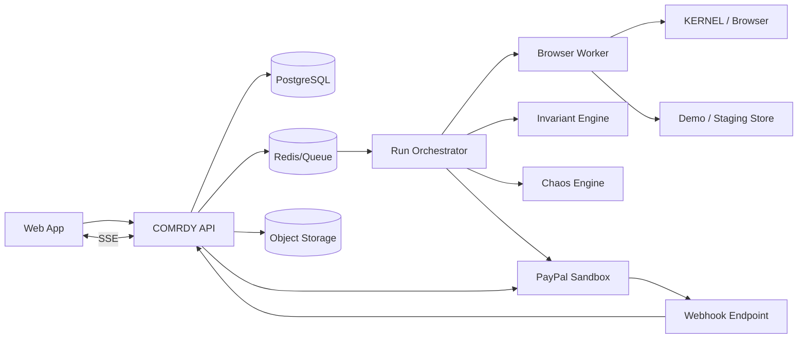

# COMRDY Backend Architecture and API

## 1. Architecture objective

The backend must support long-running agent jobs, deterministic verification, financial idempotency, replayable event history, and a fast web UI without tying the product to one model or browser provider.

## 2. Recommended monorepo

```text
comrdy/
  apps/
    web/                 Next.js marketing + product UI
    api/                 TypeScript HTTP API
    worker/              run orchestration and agent workers
    demo-store/          deterministic commerce target
  packages/
    db/                  schema, migrations, queries
    contracts/           Intent Contract JSON Schema + types
    invariants/          deterministic rule engine
    commerce-state/      normalized state model
    paypal/              PayPal adapter
    runner-browser/      KERNEL/Playwright adapter
    chaos/               fault injection engine
    evidence/            artifact + trace utilities
    sdk/                 public TS client
    ui/                  COMRDY components/tokens
    config/              lint, tsconfig, env schema
  infra/
    render/
    vercel/
    docker/
  docs/
```

## 3. Runtime topology



## 4. Service responsibilities

### Web
- renders marketing/app;
- authenticates user;
- consumes API;
- subscribes to run event stream;
- never receives PayPal secret.

### API
- auth/RBAC;
- CRUD;
- integration management;
- run creation;
- query/reporting;
- webhook endpoint;
- signed artifact URLs;
- API keys.

### Orchestrator
- durable run state machine;
- case fan-out;
- retries infrastructure-only steps;
- coordinates authorization/verification/capture;
- records events.

### Browser worker
- isolated browser per case;
- agent execution;
- screenshot/trace capture;
- normalized state extraction;
- checkout handoff.

### Invariant engine
Pure deterministic package.
No model calls.
Input:
- contract;
- normalized snapshot;
- prior state optional.
Output:
- evaluations;
- violations;
- decision.

### Chaos engine
- seeded fault selection;
- demo/staging only;
- explicit mutation adapters;
- writes chaos events.

### Evidence service
- redaction;
- hashing;
- artifact metadata;
- object storage;
- signed URLs.

## 5. Job architecture

Queue types:
- `run.start`
- `case.execute`
- `case.payment.authorize`
- `case.verify`
- `case.payment.capture`
- `case.post_purchase`
- `case.replay`
- `artifact.process`
- `webhook.process`
- `report.aggregate`

Each job carries stable IDs, not giant payloads.

## 6. Run state machine

```text
QUEUED
  -> PREPARING
  -> EXECUTING
  -> CHECKOUT_READY
  -> AUTHORIZING
  -> AUTHORIZED
  -> VERIFYING
     -> BLOCKED
     -> CAPTURING
        -> CAPTURED
  -> POST_PURCHASE
  -> COMPLETED

Any non-financial infrastructure step may -> FAILED_INFRA
Unknown financial state -> RECONCILING, never blindly retry capture.
```

Case classification is separate from runtime status.

Example:
- status: `COMPLETED`
- classification: `FALSE_SUCCESS_BLOCKED`

## 7. Idempotency strategy

### General
Every command has `command_id` UUID and database uniqueness.

### PayPal
Use stable `PayPal-Request-Id` per intended financial write.

Never generate a new idempotency key just because the worker retried.

Store request IDs with payment attempt before network call where possible.

### Webhooks
Provider event ID unique per integration.
Duplicate webhook -> acknowledge, do not reapply.

## 8. API conventions

Base: `/v1`

- JSON.
- IDs are UUID unless external.
- pagination: cursor-based for event tables; page/cursor acceptable for simple lists.
- `Idempotency-Key` accepted for POST commands.
- errors use stable machine code + factual message.
- all timestamps ISO 8601 UTC.
- money serialized as string decimal + currency.

Error shape:

```json
{
  "error": {
    "code": "PAYPAL_AUTHORIZATION_UNKNOWN",
    "message": "The authorization request timed out before COMRDY received an authorization ID. No capture was attempted.",
    "request_id": "req_...",
    "retryable": true
  }
}
```

## 9. Authentication endpoints

Actual auth may be handled by a provider, but API expects session/JWT.

- `GET /v1/me`
- `GET /v1/workspaces`
- `POST /v1/workspaces`
- `GET /v1/workspaces/:workspaceId`

## 10. Projects and targets

### `POST /v1/projects`

```json
{"name":"Demo Assurance","slug":"demo-assurance"}
```

### `POST /v1/projects/:projectId/targets`

```json
{
  "name":"COMRDY Demo Store",
  "base_url":"https://demo.comrdy.com",
  "environment":"demo",
  "platform":"demo"
}
```

### `POST /v1/targets/:id/verify`
Returns target reachability/capabilities.

## 11. Integrations

### `POST /v1/projects/:id/integrations/paypal`

Request:
```json
{
  "environment":"sandbox",
  "client_id":"...",
  "client_secret":"..."
}
```

Response never echoes secret:
```json
{
  "id":"...",
  "type":"paypal",
  "environment":"sandbox",
  "status":"verified",
  "credential_fingerprint":"A1F9...",
  "last_verified_at":"..."
}
```

### `POST /v1/integrations/:id/verify`

## 12. Missions and contracts

### `POST /v1/projects/:id/missions`

```json
{
  "name":"Ocean Shell budget cap",
  "mandate":"Buy the Ocean Shell in blue, size M. Spend no more than $150 delivered. Do not substitute another size."
}
```

### `POST /v1/missions/:id/compile`
Optional compiler options.

Response:
```json
{
  "contract_id":"...",
  "version":1,
  "validation_status":"valid",
  "invariants":[...]
}
```

### `POST /v1/contracts/:id/lock`
Marks reviewed immutable version.

## 13. Suites and runs

### `POST /v1/projects/:id/suites`

### `POST /v1/suites/:id/runs`

Request:
```json
{
  "seed": 48031,
  "capture_valid_sandbox_authorizations": true
}
```

Response `202 Accepted`:
```json
{
  "run_id":"...",
  "status":"QUEUED",
  "events_url":"/v1/runs/.../events"
}
```

### `GET /v1/runs/:id`
Summary.

### `GET /v1/runs/:id/cases`
Filter params:
- classification;
- violation_code;
- agent_profile_id;
- status.

### `GET /v1/runs/:id/events`
SSE.

Event examples:
- `run.updated`
- `case.started`
- `case.checkpoint`
- `case.authorized`
- `case.violation`
- `case.blocked`
- `case.captured`
- `case.completed`

## 14. Transaction/case detail

### `GET /v1/cases/:id`
Returns header summary.

### `GET /v1/cases/:id/lineage`

```json
{
  "checkpoints":["MANDATE","AGENT_SELECTED","CART_CREATED","CHECKOUT_READY","PAYMENT_AUTHORIZED","DECISION"],
  "attributes":[
    {
      "key":"variant.size",
      "values":["M","M","S","S","S",null],
      "first_violation_checkpoint":"CART_CREATED",
      "invariant_id":"..."
    }
  ]
}
```

### `GET /v1/cases/:id/events`
Cursor timeline.

### `GET /v1/cases/:id/evidence`
Artifact metadata and signed links.

## 15. Replay

### `POST /v1/cases/:id/replays`

```json
{
  "changed_dimension":"chaos",
  "new_value":{"profile_id":null},
  "preserve_seed":true
}
```

Returns replay + new case ID.

### `GET /v1/replays/:id/compare`
Normalized side-by-side diff.

## 16. Chaos API

### `POST /v1/projects/:id/chaos-profiles`
### `POST /v1/chaos-profiles/:id/rules`

Server validates target environment before activation.

## 17. Runtime gate API - post-hackathon

### `POST /v1/gate/verify`

Designed for merchant/server integration immediately before capture.

Request:
```json
{
  "contract_id":"ic_...",
  "transaction_ref":"merchant-123",
  "state":{...normalized commerce state...},
  "payment":{
    "provider":"paypal",
    "authorization_id":"..."
  }
}
```

Response:
```json
{
  "decision":"DENY",
  "decision_id":"gd_...",
  "violations":[
    {
      "code":"VALUE_TOTAL_MAX",
      "expected":{"operator":"<=","amount":"150.00","currency":"USD"},
      "actual":{"amount":"178.00","currency":"USD"}
    }
  ]
}
```

The gate should be low latency and must not call an LLM.

## 18. Webhook endpoint

`POST /v1/webhooks/paypal/:integrationPublicId`

Flow:
1. read raw body/headers;
2. verify PayPal webhook signature per supported integration method;
3. deduplicate provider event ID;
4. persist redacted envelope + hash;
5. enqueue processing;
6. return 2xx promptly;
7. reconcile payment attempt state.

## 19. Redaction

Before payload logging:
- remove authorization headers;
- remove client secrets;
- remove access tokens;
- redact payment instrument fields;
- optionally hash buyer email/identity;
- limit arbitrary HTML capture from third-party sites.

## 20. LLM boundary

Allowed model tasks:
- intent compilation;
- mission variation generation;
- root-cause explanation;
- remediation drafting;
- optional evidence summarization.

Forbidden model authority:
- final ALLOW/DENY decision;
- payment amount mutation;
- idempotency behavior;
- webhook verification;
- secret handling;
- permission enforcement.

## 21. Reliability patterns

- transactional outbox for important domain events where useful;
- worker lease/heartbeat;
- bounded retries with exponential backoff;
- circuit breaker for external providers;
- reconciliation job for ambiguous payment state;
- DLQ for poisoned jobs;
- no silent fallback from deterministic state to LLM guess.

## 22. Observability

Each request/job receives:
- request_id;
- workspace_id;
- project_id;
- run_id/case_id when applicable;
- trace_id.

Metrics:
- queue latency;
- case duration;
- browser start failures;
- authorization latency;
- capture latency;
- webhook lag;
- invariant evaluation latency;
- unknown-state rate;
- retry count;
- provider error rate.
