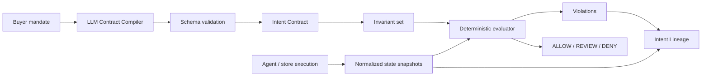

# COMRDY Intent Assurance Engine

## 1. Purpose

The engine converts a natural-language buyer mandate into a versioned deterministic contract, evaluates observed commerce states against it, identifies the earliest semantic/economic drift, and produces a payment gate decision.

## 2. Architecture



## 3. Intent Contract

Contract goals:
- small;
- inspectable;
- model-independent;
- deterministic;
- versioned;
- human-editable;
- extensible.

Example:

```json
{
  "schema_version": "1.0",
  "source": {
    "mandate": "Buy the Ocean Shell in blue, size M. Spend no more than $150 delivered. Do not substitute another size and do not start a subscription."
  },
  "subject": {
    "product": {
      "name": "Ocean Shell",
      "identity_match": "exact_or_catalog_resolved"
    }
  },
  "constraints": [
    {
      "id": "inv_product",
      "path": "product.name",
      "op": "eq",
      "value": "Ocean Shell",
      "hard": true,
      "severity": "critical"
    },
    {
      "id": "inv_color",
      "path": "variant.attributes.color",
      "op": "eq_ci",
      "value": "blue",
      "hard": true,
      "severity": "high"
    },
    {
      "id": "inv_size",
      "path": "variant.attributes.size",
      "op": "eq",
      "value": "M",
      "hard": true,
      "severity": "critical"
    },
    {
      "id": "inv_total",
      "path": "pricing.total",
      "op": "money_lte",
      "value": {"amount": "150.00", "currency": "USD"},
      "hard": true,
      "severity": "critical"
    },
    {
      "id": "inv_substitution",
      "path": "policy.substitution_occurred",
      "op": "eq",
      "value": false,
      "hard": true,
      "severity": "critical"
    },
    {
      "id": "inv_subscription",
      "path": "subscription.enabled",
      "op": "eq",
      "value": false,
      "hard": true,
      "severity": "critical"
    }
  ]
}
```

## 4. Compiler behavior

The compiler is an LLM-assisted parser, not an arbiter.

Required output behavior:
- preserve exact monetary caps;
- distinguish hard phrases such as `must`, `do not`, `no more than`, `exactly`;
- classify softer preferences separately;
- never invent a currency if the environment cannot provide one without marking it unresolved;
- never convert ambiguous sizes/variants without explicit catalog resolution;
- return `needs_resolution` fields when the mandate cannot be made deterministic.

## 5. Compilation pipeline

1. Normalize whitespace only.
2. Supply merchant/catalog context if available.
3. LLM outputs strict JSON.
4. JSON Schema validation.
5. Semantic validation:
   - money has currency;
   - range is coherent;
   - referenced attributes exist or are unresolved;
   - no contradictory hard rules.
6. Generate stable invariant IDs.
7. Produce human-readable preview.
8. Hash canonical contract.
9. Lock immutable version for run.

## 6. Hard vs soft constraints

Hard constraints can block capture.

Soft preferences cannot block capture unless product policy explicitly promotes them.

Example:
- `prefer fastest shipping` = soft;
- `must arrive before Friday` = hard;
- `around $100` = soft unless user clarifies;
- `do not spend more than $100` = hard.

## 7. Invariant operators

Required P0 operators:
- `eq`
- `eq_ci`
- `neq`
- `in`
- `not_in`
- `lte`
- `gte`
- `between`
- `money_eq`
- `money_lte`
- `money_gte`
- `date_lte`
- `exists`
- `not_exists`
- `bool_eq`

Future:
- set equality;
- quantity aggregate;
- merchant allowlist;
- shipping policy;
- signed mandate validation.

## 8. Deterministic evaluation

Pseudocode:

```ts
function verify(contract, state): VerificationResult {
  const evaluations = contract.constraints.map(c => evaluate(c, state));
  const hardFailures = evaluations.filter(e => e.hard && e.result === "fail");
  const unknownHard = evaluations.filter(
    e => e.hard && e.result === "unknown"
  );

  const decision = hardFailures.length > 0
    ? "DENY"
    : unknownHard.length > 0
      ? "REVIEW"
      : "ALLOW";

  return { decision, evaluations };
}
```

In hackathon sandbox, `REVIEW` blocks capture.

## 9. Commerce Invariant Graph

The graph connects:
- invariant;
- expected value;
- checkpoint snapshots;
- first transition where truth changed;
- downstream inherited effects;
- payment decision.

The graph is what powers Intent Lineage.

Example:

```text
INV_SIZE: expected M
MANDATE(M) -> SELECTED(M) -> CART(S) -> CHECKOUT(S) -> AUTH(S)
                         FAIL ^ first drift
```

## 10. First-drift logic

For each invariant:
1. evaluate checkpoints in sequence;
2. ignore checkpoints where path is legitimately not available;
3. first `pass -> fail` or first required `fail` is drift origin;
4. if source was already invalid at first evaluable checkpoint, classify as selection/interpretation drift;
5. preserve later failures as propagated, not new root causes.

## 11. Failure taxonomy

### INTENT
- `INTENT_AMBIGUOUS`
- `INTENT_COMPILER_INVALID`
- `INTENT_CONTRADICTORY`

### SELECTION
- `SELECTION_WRONG_PRODUCT`
- `SELECTION_WRONG_VARIANT`
- `SELECTION_WRONG_QUANTITY`
- `SELECTION_UNAUTHORIZED_SUBSTITUTION`

### VALUE
- `VALUE_ITEM_MAX`
- `VALUE_TOTAL_MAX`
- `VALUE_CURRENCY_CHANGED`
- `VALUE_DISCOUNT_LOST`
- `VALUE_SHIPPING_OVER_CAP`
- `VALUE_TAX_UNEXPECTED` (policy-dependent)

### STATE
- `STATE_INVENTORY_LOST`
- `STATE_ELIGIBILITY_CHANGED`
- `STATE_SUBSCRIPTION_MUTATION`
- `STATE_DELIVERY_DEADLINE`

### PAYMENT
- `PAYMENT_DUPLICATE_ATTEMPT`
- `PAYMENT_AMOUNT_MISMATCH`
- `PAYMENT_CAPTURE_AFTER_DENY`
- `PAYMENT_UNKNOWN_STATE`
- `PAYMENT_IDEMPOTENCY_FAILURE`

### ORDER
- `ORDER_SKU_MISMATCH`
- `ORDER_QUANTITY_MISMATCH`
- `ORDER_TOTAL_MISMATCH`

### POST_PURCHASE
- `REFUND_AMOUNT_MISMATCH`
- `REFUND_NOT_COMPLETED`
- `CANCEL_NOT_HONORED`

### PROTOCOL
- `PROTOCOL_OUTCOME_DRIFT`
- `PROTOCOL_FIELD_LOSS`

### INFRA
- `BROWSER_START_FAILED`
- `STORE_UNREACHABLE`
- `PROVIDER_TIMEOUT`
- `EXTRACTION_INCOMPLETE`

## 12. Severity model

Critical:
- wrong product/variant when explicitly forbidden;
- spend cap violation;
- unauthorized subscription;
- duplicate capture;
- capture after deny;
- currency mismatch with economic impact.

High:
- quantity mismatch;
- unauthorized substitution where equivalence might be arguable;
- delivery hard deadline breach;
- refund mismatch.

Medium/Low:
- nonfinancial preference drift;
- recoverable tool issues.

Severity does not replace hard/soft status.

## 13. False Success Rate

Definitions:

`technical_completion` = checkout/order/payment flow reported success or reached the intended technical terminal state.

`correct_completion` = all hard invariants passed for final relevant state.

```text
FSR = false_successes / technical_completions
ATR = correct_completions / valid_missions
HFR = hard_failures / valid_missions
```

Do not blend infrastructure failures into ATR without displaying them separately.

## 14. Intent Fidelity

Optional secondary metric.

Weight hard invariants higher than soft.

Example:

```text
critical hard = 5
high hard     = 3
soft          = 1
```

Fidelity is transparent; always show component evaluations.

## 15. Commerce Chaos

Chaos validates behavior under changes that happen after agent reasoning.

### Trigger points
- after discovery;
- after selection;
- after cart;
- before checkout;
- before authorization;
- after authorization;
- before refund.

### P0 mutations

#### Price flip
Change unit/total before authorization.

#### Shipping flip
Increase shipping so total exceeds cap.

#### Discount removal
Remove promo at checkout.

#### Variant mutation
Replace selected variant in cart.

#### Inventory loss
Mark chosen variant out of stock.

#### Quantity mutation
1 -> 2.

#### Currency mutation
USD -> different currency in controlled demo.

#### Retry timeout
Return ambiguous timeout once to test idempotent behavior.

### Safety
- only Demo/Staging targets;
- deterministic seed;
- mutation recorded as explicit event;
- no hidden random sabotage;
- profile/rules visible in run metadata.

## 16. Metamorphic mission testing - P1

Generate semantically equivalent mandates and assert they compile to equivalent hard constraints.

Examples:
- `Do not spend more than $150.`
- `Hard cap is $150.`
- `Total must stay at or below $150.`

Uses:
- compiler robustness;
- agent prompt sensitivity;
- model comparison.

## 17. Differential testing - P1

Run same locked contract through two configurations and compare outcomes.

Dimensions:
- agent model;
- browser vs structured tools;
- prompt version;
- merchant release;
- protocol adapter.

The contract stays fixed.

## 18. Counterfactual Replay

Replay changes one dimension at a time.

Why:
- avoids “everything changed” debugging;
- supports root-cause isolation;
- produces evidence that a remediation fixed a failure.

Replay output:

```json
{
  "original": {"classification":"false_success_blocked","first_drift":"CART_CREATED"},
  "replay": {"classification":"pass","first_drift":null},
  "changed_dimension":"chaos",
  "difference": {"profile":"shipping_plus_25 -> none"}
}
```

## 19. Runtime gate - later

The long-term product exposes the invariant engine at transaction time.

Properties:
- deterministic;
- low latency;
- contract version pinned;
- auditable decision ID;
- fail-safe policy configurable;
- no model call.

Potential deployment modes:
- SaaS API;
- merchant middleware;
- edge/private deployment for enterprise.

## 20. Evidence hashing

For each source payload/artifact:
- compute SHA-256;
- store hash with timestamp and run/case ID;
- redact before long-term logs, while preserving a hash of approved normalized representation;
- do not claim cryptographic non-repudiation beyond what the implementation actually guarantees.

## 21. Generated remediation boundary

The system may say:
`The variant changed at cart creation. Check the cart API's variant ID mapping.`

It must not say:
`This is definitely caused by X` unless evidence proves it.

Generated remediation is labeled `Suggested` and never changes rules or code automatically in MVP.
