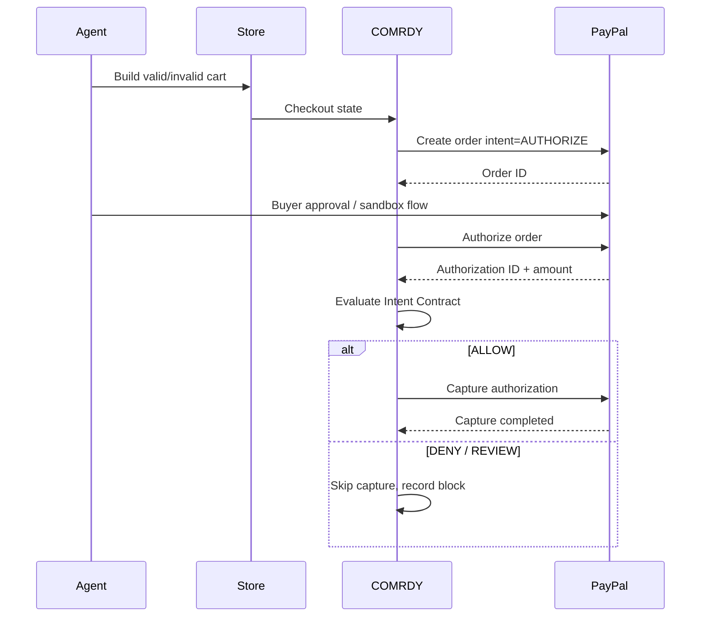

# COMRDY PayPal Integration Specification

## 1. Role of PayPal

PayPal is not a decorative checkout button in COMRDY. It is the financial state machine used to prove the product's central claim:

**authorization can succeed while COMRDY correctly prevents capture because the transaction violates the buyer mandate.**

## 2. Hackathon integration strategy

Use public PayPal Sandbox APIs as the guaranteed path.

Do not make restricted/merchant-onboarding products such as Agent Ready or Store Sync a prerequisite for the demo.

Core APIs:
- OAuth 2.0 client credentials;
- Orders v2;
- Payments v2 authorization/capture/refund operations as appropriate;
- Webhooks.

## 3. Core sequence



## 4. Authentication

Server only.

Exchange client ID/secret for OAuth access token using Sandbox base URL.

Requirements:
- secret never reaches browser;
- token cached only until expiry with safety margin;
- token never logged;
- integration verification action confirms credentials.

## 5. Order creation

Create order with `intent: AUTHORIZE`.

Persist before/after network call:
- COMRDY payment_attempt ID;
- stable PayPal request ID;
- expected amount/currency;
- order ID returned;
- redacted response metadata.

## 6. Authorization

After buyer approval/test flow, authorize the order.

Persist:
- authorization ID;
- authorization status;
- authorized amount/currency;
- order state snapshot;
- request ID;
- occurred_at.

The authorization is a checkpoint, not success.

## 7. Verification before capture

COMRDY constructs the authorization checkpoint state from:
- locked Intent Contract;
- store checkout state;
- PayPal order/authorization response;
- normalized price/currency fields.

Mandatory checks before capture:
- order/authorization IDs belong to the expected case;
- currency matches contract/policy;
- authorized amount matches expected/allowed total;
- product/variant/quantity state still passes;
- subscription state passes;
- no duplicate capture record exists;
- gate decision is ALLOW.

## 8. Capture

Use Payments v2 capture of the specific authorization ID.

Financial write requirements:
- stable idempotency key;
- capture command persisted before call;
- never capture if decision != ALLOW;
- never retry with a new idempotency key after unknown response;
- reconcile ambiguous state via provider retrieval/webhook before attempting anything else.

## 9. Why authorization/capture is ideal for COMRDY

The split lifecycle gives the product a visible trust boundary:

```text
AUTHORIZED       !=      CAPTURED
funds held               payment finalized
```

The demo should teach this visually in seconds.

## 10. Webhooks

Subscribe only to needed events for the demo/application.

Processing requirements:
- verify authenticity/signature according to current PayPal docs;
- persist unique provider event ID;
- deduplicate;
- respond 2xx promptly after safe persistence/queueing;
- process asynchronously;
- reconcile payment state;
- record webhook lag.

Do not trust webhook payload merely because it hit the endpoint.

## 11. Idempotency

Use `PayPal-Request-Id` where supported for POST operations.

Generate once per intended operation:

```text
create order:   pp-create-{paymentAttemptId}
authorize:      pp-auth-{paymentAttemptId}
capture:        pp-capture-{paymentAttemptId}
refund:         pp-refund-{paymentAttemptId}-{refundSequence}
```

If a worker retries, reuse the same operation ID.

## 12. Negative testing

PayPal Sandbox supports negative-testing mechanisms for selected API behavior. Use only if current docs confirm the specific scenario.

For the hackathon, COMRDY's own demo store/chaos engine should remain the primary deterministic source of commerce failures because it is under our control.

## 13. Refund test

For a valid captured sandbox transaction:
1. create order;
2. authorize;
3. verify;
4. capture;
5. create demo merchant order;
6. request refund;
7. verify provider refund amount/status;
8. compare with expected refund.

Seed one demo scenario where merchant-side refund accounting intentionally disagrees with expected amount, but do not falsify the actual PayPal response. The finding should distinguish provider truth from merchant application truth.

## 14. Data stored

Allowed:
- PayPal order ID;
- authorization ID;
- capture ID;
- refund ID;
- statuses;
- amounts/currency;
- redacted provider payload;
- event ID;
- idempotency request IDs;
- timestamps.

Do not store:
- raw access tokens;
- client secret in plaintext;
- funding credentials;
- unnecessary buyer PII.

## 15. Sandbox UX

Always show environment.

Persistent app-shell badge:
`SANDBOX`

Near any capture/refund action:
`PayPal Sandbox - no live customer funds.`

For hosted judge demo, provide prepared sandbox accounts/workflow without exposing credentials in the public repo.

## 16. Agent Ready / Store Sync

Treat as expansion adapters, not MVP dependencies.

Potential future use:
- compare agentic checkout surfaces;
- validate transaction integrity from ACP/UCP paths;
- consume Store Sync catalog/order context.

Current product docs note access/onboarding and eligibility constraints, so the base COMRDY demo should not depend on approval.

## 17. WebMCP

PayPal's 2026 WebMCP work strongly validates structured agent checkout as a growing execution path. COMRDY can later compare browser and structured-tool outcomes against the same contract.

For MVP:
- implement browser path first;
- structured path only if it is deterministic and can be finished without risking the core demo.

## 18. Provider abstraction

Internal interface:

```ts
interface PaymentAdapter {
  createOrder(input: CreateOrderInput): Promise<OrderRef>
  authorize(orderId: string): Promise<AuthorizationRef>
  getAuthorization(id: string): Promise<AuthorizationState>
  capture(id: string, input: CaptureInput): Promise<CaptureRef>
  refund(captureId: string, input: RefundInput): Promise<RefundRef>
  reconcile(ref: PaymentRef): Promise<PaymentState>
}
```

PayPal is the only hackathon implementation.

## 19. Demo scenarios

### Valid
Mandate total <= $150; authorization $139; all invariants pass; capture completes.

### Budget false success
Mandate <= $150; shipping mutation creates $174 total; PayPal authorizes; COMRDY denies; capture is skipped.

### Variant false success
Mandate size M; cart becomes S; amount still valid; PayPal authorizes; COMRDY denies because nonfinancial hard invariant failed.

### Duplicate retry
Simulate ambiguous merchant response; orchestration retries infrastructure step; idempotency prevents duplicate financial outcome.

## 20. Official-doc assumptions to verify at implementation time

Before coding final API behavior, re-check current PayPal docs for:
- endpoint shape;
- supported headers;
- webhook verification method;
- Sandbox behavior;
- authorization/capture timing rules;
- refund endpoint/fields;
- SDK version.

Do not hardcode hackathon architecture from stale examples.
