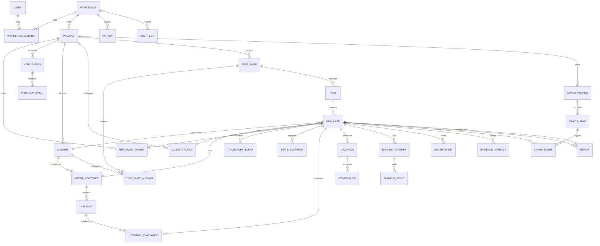
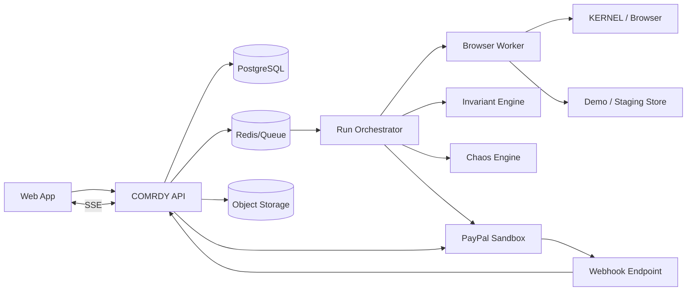
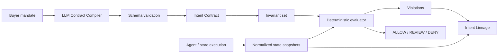
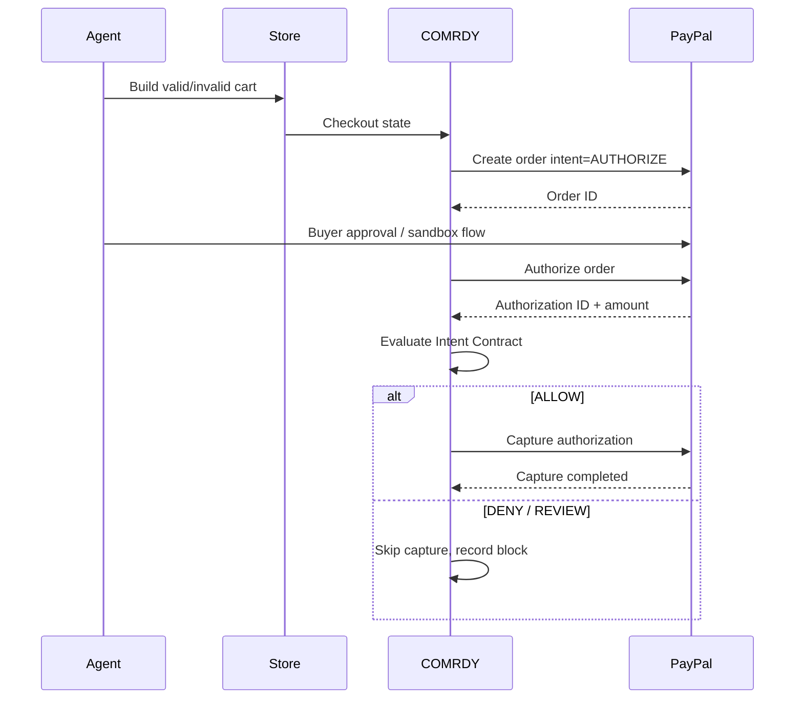

> Implementation notice (2026-11-01): the focused hackathon scope in [IMPLEMENTATION_SCOPE](../docs/IMPLEMENTATION_SCOPE.md), the root README, and CURRENT_HANDOFF supersede the original SaaS scope, schedules, and unverified claims below. The original blueprint is retained as design history.

# COMRDY Master Product Specification

Domain: comrdy.com  
Prepared: 2026-10-07  
Category: Agentic Commerce Transaction Assurance

> This master file concatenates the build-ready COMRDY blueprint. The numbered files remain the canonical modular references for implementation.


---

<!-- Source: 00_README.md -->

# COMRDY Product Blueprint

Version: 0.1
Date: 2026-10-06
Domain: comrdy.com
Working category: Agentic Commerce Transaction Assurance

## One-line product definition

COMRDY tests and verifies whether an AI shopping agent preserves the customer's authorized intent from product selection through cart, checkout, PayPal authorization, capture, order creation, and refund.

## Core insight

A payment can succeed and still be the wrong purchase.

COMRDY does not treat `PAYMENT_COMPLETED` as success by itself. It compares the actual economic outcome with a deterministic intent contract compiled from the shopper mandate.

## Primary product metrics

- Agent Transaction Reliability (ATR): correct economic outcomes / valid missions.
- False Success Rate (FSR): technically completed transactions that violate the mandate / technically completed transactions.
- Hard Failure Rate (HFR): missions that fail before a valid transaction outcome / valid missions.
- Prevented Invalid Value (PIV): total value of invalid authorizations or captures blocked by COMRDY.
- Intent Fidelity: weighted percentage of invariant checks that stayed true from mandate to final outcome.

## Hackathon scope lock

Build the product as a real SaaS architecture, but ship a narrow, undeniable hackathon slice:

1. Intent Contract Compiler.
2. Synthetic shopper runner.
3. Deterministic invariant engine.
4. PayPal Sandbox authorize -> verify -> capture or block.
5. Commerce Chaos fault injection.
6. Intent Lineage + false-success evidence view.
7. Counterfactual replay for one failed mission.
8. One controlled demo store with reproducible faults.

Do not make PayPal Agent Ready, Store Sync, or restricted partner access a blocking dependency. Use public PayPal Sandbox Orders/Payments APIs as the guaranteed core path.

## Product principles

1. Deterministic money decisions. LLMs may interpret intent; they do not authorize money movement.
2. Evidence over scores. Every finding must include source intent, observed state, violated invariant, and transaction evidence.
3. Real financial lifecycle. Testing continues past checkout into authorization, capture, order state, refund, and cancellation.
4. Reproducible failure. Every run has a seed, environment snapshot, agent version, contract version, and event timeline.
5. Low-trust by default. The system assumes prices, inventory, shipping, discounts, retries, agent decisions, and protocols can drift.
6. Light, precise interface. COMRDY should look like payment infrastructure, not an AI demo.

## Document map

- `01_PRODUCT_STRATEGY.md` - category, ICP, moat, differentiation, scope.
- `02_PRD.md` - full product requirements and acceptance criteria.
- `03_UX_INFORMATION_ARCHITECTURE.md` - navigation, onboarding, workflows, roles.
- `04_DESIGN_SYSTEM_UI_SPEC.md` - visual system, colors, typography, components.
- `05_ERD_DATA_MODEL.md` - relational model and Mermaid ERD.
- `06_BACKEND_ARCHITECTURE_API.md` - services, queues, API contracts, run state machine.
- `07_ENGINE_INTENT_ASSURANCE.md` - intent contracts, invariant graph, chaos, replay, scoring.
- `08_PAYPAL_INTEGRATION.md` - exact PayPal Sandbox architecture and safety rules.
- `09_FRONTEND_SCREEN_SPECS.md` - screen-by-screen product UI specification.
- `10_MARKETING_SITE.md` - homepage IA, copy, SEO, product pages, conversion paths.
- `11_DEMO_STORE_TEST_PLAN.md` - demo merchant, seeded faults, mission library.
- `12_VIDEO_SUBMISSION.md` - under-3-minute Devpost video production plan and voiceover.
- `13_SECURITY_QA_OBSERVABILITY.md` - security model, QA, accessibility, reliability.
- `14_BUILD_PLAN.md` - monorepo, weekly execution plan, P0/P1/P2 backlog.
- `15_REFERO_RESEARCH.md` - research references and design decision ledger.
- `16_GTM_PRICING_ROADMAP.md` - commercialization, packaging, roadmap, defensibility.
- `17_ANALYTICS_COPY_EVENTS.md` - product analytics and UI language system.
- `18_DEV_HANDOFF.md` - environment, CI, local run, demo mode, definition of done.
- `19_SOURCES.md` - official PayPal/Devpost sources, competition references, Refero research index.
- `20_BRAND_ASSET_PRODUCTION.md` - wordmark, favicon, imagery, OG/social, video/asset production rules.
- `21_HACKATHON_SUBMISSION.md` - final hackathon positioning, judge strategy, screenshots, claim boundaries, submission checklist.

## Recommended stack

### Web and product UI
- Next.js, React, TypeScript.
- Tailwind CSS.
- shadcn/ui primitives, customized to COMRDY tokens.
- AG Grid for high-density run and transaction tables.
- Recharts or a similarly small chart library only where a chart adds operational value.

### Backend
- TypeScript API service.
- PostgreSQL.
- Drizzle ORM or direct typed SQL.
- Redis-compatible queue/cache.
- Dedicated worker service for agent runs and replay.
- S3-compatible object storage for screenshots, trace payloads, and evidence artifacts.

### Agent execution
- KERNEL or equivalent isolated cloud browser sessions for browser-agent tests.
- Playwright inside controlled demo and fallback execution paths.
- LLM provider only for contract compilation, mission generation, root-cause assistance, and remediation drafting.

### Payments
- PayPal Sandbox.
- Orders v2 with `AUTHORIZE` intent.
- Payments v2 to capture authorized payments only after COMRDY passes verification.
- PayPal webhooks for asynchronous state reconciliation.

### Deployment
- Vercel for marketing/product web.
- Render or equivalent long-running infrastructure for API/worker.
- Managed PostgreSQL.
- Managed Redis.

## Brand lock

- Name: COMRDY.
- Primary message: `A payment can succeed and still be wrong.`
- Product explanation: `COMRDY proves whether an AI shopper stayed inside the customer's intent before money is captured.`
- Wordmark first. Do not rush an AI-generated icon for the hackathon.
- No gradients, glassmorphism, purple AI styling, floating sparkles, decorative 3D, shield-check cliches, or generic “agent” mascots.


---

<!-- Source: 01_PRODUCT_STRATEGY.md -->

# COMRDY Product Strategy

## 1. Category

COMRDY should not position itself as:

- an AI readiness scanner;
- a shopping assistant;
- a fraud engine;
- a generic observability platform;
- a payment protocol;
- an agent wallet;
- a pre-checkout ecommerce QA tool.

The category is:

**Agentic Commerce Transaction Assurance**

The simplest product question is:

> Did the agent buy the right thing, for the right amount, under the right authority?

## 2. Market wedge

Current products cover important upstream pieces:

- discoverability and agent-readiness scoring;
- synthetic shopping missions;
- product/cart/checkout QA;
- protocol conformance;
- agent spend controls;
- payment processing.

COMRDY owns the continuity between those layers.

The product begins where conventional agent-commerce testing becomes weak: the handoff from an apparently successful checkout into a real authorization, capture, order, fulfillment, cancellation, or refund.

## 3. The failure class COMRDY owns

### False success

A false success occurs when:

1. an agent reaches a technically successful state, and
2. the economic outcome violates the shopper mandate.

Examples:

- correct product family, wrong size;
- correct item, final total above hard cap;
- discount removed before payment;
- one-time purchase silently becomes subscription;
- one unit becomes two after retry;
- currency changes;
- shipping route becomes ineligible;
- capture occurs after inventory invalidation;
- retry causes duplicate capture;
- refund amount is lower than expected;
- browser path and structured-agent path produce materially different orders.

## 4. Ideal customers

### Primary ICP: commerce platform and ecommerce engineering teams

Companies exposing purchase flows to AI agents, assistant surfaces, browser agents, or structured commerce protocols.

Typical team:

- VP/Head of Ecommerce;
- Commerce Platform Engineering;
- Payments Engineering;
- QA/SDET;
- AI Platform / Applied AI;
- Risk and Trust;
- Developer Experience.

### Secondary ICP: agencies and system integrators

Agencies managing multiple Shopify, custom commerce, or enterprise storefronts need repeatable evidence for client agent-readiness and transaction correctness.

### Later ICP: payment providers and agent platforms

Protocol providers, payment processors, shopping agents, and commerce networks can use COMRDY as a neutral cross-system conformance and transaction-assurance layer.

## 5. Jobs to be done

### Merchant engineering

> Before we expose our store to AI shoppers, prove the same customer mandate produces the correct order and payment across our agent paths.

### QA

> Turn a natural-language buyer mandate into reproducible commerce tests that fail deterministically when the resulting economic outcome changes.

### Payments engineering

> Prevent capture when the order no longer matches the user's authorized constraints.

### Product / leadership

> Show a transparent reliability metric and evidence trail instead of an opaque “agent-ready” score.

### Incident response

> Reproduce a failed agent purchase, compare paths/models, identify where the transaction drifted, and verify the remediation.

## 6. Core product objects

1. **Merchant Target** - store/domain/environment being tested.
2. **Mission** - natural-language buyer task.
3. **Intent Contract** - deterministic representation of what is allowed.
4. **Invariant** - one rule that must remain true.
5. **Agent Profile** - agent/model/tool configuration.
6. **Execution Path** - Browser, WebMCP, ACP, UCP, direct API, or custom adapter.
7. **Run** - execution of a suite against a target.
8. **Transaction Attempt** - one mission's commerce/payment lifecycle.
9. **Violation** - an invariant failure.
10. **Evidence Chain** - snapshots and events proving what happened.
11. **Chaos Rule** - controlled state mutation introduced during a run.
12. **Replay** - rerun of a failed mission under controlled changed variables.
13. **Gate Decision** - ALLOW, REVIEW, or DENY before capture.

## 7. Product moat

No software feature is literally uncopyable, particularly in an open-source hackathon. COMRDY must build a compounding moat.

### 7.1 Failure corpus

Normalize real agent-commerce failure modes into a versioned taxonomy with reproducible test fixtures.

### 7.2 Transaction Integrity Dataset

Aggregate anonymized outcomes across:

- agent/model;
- store platform;
- execution path;
- invariant type;
- payment lifecycle;
- failure root cause;
- remediation outcome.

The dataset becomes more defensible than the UI.

### 7.3 Intent Contract format

Publish a small, deterministic contract representation that can become a portable interchange format between testing, runtime gates, merchants, and payment systems.

### 7.4 Integrations

Deep adapters for Shopify, Magento/Adobe Commerce, commercetools, custom APIs, PayPal/Braintree, and structured agent protocols create switching cost.

### 7.5 Regression library

Every incident can become a permanent test fixture. Customers accumulate valuable organizational assurance history inside COMRDY.

### 7.6 Reliability benchmark

Build a benchmark based on actual transaction integrity, not generic web readiness.

## 8. Product principles that protect differentiation

1. **Never stop at checkout.** If the product only tests pre-payment, it collapses into existing synthetic shopper products.
2. **Never use LLM output as the final financial decision.** A deterministic gate is the trust primitive.
3. **Never hide the evidence behind a score.** Show the exact drift point.
4. **Protocol-agnostic architecture.** Browser and protocol adapters are interchangeable runners around the same contract and assertion engine.
5. **Reproducible chaos.** Failures must be re-creatable with a seed.
6. **Post-purchase truth.** Refund/cancellation/order state are part of transaction correctness.

## 9. Competitive positioning

### Against readiness scanners

They answer: “Can an agent find/read/use this store?”

COMRDY answers: “Did the economic result remain inside the user's authority?”

### Against synthetic shopper QA

They often stop before payment or focus on journey completion.

COMRDY uses real sandbox authorization/capture behavior and continues through post-purchase states.

### Against spend-control systems

They answer: “Can this agent spend up to X?”

COMRDY evaluates product, variant, price, quantity, currency, delivery, subscription state, substitution permission, tax/shipping bounds, order state, and post-purchase correctness together.

### Against payment processors

Processors know whether a payment succeeded.

COMRDY evaluates whether it should have succeeded under the original mandate.

## 10. Commercial form

### Open-source core

- Intent Contract schema.
- Invariant validator.
- Local demo runner.
- Example PayPal Sandbox integration.

### COMRDY Cloud

- hosted browser execution;
- scheduled regression suites;
- evidence storage;
- protocol adapters;
- chaos orchestration;
- team permissions;
- benchmarks;
- runtime gate;
- enterprise connectors;
- audit retention;
- alerts and CI integration.

## 11. Roadmap boundaries

### Hackathon MVP

One target, one controlled merchant, browser runner, PayPal Sandbox, deterministic contracts, chaos, replay, evidence UI.

### Private beta

Real merchant staging environments, scheduled test suites, CI, webhooks, multi-user workspaces, one structured tool adapter, exportable evidence.

### V1

Shopify/custom integration, runtime verification endpoint, production observability mode, protocol comparison, team policies.

### V2

Cross-merchant benchmarks, risk-based policy packs, AP2/mandate interoperability, enterprise data residency, expanded post-purchase verification.


---

<!-- Source: 02_PRD.md -->

# COMRDY Product Requirements Document

## 1. Product statement

COMRDY is a web application and developer platform that verifies AI-driven commerce transactions against deterministic customer intent before and after payment.

The product turns a buyer mandate into a structured Intent Contract, runs one or more shopping agents, observes the commerce state at each step, authorizes payment in PayPal Sandbox, evaluates invariants, and either allows capture or blocks the transaction with evidence.

## 2. Problem

Agentic commerce introduces a failure mode that conventional analytics, payment processors, and web QA do not reliably detect:

**the journey can be technically successful while the economic outcome is wrong.**

A model can select the wrong variant, exceed budget, accept an unauthorized substitution, convert a one-time purchase into a subscription, retry a payment twice, or lose a discount between cart and authorization. The payment layer can report success even though the original user mandate was violated.

## 3. Goals

### G1 - Verify intent fidelity

Create a deterministic source of truth for the customer's authorized constraints and continuously compare observed state against it.

### G2 - Exercise real payment lifecycle behavior

Use PayPal Sandbox authorization and capture so the product proves value at the exact boundary where money would move.

### G3 - Detect false success

Separate technical completion from correct economic completion.

### G4 - Produce replayable evidence

Every failed run must be reproducible and inspectable by engineering teams.

### G5 - Enable regression testing

A fixed mission library must run on demand, on schedule, and in CI after changes.

### G6 - Stay protocol-agnostic

The contract/assertion layer must not depend on one browser agent, model, store platform, or commerce protocol.

## 4. Non-goals for hackathon MVP

- Production use with real customer funds.
- Acting as a fraud/AML system.
- Replacing PayPal risk controls.
- Full Shopify App Store production integration.
- Full support for ACP, UCP, AP2, or Store Sync partner-only flows.
- Agent discovery/readiness SEO scanning.
- Generic browser testing outside commerce.
- A consumer shopping assistant.
- Cross-merchant benchmarking based on customer data.

## 5. Personas

### 5.1 Maya - Payments / Commerce Engineer

Needs to prove agent transactions are safe before enabling new purchase surfaces.

Success looks like:
- reproducible failures;
- exact API/state evidence;
- deterministic pass/fail;
- CI integration;
- idempotent payment handling.

### 5.2 Jordan - QA / SDET Lead

Needs to turn ambiguous natural-language customer tasks into stable regression tests.

Success looks like:
- parameterized mission library;
- seeded chaos;
- pass/fail rules;
- replays;
- exportable defects.

### 5.3 Priya - Head of Ecommerce

Needs an executive answer to whether agentic checkout is reliable.

Success looks like:
- Agent Transaction Reliability;
- False Success Rate;
- highest-risk failure classes;
- trend after fixes;
- prevented invalid value.

### 5.4 Sam - AI Platform Engineer

Needs to compare model/agent/protocol configurations without conflating model quality with store behavior.

Success looks like:
- same intent contract across configurations;
- side-by-side result matrix;
- trajectory and tool-call evidence;
- replay with one variable changed.

## 6. Primary user journeys

### J1 - First successful audit

1. User creates workspace.
2. User selects `Demo Store` or adds a staging target.
3. User connects PayPal Sandbox credentials.
4. COMRDY verifies credentials without displaying secrets.
5. User chooses the starter mission pack.
6. COMRDY compiles missions into Intent Contracts.
7. User reviews one contract and runs suite.
8. Browser agents execute.
9. COMRDY records state changes.
10. A valid mission is authorized and captured.
11. Invalid missions are authorized but blocked before capture.
12. Results page shows reliability and false-success findings.
13. User opens one finding and replays it.

### J2 - Create a custom mission

1. User clicks `New test`.
2. Enters natural-language buyer mandate.
3. Selects environment and agent profile.
4. COMRDY compiles deterministic constraints.
5. User edits/locks constraints if desired.
6. User chooses chaos rules or no chaos.
7. Runs one mission.
8. Sees trajectory and payment decision.

### J3 - Investigate a false success

1. User filters runs to `False success`.
2. Opens transaction.
3. Sees Intent Lineage from mandate to payment.
4. Violated invariant is pinned at the first drift point.
5. User opens raw evidence / snapshots.
6. Clicks `Replay`.
7. Changes one factor: model, path, chaos, or prompt variant.
8. Compares original vs replay.
9. Saves finding to regression suite.

### J4 - CI regression

1. Engineer creates API key.
2. CI invokes suite.
3. COMRDY runs selected mission set.
4. Results are returned synchronously as job accepted, then polled/streamed.
5. Build passes only if reliability threshold and severity policy are met.
6. Failed build links directly to evidence.

## 7. Functional requirements

### 7.1 Authentication and workspace

P0:
- Email or OAuth login.
- Create workspace.
- Invite members by email later; single-member works for hackathon.
- Roles: Owner, Admin, Member, Viewer.
- Workspace-scoped data isolation.

Acceptance:
- User cannot access another workspace by guessing IDs.
- All API routes enforce workspace authorization.

### 7.2 Merchant targets

P0:
- Create a target with name, base URL, environment (`demo`, `staging`, `sandbox`).
- Demo target is preconfigured.
- Health check verifies reachability.
- Target stores capability metadata: browser, structured tools, checkout, payment adapter.

P1:
- Authenticated staging target credentials.
- Environment headers/cookies.
- Shopify/custom adapters.

### 7.3 PayPal integration

P0:
- Connect Sandbox client ID and secret.
- Encrypt secret at rest.
- Validate via OAuth token exchange.
- Create Orders v2 orders with `intent=AUTHORIZE`.
- Authorize after payer approval/test fixture.
- Store order and authorization IDs.
- Verify transaction.
- Capture the authorization only when policy allows.
- Receive and verify webhooks.
- Issue sandbox refund in post-purchase test.

P1:
- Separate merchant integrations per project.
- Braintree adapter.

### 7.4 Mission library

P0:
- Create, edit, archive mission.
- Natural language mandate.
- Tags.
- Expected path/merchant.
- Mission variables for size, color, quantity, max price.
- Clone mission.

P1:
- CSV/JSON import.
- Generated semantic variants.
- Scheduled mission sets.

### 7.5 Intent Contract Compiler

P0:
- Parse natural language mandate to versioned JSON contract.
- Contract schema validation.
- Distinguish hard constraints from preferences.
- Preserve original text and compiler version.
- Human-readable preview.
- Manual edit and lock.

Required hard-constraint types:
- product identity/category;
- variant attributes;
- quantity;
- item price cap;
- total price cap;
- currency;
- destination/eligibility;
- delivery deadline if supplied;
- substitution allowed/forbidden;
- subscription allowed/forbidden;
- payment frequency;
- merchant allow/deny if relevant.

Acceptance:
- Compiler output must be valid JSON against schema.
- Every hard constraint receives a stable invariant ID.
- Financial gate consumes only validated structured constraints.

### 7.6 Agent profiles

P0:
- Name.
- Runner type (`browser`).
- Model/provider metadata.
- Prompt/policy version.
- Browser/tool configuration.

P1:
- Structured tool / WebMCP adapter.
- ACP/UCP adapter where accessible.
- Custom agent HTTP adapter.

### 7.7 Test suites

P0:
- Name, description, target, missions, agent profile, chaos profile.
- Run now.
- Duplicate.
- Pass/fail policy.

Policy inputs:
- minimum ATR;
- maximum critical violations;
- maximum false success rate;
- whether payment capture is enabled for valid sandbox missions.

### 7.8 Run orchestration

P0:
- Queue run.
- Fan out mission cases.
- Each case has isolated browser session.
- Stream run progress to UI.
- Persist trajectory events.
- Retry infrastructure failures with bounded retry count.
- Do not retry a financial action without idempotency protection.

Run states:
`QUEUED -> COMPILING -> PREPARING -> EXECUTING -> AUTHORIZED -> VERIFYING -> CAPTURED|BLOCKED -> POST_PURCHASE -> COMPLETED|FAILED`

### 7.9 Snapshot and state extraction

P0:
At significant checkpoints capture normalized commerce state:
- selected product;
- variant;
- unit price;
- quantity;
- discount;
- subtotal;
- shipping;
- tax;
- total;
- currency;
- subscription state;
- inventory/availability;
- destination;
- order identifier;
- payment identifiers.

Checkpoint types:
- `AGENT_SELECTED`
- `CART_CREATED`
- `CART_UPDATED`
- `CHECKOUT_READY`
- `PAYMENT_AUTHORIZED`
- `PAYMENT_CAPTURED`
- `ORDER_CREATED`
- `REFUND_COMPLETED`

### 7.10 Invariant engine

P0:
- Evaluate all active invariants against each snapshot.
- Store PASS/FAIL/UNKNOWN.
- Identify earliest drift point.
- Calculate severity.
- Return gate decision.

Decision rules:
- `ALLOW`: all hard invariants pass and required evidence is present.
- `REVIEW`: no invariant failed, but critical evidence is unknown/incomplete.
- `DENY`: one or more hard invariants fail.

P0 hackathon policy:
- `REVIEW` behaves as block before capture.

### 7.11 Commerce Chaos

P0:
Controlled mutation rules:
- price increase;
- shipping increase;
- discount removal;
- inventory disappearance;
- variant mutation;
- quantity mutation;
- currency mutation;
- transient API timeout / retry;
- duplicate action attempt.

Requirements:
- seeded randomness;
- explicit activation in test environment;
- never active for arbitrary production targets;
- mutation event appears in evidence timeline.

### 7.12 PayPal capture gate

P0:
- After authorization, COMRDY retrieves normalized expected/actual states.
- Evaluates hard invariants.
- `ALLOW` triggers capture using authorization ID and idempotency key.
- `DENY` skips capture and records block reason.
- UI makes authorization vs capture visually distinct.

### 7.13 Evidence Chain / Transaction Flight Recorder

P0:
For each case store:
- original mission;
- contract;
- agent profile/version;
- screenshots;
- page/tool events;
- state snapshots;
- chaos events;
- invariant evaluations;
- PayPal request/response metadata with secrets redacted;
- webhook events;
- decision;
- capture/refund outcome.

### 7.14 Intent Lineage

P0:
Visualize major attributes as columns/rows through checkpoints.

Example attributes:
- SKU;
- size;
- color;
- quantity;
- total;
- currency;
- subscription.

The first changed/invalid value is visually emphasized and linked to raw evidence.

### 7.15 False Success classification

P0:
Case categories:
- `PASS`
- `HARD_FAILURE`
- `FALSE_SUCCESS_BLOCKED`
- `FALSE_SUCCESS_CAPTURED` (reserved; sandbox/testing only)
- `INDETERMINATE`
- `INFRA_FAILURE`

### 7.16 Replay

P0:
- Replay one failed case.
- Preserve original contract and seed by default.
- User can change one factor.
- Side-by-side comparison.

Allowed changed factors in MVP:
- chaos on/off;
- agent prompt version;
- model configuration;
- execution path if available.

### 7.17 Remediation

P1:
- Generate root-cause hypothesis.
- Recommend concrete fix.
- Link to evidence.
- Mark recommendation accepted/rejected.
- Re-run after fix.

LLM output is advisory only.

### 7.18 Dashboard and reporting

P0:
Workspace overview:
- ATR;
- FSR;
- HFR;
- prevented invalid value;
- runs over time;
- top violation classes;
- latest runs.

P0:
Run detail:
- progress/status;
- mission matrix;
- pass/fail counts;
- agent/payment outcomes;
- filterable table.

P0:
Transaction detail:
- Intent Lineage;
- checkpoint timeline;
- invariant list;
- PayPal authorization/capture state;
- evidence artifacts;
- replay CTA.

### 7.19 API keys and CI

P1 for product, P0 if sponsor/demo time permits:
- Create/revoke scoped API key.
- `POST /v1/runs`.
- `GET /v1/runs/:id`.
- machine-readable summary.
- exit policy documented for CI helper.

### 7.20 Alerts

P2:
- Email, Slack/webhook on critical false success.
- scheduled regression summary.

## 8. Non-functional requirements

### Reliability
- No duplicate capture caused by COMRDY retry behavior.
- All financial writes use idempotency strategy.
- Run events are append-only.
- Worker crashes can resume from durable state.

### Performance
- Product dashboard initial load target: <2.5 s on broadband for typical workspace.
- Table interactions should feel immediate for 10k rows using server pagination/virtualization.
- Stream run status rather than polling every second from every client.

### Security
- Secrets encrypted at rest and never returned after creation.
- Webhook verification.
- PII minimization.
- Audit log for credential, policy, gate, and permission changes.
- Strict tenant isolation.
- No live payment mode in hackathon deployment.

### Accessibility
- WCAG 2.2 AA target.
- Keyboard-operable tables, dialogs, filters, and timelines.
- Color is never the only failure signal.
- All status labels include text/icon.

### Auditability
- Every decision references exact contract version and snapshot hashes.
- Replays never overwrite original evidence.

## 9. Success metrics

### Hackathon success
- Judges understand the problem in <15 seconds.
- At least one valid mission captures in PayPal Sandbox.
- At least two seeded false successes are blocked.
- One replay demonstrates root-cause isolation.
- Demo completes reliably from reset state.

### Product activation
- User gets first completed 10-mission run within 15 minutes of signup.
- At least 80% of activated users open one evidence detail.

### Product value
- Weekly regression suites run per active workspace.
- Percentage of findings converted into permanent regression cases.
- Reduction in FSR after remediation.
- Prevented invalid value over time.

## 10. Product language

Use precise operational copy.

Preferred:
- Transaction Reliability
- False Success
- Capture blocked
- Authority drift
- Selection drift
- Value drift
- Evidence incomplete
- Replay
- Invariant failed

Avoid:
- AI magic
- smart insights
- supercharge
- revolutionary
- optimize your commerce
- agent readiness score as the product's main metric


---

<!-- Source: 03_UX_INFORMATION_ARCHITECTURE.md -->

# COMRDY UX and Information Architecture

## 1. UX thesis

COMRDY is an operational developer/finance product. The interface should answer three questions in this order:

1. **What happened?**
2. **Was it allowed?**
3. **Where did it drift?**

The UX must never force users to interpret a decorative “AI score” before seeing evidence.

## 2. Product navigation

Desktop left navigation:

```text
COMRDY

Overview
Runs
Test suites
Missions
Contracts

Assurance
  Violations
  Replays
  Chaos

Build
  Targets
  Agents
  Integrations
  API keys

Workspace
  Team
  Audit log
  Settings
```

Hackathon MVP may hide unimplemented sections rather than showing dead navigation.

Top bar:
- workspace switcher;
- environment badge (`Sandbox` always visible in hackathon);
- global search / command shortcut;
- docs/help;
- user menu.

## 3. Marketing site information architecture

```text
/
/product
/how-it-works
/paypal
/security
/docs
/research          later
/pricing           beta/later
/changelog         later
```

Primary public CTA during hackathon: `Run the demo`.
Secondary CTA: `View source`.

Do not force signup before a visitor can understand the product.

## 4. First-run onboarding

Goal: first evidence in <15 minutes.

### Step 1 - Welcome

Headline: `Prove your first agent transaction.`

Choices:
- `Use COMRDY demo store` - recommended.
- `Connect a staging store` - advanced.

The recommended path must be visually dominant without calling the advanced path “expert mode.”

### Step 2 - PayPal Sandbox

Two modes:
- `Use COMRDY demo sandbox` for hosted demo.
- `Connect my PayPal Sandbox` for developer installation.

Show exactly what credentials are required and state that secrets are encrypted and never displayed again.

### Step 3 - Mission pack

Default pack: `Transaction integrity starter pack`.

Contains:
- correct purchase;
- budget cap;
- wrong variant;
- shipping over cap;
- discount removal;
- inventory loss;
- duplicate retry;
- subscription mutation;
- refund mismatch.

Allow deselection, but preselect all for demo.

### Step 4 - Review contract

Show one representative compiled contract rather than nine forms.

Two-column arrangement:
- left: original mandate;
- right: deterministic constraints.

CTA: `Run 9 missions`.

### Step 5 - Live run

Take user directly into a streaming run page instead of a generic success page.

## 5. Core flow: create mission

```text
Missions
  -> New mission
     -> Buyer mandate
     -> Compile contract
     -> Review hard constraints
     -> Choose agent / target
     -> Optional chaos
     -> Save or Run now
```

### Buyer mandate screen

One large plain textarea, not a chatbot.

Example placeholder:
`Buy the Ocean Shell in blue, size M. Spend no more than $150 delivered. Do not substitute another size and do not start a subscription.`

Below:
- target;
- variable presets;
- advanced controls collapsed.

CTA: `Compile contract`.

### Contract review

Display hard constraints as a compact table:

| Constraint | Operator | Value | Hard? |
|---|---|---|---|
| product.slug | = | ocean-shell | Yes |
| variant.color | = | blue | Yes |
| variant.size | = | M | Yes |
| total | <= | 150 USD | Yes |
| substitution | = | false | Yes |
| subscription | = | false | Yes |

Do not render each constraint as a separate rounded card.

## 6. Core flow: run detail

Header:
- suite name;
- target;
- agent profile;
- started time;
- run status;
- actions: `Stop`, `Replay failures`, `Export`.

### Summary strip

Use one horizontal strip, not four floating cards.

```text
ATR 66.7% | False successes 6 | Hard failures 3 | Prevented $428
```

Each item is clickable and filters the mission table.

### Main run table

Columns:
- Mission
- Result
- Drift
- Authorized
- Captured
- Total
- Duration
- Agent
- Evidence

Use AG Grid virtualization, column pinning, keyboard navigation, server-side filter state for real product.

Row result labels:
- PASS
- FALSE SUCCESS
- HARD FAIL
- INDETERMINATE
- INFRA

### Live mode

Rows appear as cases progress. A subtle activity indicator can appear in the status cell; do not animate the entire row.

## 7. Core flow: transaction detail

This is the product's signature screen.

### Header band

Left:
`False success blocked`

Right:
`PayPal authorization $178.00` / `Capture blocked`

Below:
- transaction/case ID;
- mission;
- target;
- agent;
- run link.

### Intent Lineage

Primary visualization.

Columns are checkpoints:

```text
Mandate -> Agent -> Cart -> Checkout -> Authorization -> Decision
```

Rows are attributes:

```text
Product
Color
Size
Quantity
Item price
Shipping
Tax
Total
Currency
Subscription
```

Values remain neutral while unchanged. At the first invalid transition:
- cell gets semantic danger background;
- previous -> new value shown;
- invariant code appears;
- small evidence link opens relevant screenshot/event.

Example:

```text
Size     M | M | S | S | S | DENY
                  ^
             INV_VARIANT_SIZE
```

### Why it was blocked

Plain sentence:
`Checkout changed size M to S. The mission forbids substitution.`

Then deterministic rule:
`variant.size == "M"`

### Payment state

Use a vertical event timeline:
- order created;
- buyer approved;
- payment authorized;
- COMRDY verification failed;
- capture skipped.

### Evidence drawer

Right-side drawer on desktop / bottom sheet on mobile:
- screenshot;
- DOM/tool snapshot;
- normalized state JSON;
- redacted PayPal payload;
- event hash/time.

### Actions

- `Replay transaction`
- `Add to regression suite`
- `Copy evidence link`
- `Open raw trace`

## 8. Replay flow

Open as a full page, not a small modal.

Left side: Original.
Right side: Replay.

Top control:
`Change one variable`

Choices:
- Chaos profile
- Agent profile
- Model
- Prompt version
- Execution path

Everything else is locked by default.

Results compare:
- outcome;
- first drift point;
- total;
- capture decision;
- duration;
- step count.

A GitHub-style side-by-side diff is used for normalized event/state differences.

## 9. Chaos flow

Chaos is not hidden under “AI settings.” It is a test-engineering feature.

`Chaos` page:
- profiles list;
- active rules;
- deterministic seed;
- scope;
- trigger checkpoint;
- mutation action.

New rule form:

```text
At: CHECKOUT_READY
When: product.slug == "ocean-shell"
Mutate: shipping.total
From: current
To: +25 USD
Once per case: yes
```

Danger notice:
`Chaos runs only against targets marked Demo or Staging.`

## 10. Integrations UX

Cards are justified here because each integration is an actionable object.

Integration rows/cards:
- PayPal Sandbox;
- Browser Runner;
- Object Storage;
- Webhook endpoint;
- future structured protocols.

Each displays:
- status;
- environment;
- last verified;
- action.

Never display credential secrets after save.

## 11. API key UX

Pattern based on one-time secret reveal:

1. List page.
2. `Create API key` modal.
3. Name + scopes + expiration.
4. Secret revealed once.
5. Copy confirmation.
6. Return to masked key list.

Scopes:
- runs:read
- runs:write
- evidence:read
- projects:read

Production gate scopes are future/enterprise only.

## 12. Role model

### Owner
All actions, billing, delete workspace.

### Admin
Manage targets, integrations, users, suites, API keys.

### Member
Create/run tests, view evidence, create replays.

### Viewer
Read-only results and evidence.

Financial/runtime gate policy changes require Admin or Owner.

## 13. Empty states

### No runs
`No runs yet. Run the starter suite to verify your first agent transaction.`
CTA: `Run starter suite`

### No false successes
`No false successes in this range.`
Secondary sentence: `All completed transactions matched their hard intent constraints.`
No confetti.

### No PayPal integration
`Connect PayPal Sandbox before testing authorization and capture.`
CTA: `Connect PayPal Sandbox`

### No evidence
`Evidence was not recorded for this checkpoint.`
Show technical reason if available.

## 14. Error handling

Errors use specific remediation.

Bad:
`Something went wrong.`

Good:
`PayPal authorization timed out before an authorization ID was returned. No capture was attempted. Retry this case.`

## 15. Responsive behavior

### Desktop >= 1280
- persistent left navigation;
- full Intent Lineage table;
- right evidence drawer;
- multi-column diff/replay.

### Tablet 768-1279
- collapsible rail;
- lineage horizontally scrollable with sticky attribute column;
- evidence opens full-width drawer.

### Mobile <768
The product remains usable for review, not ideal for authoring complex suites.
- bottom or overlay navigation;
- run table becomes mission list;
- lineage becomes checkpoint accordion per attribute;
- no forced tiny desktop table.

## 16. Command/search

Global command palette:
- Open run by ID.
- Open transaction by ID.
- Run suite.
- New mission.
- Open integrations.

Keyboard shortcuts are discoverable, not required.

## 17. UX quality rules

- Do not use chat bubbles for ordinary configuration.
- Do not wrap every section in a card.
- Do not show meaningless AI confidence percentages.
- Do not collapse raw evidence behind generated prose only.
- Use tables for comparable structured data.
- Use drawers for drill-down that should preserve context.
- Use full pages for investigations/replay.
- Keep payment state distinct from test result state.
- Always show Sandbox/Staging environment near financial actions.


---

<!-- Source: 04_DESIGN_SYSTEM_UI_SPEC.md -->

# COMRDY Design System and UI Specification

## 1. Design north star

**A financial test instrument, not an AI product.**

COMRDY should feel like a tool a payments engineer can trust during an incident: light, exact, calm, high-contrast, data-first, and visibly deterministic.

The product must not look like a generic AI SaaS template.

## 2. Reference lock

### Primary marketing reference role: Brex
Preserve:
- white/light neutral canvas;
- high confidence sans typography;
- product-first screenshots;
- contained max-width layout;
- one strong action accent;
- minimal shadow.

Do not copy:
- Brex orange;
- proprietary headline type;
- exact card/layout proportions.

### Product UI reference role: shadcn/UI style discipline
Preserve:
- monochrome base;
- clear 1px borders;
- compact density;
- practical component states;
- Geist-like technical typography;
- low decoration.

### Technical evidence role: Convex
Borrow only:
- dark code/evidence panels for raw payloads;
- monospace as a functional contrast;
- syntax colors confined to code/raw evidence.

### Operational dashboard structure: Stellate + Mercury
Borrow:
- dense filterable metrics/table layout;
- stable sidebar and main workspace;
- chronological audit clarity;
- detail drawer for traces.

### Comparison/replay pattern: GitHub diff
Borrow:
- side-by-side changed-state comparison;
- clear additions/removals/changed values;
- sticky context while investigating.

## 3. Anti-AI-slop constraints

Hard rejects:
- indigo/violet brand palette;
- gradient blobs;
- glassmorphism;
- glowing borders;
- generic 3D shapes;
- “AI brain” or sparkle icons;
- shield/checkmark logo cliché;
- cards around every text block;
- default dark mode;
- serif headline with one decorative italic word;
- fake terminal windows used as decoration;
- multi-color rainbow dashboards;
- motivational product copy;
- tiny unreadable gray text;
- enormous 80px hero headline with no product evidence;
- left accent stripes unless they encode status.

## 4. Brand identity

### Name treatment
Use `COMRDY` in uppercase in the wordmark and legal/product contexts.

Do not visually expand it to “Commerce Ready” in the logo. The explanation belongs in copy, not the mark.

### Logo for hackathon
Wordmark only.

Reason:
- avoids a rushed AI-generated logo;
- creates a serious infrastructure identity;
- makes the unusual name itself memorable.

Recommended wordmark styling:
- Geist Sans or equivalent;
- 650/700 weight;
- uppercase;
- tracking `-0.03em` at large sizes, `0` in navigation;
- no symbol attached.

Later, a custom typographic mark can modify one glyph after professional logo work.

## 5. Color system

No gradients in the core product.

### Neutral scale

| Token | Hex | Use |
|---|---|---|
| `--c-white` | `#FFFFFF` | page / primary surfaces |
| `--c-gray-25` | `#FBFCFD` | alternate section background |
| `--c-gray-50` | `#F7F8FA` | app shell secondary surface |
| `--c-gray-100` | `#EEF1F4` | hover / disabled surface |
| `--c-gray-200` | `#D9DEE5` | default border |
| `--c-gray-300` | `#B8C0CC` | strong border |
| `--c-gray-500` | `#697586` | tertiary text / icons |
| `--c-gray-650` | `#47515E` | secondary text |
| `--c-gray-800` | `#202833` | strong secondary text |
| `--c-gray-950` | `#0C1117` | primary text / dark controls |

### Brand accent: Signal Blue

| Token | Hex | Use |
|---|---|---|
| `--c-brand-50` | `#EAF2FF` | selected tint / info background |
| `--c-brand-100` | `#D6E6FF` | light interaction background |
| `--c-brand-500` | `#0B63F6` | primary brand interaction |
| `--c-brand-600` | `#0958DD` | hover |
| `--c-brand-700` | `#084FC7` | pressed |
| `--c-brand-900` | `#06398F` | high contrast brand text |

Rules:
- Brand blue is for navigation selection, links, focus, and primary marketing CTA.
- It is not a success color.
- Do not flood page backgrounds with blue.
- Do not create blue gradients.

### Semantic success

- text/icon: `#147D3F`
- background: `#ECF8F0`
- border: `#A9DDBB`

### Semantic warning/review

- text/icon: `#8A5B00`
- background: `#FFF7E0`
- border: `#E9C66A`

### Semantic danger/blocked

- text/icon: `#B42318`
- background: `#FFF0EE`
- border: `#F0A8A0`

### Semantic neutral/unknown

- text/icon: `#47515E`
- background: `#F2F4F7`
- border: `#D9DEE5`

### Evidence console

Use dark only where raw technical content benefits from it.

- background: `#101419`
- raised: `#171C22`
- text: `#E7EDF4`
- muted: `#9DA9B8`
- border: `#2B333D`
- syntax colors are confined to code/evidence only.

## 6. Typography

### Primary
`Geist Sans`, with system fallback.

Roles:
- marketing display;
- product headings;
- body;
- controls;
- tables.

### Monospace
`Geist Mono` or `IBM Plex Mono`.

Use only for:
- IDs;
- invariant expressions;
- JSON;
- timestamps where useful;
- code;
- hashes;
- API keys.

Do not use monospace for entire dashboard body copy.

### Type scale

| Role | Desktop | Mobile | Weight | Line height |
|---|---:|---:|---:|---:|
| Marketing display | 64 | 42 | 600 | 1.02 |
| H1 app | 32 | 28 | 600 | 1.15 |
| H2 | 24 | 22 | 600 | 1.2 |
| H3 | 18 | 18 | 600 | 1.3 |
| Body | 15 | 15 | 400 | 1.55 |
| UI | 14 | 14 | 450/500 | 1.4 |
| Small | 12 | 12 | 450/500 | 1.45 |
| Micro | 11 | 11 | 500 | 1.35 |

Tracking:
- display: `-0.035em`;
- H1/H2: `-0.02em`;
- UI labels: `0.005em`;
- uppercase labels: `0.075em`;
- small 11-12px text: `0.015em`.

Use `font-variant-numeric: tabular-nums` for amounts, metrics, timestamps, and table numbers.

## 7. Layout

### Marketing
- max content width: 1280px;
- page gutter: 24px mobile, 40px tablet, 64px desktop;
- hero content width: 980px max;
- section spacing: 96-136px desktop, 64-88px mobile;
- dominant product evidence should occupy 65-85% of viewport width where shown.

### App shell
- nav width: 232px expanded;
- compact rail: 64px;
- top bar: 52px;
- workspace max width: none for tables; 1480px preferred for narrative/detail screens;
- detail reading measure: 72ch max for explanatory prose.

## 8. Spacing system

Base 4px.

Tokens:
`4, 8, 12, 16, 20, 24, 32, 40, 48, 64, 80, 96, 128`

Default component inner spacing: 12-16px.
Default section gaps in app: 24-32px.

## 9. Radius

- button: 7px;
- input/select: 7px;
- small tag: 5px;
- card only where justified: 9px;
- drawer/modal: 10px;
- evidence/code: 8px;
- never use 20-32px “soft SaaS” radii.
- pills only for compact filters/status tokens where shape carries meaning.

## 10. Borders and elevation

Default hierarchy is created with borders and background tone, not shadow.

- default border: 1px `#D9DEE5`;
- stronger split: `#B8C0CC`;
- subtle shadow only for popover/modal: `0 8px 30px rgba(12,17,23,.10)`;
- simple cards have no shadow.

## 11. Buttons

### Primary
- background: `#0C1117` inside product;
- marketing hero primary may use `#0B63F6`;
- white text;
- 7px radius;
- 36-40px height.

Product uses dark primary because operational UI should not look promotional.

### Secondary
- white background;
- 1px gray border;
- primary text.

### Destructive
- red text or red fill only for real destructive actions.

### Financial action
Capture/Refund buttons require explicit labels:
- `Capture authorized payment`
- `Issue sandbox refund`

Never use generic `Confirm`.

## 12. Status tokens

Status token = icon + text + optional background.

Examples:
- `PASS`
- `FALSE SUCCESS`
- `BLOCKED`
- `AUTHORIZED`
- `CAPTURED`
- `REVIEW`
- `INFRA`

Do not rely on green/red alone.

## 13. Tables

Tables are a major COMRDY surface.

Rules:
- 40-44px row height desktop;
- sticky header;
- tabular numerals;
- left-align text, right-align currency/numbers;
- do not center most columns;
- filters use top toolbar and column menus;
- selected row uses brand-50 background;
- status cells use compact semantic label;
- row hover is gray-25/50, not blue glow.

AG Grid should be customized to remove heavy enterprise visual chrome.

## 14. Intent Lineage component

This is the signature COMRDY visual.

### Structure
- fixed left attribute column;
- horizontal checkpoint columns;
- value cells;
- thin connective arrow/rule between checkpoints;
- first invalid transition emphasized;
- later inherited invalid values remain visibly linked but less intense.

### Visual states
- unchanged/pass: neutral;
- changed but allowed: brand soft + `changed` label;
- failed: danger background/border;
- unknown: warning/neutral hatch is forbidden; use explicit `Unknown` label.

### Interaction
- hover/focus on a cell shows checkpoint time and source;
- click opens evidence drawer;
- keyboard arrows move between cells;
- sticky row/column labels.

## 15. Timeline

Payment/evidence timeline uses a single vertical rule and nodes.

Node shape:
- circle 8px;
- semantic fill if state is terminal;
- timestamp + title + short factual summary.

No large illustrated stepper.

## 16. Charts

Only use charts when they answer a trend/comparison question.

Allowed:
- ATR over time line;
- false success by violation horizontal bar;
- agent/protocol reliability comparison.

Avoid:
- donut charts for 2 values;
- gauge/speedometer;
- decorative area gradients;
- 3D charts.

## 17. Icons

Use Lucide or Phosphor, one library only.

Style:
- 16px default;
- 1.75-2px stroke;
- monochrome;
- semantic color only when state matters.

No emoji.

## 18. Motion

Motion should explain state change.

- 120-180ms UI transitions;
- table row progress uses small spinner;
- new event can fade/translate 4px;
- lineage failure can briefly highlight once;
- no ambient floating motion;
- respect `prefers-reduced-motion`.

## 19. Forms

- label always visible;
- hint text below only if necessary;
- validation near field;
- monospace only for technical secrets/URLs where helpful;
- advanced configuration collapsed by default;
- never use placeholder as label.

## 20. Marketing composition

Do not use generic left-text/right-image hero.

Homepage first viewport:
1. centered wordmark/nav;
2. full-width concise headline;
3. two CTAs;
4. one sentence of proof/context;
5. a wide Intent Lineage product visualization beginning inside the first viewport and extending below fold.

This makes the product mechanism, not a stock illustration, the visual identity.

## 21. Accessibility

- WCAG 2.2 AA.
- Focus ring: 2px brand-500 with 2px offset on white.
- Body text contrast >= 4.5:1.
- UI/graphic controls >= 3:1.
- no color-only status.
- evidence screenshots need descriptive alt/context text.
- data visualizations need table fallback or accessible labels.

## 22. Design QA checklist

Before shipping any screen:

- Is every card necessary?
- Is the most important operational fact visible without reading generated prose?
- Can a user distinguish authorization from capture?
- Is the environment visible near payment actions?
- Does each semantic color retain one meaning?
- Are raw IDs and amounts aligned with tabular numerals?
- Is generated copy clearly advisory when present?
- Does the screen still make sense with brand blue removed?
- Would this screenshot look plausible next to real financial/dev tools rather than an AI template?


---

<!-- Source: 05_ERD_DATA_MODEL.md -->

# COMRDY ERD and Data Model

## 1. Data model principles

1. Multi-tenant from day one.
2. Immutable evidence and event history.
3. Versioned intent contracts and policies.
4. Financial identifiers stored separately from secrets.
5. Replays create new records; never mutate original run history.
6. Normalized relational core plus JSONB for external payload snapshots.
7. Large binary evidence lives in object storage, not PostgreSQL.

## 2. Core ERD



## 3. Tables

### users

| Column | Type | Notes |
|---|---|---|
| id | uuid PK | |
| email | citext unique | |
| name | text | |
| avatar_url | text nullable | |
| created_at | timestamptz | |
| last_seen_at | timestamptz | |

### workspaces

| Column | Type | Notes |
|---|---|---|
| id | uuid PK | |
| slug | text unique | public path key |
| name | text | |
| plan | text | free/team/enterprise |
| created_at | timestamptz | |

### workspace_members

Composite unique `(workspace_id, user_id)`.

Columns:
- id uuid PK;
- workspace_id FK;
- user_id FK;
- role enum `owner|admin|member|viewer`;
- joined_at.

### projects

A logical commerce testing project within a workspace.

Columns:
- id;
- workspace_id;
- slug;
- name;
- description;
- default_target_id nullable;
- created_by;
- created_at;
- archived_at nullable.

Unique `(workspace_id, slug)`.

### merchant_targets

Columns:
- id;
- project_id;
- name;
- base_url;
- environment enum `demo|staging|sandbox|production`;
- platform enum `demo|shopify|custom|other`;
- browser_enabled boolean;
- structured_tools_enabled boolean;
- status enum `healthy|degraded|offline|unverified`;
- capabilities jsonb;
- auth_config_ciphertext nullable;
- last_verified_at;
- created_at.

Production targets cannot enable Chaos.

### integrations

Columns:
- id;
- project_id;
- type enum `paypal|kernel|object_storage|webhook|custom`;
- environment;
- status;
- display_name;
- encrypted_config;
- config_fingerprint;
- last_verified_at;
- created_by;
- created_at;
- revoked_at.

Never store raw secrets in logs.

### missions

Columns:
- id;
- project_id;
- name;
- mandate_text;
- variables jsonb;
- tags text[];
- status `draft|active|archived`;
- created_by;
- created_at;
- updated_at.

### intent_contracts

Versioned immutable compiled contracts.

Columns:
- id;
- mission_id;
- version integer;
- schema_version text;
- compiler_provider text;
- compiler_model text;
- compiler_prompt_version text;
- raw_contract jsonb;
- contract_hash text;
- validation_status `valid|invalid`;
- locked_by_user boolean;
- created_by;
- created_at.

Unique `(mission_id, version)`.

### invariants

Columns:
- id;
- intent_contract_id;
- invariant_key text;
- category enum;
- path text;
- operator text;
- expected_value jsonb;
- severity `critical|high|medium|low`;
- hard boolean;
- human_label text;
- metadata jsonb.

Examples:
- `variant.size EQ "M"`
- `total.amount LTE 150`
- `subscription.enabled EQ false`

### agent_profiles

Columns:
- id;
- project_id;
- name;
- runner_type `browser|structured|custom`;
- provider;
- model;
- toolset_version;
- prompt_version;
- config jsonb;
- active boolean;
- created_at.

Do not store provider secrets in profile; reference integration/secret store.

### test_suites

Columns:
- id;
- project_id;
- name;
- description;
- default_agent_profile_id;
- default_target_id;
- chaos_profile_id nullable;
- policy jsonb;
- created_at;
- updated_at.

Policy example:
```json
{
  "min_atr": 0.98,
  "max_false_success_rate": 0.01,
  "max_critical_violations": 0,
  "capture_valid_sandbox_authorizations": true
}
```

### test_suite_missions

Columns:
- id;
- test_suite_id;
- mission_id;
- sort_order;
- enabled;
- overrides jsonb.

Unique `(test_suite_id, mission_id)`.

### runs

Columns:
- id;
- test_suite_id;
- project_id;
- initiated_by_type `user|api|schedule|ci`;
- initiated_by_id nullable;
- status;
- seed bigint;
- started_at;
- finished_at;
- summary jsonb;
- app_version;
- runner_version;
- created_at.

Indexes:
- `(project_id, created_at desc)`;
- `(status, created_at)` for worker recovery.

### run_cases

One mission execution.

Columns:
- id;
- run_id;
- mission_id;
- intent_contract_id;
- agent_profile_id;
- merchant_target_id;
- status;
- classification `pass|hard_failure|false_success_blocked|false_success_captured|indeterminate|infra_failure`;
- gate_decision `allow|review|deny|null`;
- first_drift_checkpoint nullable;
- first_drift_invariant_id nullable;
- expected_total numeric nullable;
- actual_total numeric nullable;
- currency char(3) nullable;
- started_at;
- finished_at;
- duration_ms integer;
- attempt_count integer default 1;
- seed bigint.

### trajectory_events

Append-only sequence of agent/browser/tool activity.

Columns:
- id bigserial PK;
- run_case_id;
- sequence_no integer;
- occurred_at;
- event_type;
- source `agent|browser|tool|system|payment|chaos`;
- summary text;
- payload jsonb redacted;
- screenshot_artifact_id nullable;
- parent_event_id nullable.

Unique `(run_case_id, sequence_no)`.

### state_snapshots

Columns:
- id;
- run_case_id;
- checkpoint enum;
- sequence_no;
- normalized_state jsonb;
- source_payload_hash text;
- captured_at;
- extraction_method;
- confidence_metadata jsonb nullable.

A snapshot's normalized values are used by deterministic rules. Any extraction uncertainty must be explicit; never silently invent a value.

### invariant_evaluations

Columns:
- id;
- run_case_id;
- invariant_id;
- state_snapshot_id;
- result `pass|fail|unknown|not_applicable`;
- actual_value jsonb;
- expected_value jsonb;
- explanation text generated deterministically where possible;
- evaluated_at.

Indexes:
- `(run_case_id, result)`;
- `(invariant_id, result)`.

### violations

Columns:
- id;
- run_case_id;
- invariant_id;
- first_snapshot_id;
- code text;
- category;
- severity;
- title;
- factual_summary;
- expected jsonb;
- actual jsonb;
- created_at;
- resolved_at nullable.

### payment_attempts

Columns:
- id;
- run_case_id;
- provider `paypal`;
- environment `sandbox|live`;
- order_id text;
- authorization_id text nullable;
- capture_id text nullable;
- refund_id text nullable;
- currency char(3);
- authorized_amount numeric nullable;
- captured_amount numeric nullable;
- refunded_amount numeric nullable;
- status;
- request_id_create text;
- request_id_authorize text;
- request_id_capture text;
- created_at;
- updated_at.

Unique provider IDs where practical.

### payment_events

Append-only normalized payment provider events.

Columns:
- id;
- payment_attempt_id;
- event_type;
- provider_event_id nullable;
- occurred_at;
- status;
- amount numeric nullable;
- currency char(3) nullable;
- payload_redacted jsonb;
- payload_hash text;
- source `api_response|webhook|reconciliation`.

### order_events

Columns:
- id;
- run_case_id;
- external_order_id;
- event_type;
- status;
- payload jsonb;
- occurred_at.

### evidence_artifacts

Metadata only; file in object storage.

Columns:
- id;
- run_case_id;
- type `screenshot|dom|trace|har|json|video_fragment|document`;
- storage_key;
- mime_type;
- byte_size;
- sha256;
- checkpoint nullable;
- created_at;
- expires_at nullable.

### chaos_profiles

Columns:
- id;
- project_id;
- name;
- description;
- enabled;
- created_at.

### chaos_rules

Columns:
- id;
- chaos_profile_id;
- name;
- trigger_checkpoint;
- predicate jsonb;
- mutation_type;
- mutation_config jsonb;
- probability decimal default 1;
- once_per_case boolean default true;
- severity_hint;
- enabled.

### chaos_events

Columns:
- id;
- run_case_id;
- chaos_rule_id;
- occurred_at;
- before_state jsonb;
- after_state jsonb;
- seed;
- success boolean;
- details jsonb.

### replays

Columns:
- id;
- source_run_case_id;
- created_run_case_id unique;
- changed_dimension enum `chaos|agent|model|prompt|path|none`;
- old_value jsonb;
- new_value jsonb;
- created_by;
- created_at.

### remediations

Columns:
- id;
- violation_id;
- status `suggested|accepted|rejected|verified`;
- root_cause_summary;
- recommendation;
- generated_by;
- evidence_refs uuid[];
- verified_by_run_case_id nullable;
- created_at.

### webhook_events

Raw webhook envelope with replay protection.

Columns:
- id;
- integration_id;
- provider_event_id;
- event_type;
- received_at;
- verification_status;
- payload_redacted;
- payload_hash;
- processing_status;
- processed_at;
- error nullable.

Unique `(integration_id, provider_event_id)`.

### api_keys

Columns:
- id;
- workspace_id;
- name;
- key_prefix;
- secret_hash;
- scopes text[];
- expires_at nullable;
- last_used_at nullable;
- created_by;
- created_at;
- revoked_at nullable.

### audit_logs

Append-only administrative audit trail.

Columns:
- id bigserial;
- workspace_id;
- actor_type `user|api|system`;
- actor_id;
- action;
- resource_type;
- resource_id;
- metadata jsonb;
- ip_hash nullable;
- occurred_at.

## 4. Normalized commerce state

All adapters produce the same shape.

```json
{
  "merchant": {"id": "demo", "domain": "store.com"},
  "product": {
    "id": "p_123",
    "sku": "OCEAN-SHELL",
    "name": "Ocean Shell"
  },
  "variant": {
    "id": "v_456",
    "attributes": {"color": "blue", "size": "M"}
  },
  "quantity": 1,
  "pricing": {
    "unit": {"amount": "129.00", "currency": "USD"},
    "discount": {"amount": "0.00", "currency": "USD"},
    "shipping": {"amount": "10.00", "currency": "USD"},
    "tax": {"amount": "0.00", "currency": "USD"},
    "total": {"amount": "139.00", "currency": "USD"}
  },
  "subscription": {"enabled": false, "interval": null},
  "availability": {"in_stock": true, "eligible": true},
  "delivery": {"destination_country": "US", "estimated_date": null},
  "order": {"id": null, "status": null},
  "payment": {"provider": "paypal", "status": null}
}
```

## 5. Retention

Hackathon/demo:
- keep evidence 7-30 days;
- allow manual purge.

Cloud beta:
- Free: 7 days.
- Team: 30-90 days.
- Enterprise: configurable.

Contract/run summaries can be retained longer than screenshots/HAR files.

## 6. Tenant isolation

Every project-owned row is reachable from `workspace_id` through FK chain. Prefer adding denormalized `workspace_id` to high-volume event tables if row-level security/performance benefits justify it.

Database policies or repository-layer scoping must make unscoped queries difficult.

## 7. Index priorities

High-value indexes:
- runs project/time;
- run_cases run/classification;
- run_cases first_drift_invariant;
- violations project via run join / materialized reporting table;
- invariant_evaluations run_case/result;
- trajectory_events run_case/sequence;
- state_snapshots run_case/checkpoint;
- payment provider IDs;
- webhook provider event IDs;
- audit log workspace/time.

## 8. Reporting model

Do not calculate all workspace dashboards from raw event tables on every request.

Create incremental aggregates or materialized views for:
- daily reliability metrics;
- violation counts by code;
- prevented invalid value;
- agent profile performance;
- target health.


---

<!-- Source: 06_BACKEND_ARCHITECTURE_API.md -->

# COMRDY Backend Architecture and API

## 1. Architecture objective

The backend must support long-running agent jobs, deterministic verification, financial idempotency, replayable event history, and a fast web UI without tying the product to one model or browser provider.

## 2. Recommended monorepo

```text
comrdy/
  apps/
    web/                 Next.js marketing + product UI
    api/                 TypeScript HTTP API
    worker/              run orchestration and agent workers
    demo-store/          deterministic commerce target
  packages/
    db/                  schema, migrations, queries
    contracts/           Intent Contract JSON Schema + types
    invariants/          deterministic rule engine
    commerce-state/      normalized state model
    paypal/              PayPal adapter
    runner-browser/      KERNEL/Playwright adapter
    chaos/               fault injection engine
    evidence/            artifact + trace utilities
    sdk/                 public TS client
    ui/                  COMRDY components/tokens
    config/              lint, tsconfig, env schema
  infra/
    render/
    vercel/
    docker/
  docs/
```

## 3. Runtime topology



## 4. Service responsibilities

### Web
- renders marketing/app;
- authenticates user;
- consumes API;
- subscribes to run event stream;
- never receives PayPal secret.

### API
- auth/RBAC;
- CRUD;
- integration management;
- run creation;
- query/reporting;
- webhook endpoint;
- signed artifact URLs;
- API keys.

### Orchestrator
- durable run state machine;
- case fan-out;
- retries infrastructure-only steps;
- coordinates authorization/verification/capture;
- records events.

### Browser worker
- isolated browser per case;
- agent execution;
- screenshot/trace capture;
- normalized state extraction;
- checkout handoff.

### Invariant engine
Pure deterministic package.
No model calls.
Input:
- contract;
- normalized snapshot;
- prior state optional.
Output:
- evaluations;
- violations;
- decision.

### Chaos engine
- seeded fault selection;
- demo/staging only;
- explicit mutation adapters;
- writes chaos events.

### Evidence service
- redaction;
- hashing;
- artifact metadata;
- object storage;
- signed URLs.

## 5. Job architecture

Queue types:
- `run.start`
- `case.execute`
- `case.payment.authorize`
- `case.verify`
- `case.payment.capture`
- `case.post_purchase`
- `case.replay`
- `artifact.process`
- `webhook.process`
- `report.aggregate`

Each job carries stable IDs, not giant payloads.

## 6. Run state machine

```text
QUEUED
  -> PREPARING
  -> EXECUTING
  -> CHECKOUT_READY
  -> AUTHORIZING
  -> AUTHORIZED
  -> VERIFYING
     -> BLOCKED
     -> CAPTURING
        -> CAPTURED
  -> POST_PURCHASE
  -> COMPLETED

Any non-financial infrastructure step may -> FAILED_INFRA
Unknown financial state -> RECONCILING, never blindly retry capture.
```

Case classification is separate from runtime status.

Example:
- status: `COMPLETED`
- classification: `FALSE_SUCCESS_BLOCKED`

## 7. Idempotency strategy

### General
Every command has `command_id` UUID and database uniqueness.

### PayPal
Use stable `PayPal-Request-Id` per intended financial write.

Never generate a new idempotency key just because the worker retried.

Store request IDs with payment attempt before network call where possible.

### Webhooks
Provider event ID unique per integration.
Duplicate webhook -> acknowledge, do not reapply.

## 8. API conventions

Base: `/v1`

- JSON.
- IDs are UUID unless external.
- pagination: cursor-based for event tables; page/cursor acceptable for simple lists.
- `Idempotency-Key` accepted for POST commands.
- errors use stable machine code + factual message.
- all timestamps ISO 8601 UTC.
- money serialized as string decimal + currency.

Error shape:

```json
{
  "error": {
    "code": "PAYPAL_AUTHORIZATION_UNKNOWN",
    "message": "The authorization request timed out before COMRDY received an authorization ID. No capture was attempted.",
    "request_id": "req_...",
    "retryable": true
  }
}
```

## 9. Authentication endpoints

Actual auth may be handled by a provider, but API expects session/JWT.

- `GET /v1/me`
- `GET /v1/workspaces`
- `POST /v1/workspaces`
- `GET /v1/workspaces/:workspaceId`

## 10. Projects and targets

### `POST /v1/projects`

```json
{"name":"Demo Assurance","slug":"demo-assurance"}
```

### `POST /v1/projects/:projectId/targets`

```json
{
  "name":"COMRDY Demo Store",
  "base_url":"https://demo.comrdy.com",
  "environment":"demo",
  "platform":"demo"
}
```

### `POST /v1/targets/:id/verify`
Returns target reachability/capabilities.

## 11. Integrations

### `POST /v1/projects/:id/integrations/paypal`

Request:
```json
{
  "environment":"sandbox",
  "client_id":"...",
  "client_secret":"..."
}
```

Response never echoes secret:
```json
{
  "id":"...",
  "type":"paypal",
  "environment":"sandbox",
  "status":"verified",
  "credential_fingerprint":"A1F9...",
  "last_verified_at":"..."
}
```

### `POST /v1/integrations/:id/verify`

## 12. Missions and contracts

### `POST /v1/projects/:id/missions`

```json
{
  "name":"Ocean Shell budget cap",
  "mandate":"Buy the Ocean Shell in blue, size M. Spend no more than $150 delivered. Do not substitute another size."
}
```

### `POST /v1/missions/:id/compile`
Optional compiler options.

Response:
```json
{
  "contract_id":"...",
  "version":1,
  "validation_status":"valid",
  "invariants":[...]
}
```

### `POST /v1/contracts/:id/lock`
Marks reviewed immutable version.

## 13. Suites and runs

### `POST /v1/projects/:id/suites`

### `POST /v1/suites/:id/runs`

Request:
```json
{
  "seed": 48031,
  "capture_valid_sandbox_authorizations": true
}
```

Response `202 Accepted`:
```json
{
  "run_id":"...",
  "status":"QUEUED",
  "events_url":"/v1/runs/.../events"
}
```

### `GET /v1/runs/:id`
Summary.

### `GET /v1/runs/:id/cases`
Filter params:
- classification;
- violation_code;
- agent_profile_id;
- status.

### `GET /v1/runs/:id/events`
SSE.

Event examples:
- `run.updated`
- `case.started`
- `case.checkpoint`
- `case.authorized`
- `case.violation`
- `case.blocked`
- `case.captured`
- `case.completed`

## 14. Transaction/case detail

### `GET /v1/cases/:id`
Returns header summary.

### `GET /v1/cases/:id/lineage`

```json
{
  "checkpoints":["MANDATE","AGENT_SELECTED","CART_CREATED","CHECKOUT_READY","PAYMENT_AUTHORIZED","DECISION"],
  "attributes":[
    {
      "key":"variant.size",
      "values":["M","M","S","S","S",null],
      "first_violation_checkpoint":"CART_CREATED",
      "invariant_id":"..."
    }
  ]
}
```

### `GET /v1/cases/:id/events`
Cursor timeline.

### `GET /v1/cases/:id/evidence`
Artifact metadata and signed links.

## 15. Replay

### `POST /v1/cases/:id/replays`

```json
{
  "changed_dimension":"chaos",
  "new_value":{"profile_id":null},
  "preserve_seed":true
}
```

Returns replay + new case ID.

### `GET /v1/replays/:id/compare`
Normalized side-by-side diff.

## 16. Chaos API

### `POST /v1/projects/:id/chaos-profiles`
### `POST /v1/chaos-profiles/:id/rules`

Server validates target environment before activation.

## 17. Runtime gate API - post-hackathon

### `POST /v1/gate/verify`

Designed for merchant/server integration immediately before capture.

Request:
```json
{
  "contract_id":"ic_...",
  "transaction_ref":"merchant-123",
  "state":{...normalized commerce state...},
  "payment":{
    "provider":"paypal",
    "authorization_id":"..."
  }
}
```

Response:
```json
{
  "decision":"DENY",
  "decision_id":"gd_...",
  "violations":[
    {
      "code":"VALUE_TOTAL_MAX",
      "expected":{"operator":"<=","amount":"150.00","currency":"USD"},
      "actual":{"amount":"178.00","currency":"USD"}
    }
  ]
}
```

The gate should be low latency and must not call an LLM.

## 18. Webhook endpoint

`POST /v1/webhooks/paypal/:integrationPublicId`

Flow:
1. read raw body/headers;
2. verify PayPal webhook signature per supported integration method;
3. deduplicate provider event ID;
4. persist redacted envelope + hash;
5. enqueue processing;
6. return 2xx promptly;
7. reconcile payment attempt state.

## 19. Redaction

Before payload logging:
- remove authorization headers;
- remove client secrets;
- remove access tokens;
- redact payment instrument fields;
- optionally hash buyer email/identity;
- limit arbitrary HTML capture from third-party sites.

## 20. LLM boundary

Allowed model tasks:
- intent compilation;
- mission variation generation;
- root-cause explanation;
- remediation drafting;
- optional evidence summarization.

Forbidden model authority:
- final ALLOW/DENY decision;
- payment amount mutation;
- idempotency behavior;
- webhook verification;
- secret handling;
- permission enforcement.

## 21. Reliability patterns

- transactional outbox for important domain events where useful;
- worker lease/heartbeat;
- bounded retries with exponential backoff;
- circuit breaker for external providers;
- reconciliation job for ambiguous payment state;
- DLQ for poisoned jobs;
- no silent fallback from deterministic state to LLM guess.

## 22. Observability

Each request/job receives:
- request_id;
- workspace_id;
- project_id;
- run_id/case_id when applicable;
- trace_id.

Metrics:
- queue latency;
- case duration;
- browser start failures;
- authorization latency;
- capture latency;
- webhook lag;
- invariant evaluation latency;
- unknown-state rate;
- retry count;
- provider error rate.


---

<!-- Source: 07_ENGINE_INTENT_ASSURANCE.md -->

# COMRDY Intent Assurance Engine

## 1. Purpose

The engine converts a natural-language buyer mandate into a versioned deterministic contract, evaluates observed commerce states against it, identifies the earliest semantic/economic drift, and produces a payment gate decision.

## 2. Architecture



## 3. Intent Contract

Contract goals:
- small;
- inspectable;
- model-independent;
- deterministic;
- versioned;
- human-editable;
- extensible.

Example:

```json
{
  "schema_version": "1.0",
  "source": {
    "mandate": "Buy the Ocean Shell in blue, size M. Spend no more than $150 delivered. Do not substitute another size and do not start a subscription."
  },
  "subject": {
    "product": {
      "name": "Ocean Shell",
      "identity_match": "exact_or_catalog_resolved"
    }
  },
  "constraints": [
    {
      "id": "inv_product",
      "path": "product.name",
      "op": "eq",
      "value": "Ocean Shell",
      "hard": true,
      "severity": "critical"
    },
    {
      "id": "inv_color",
      "path": "variant.attributes.color",
      "op": "eq_ci",
      "value": "blue",
      "hard": true,
      "severity": "high"
    },
    {
      "id": "inv_size",
      "path": "variant.attributes.size",
      "op": "eq",
      "value": "M",
      "hard": true,
      "severity": "critical"
    },
    {
      "id": "inv_total",
      "path": "pricing.total",
      "op": "money_lte",
      "value": {"amount": "150.00", "currency": "USD"},
      "hard": true,
      "severity": "critical"
    },
    {
      "id": "inv_substitution",
      "path": "policy.substitution_occurred",
      "op": "eq",
      "value": false,
      "hard": true,
      "severity": "critical"
    },
    {
      "id": "inv_subscription",
      "path": "subscription.enabled",
      "op": "eq",
      "value": false,
      "hard": true,
      "severity": "critical"
    }
  ]
}
```

## 4. Compiler behavior

The compiler is an LLM-assisted parser, not an arbiter.

Required output behavior:
- preserve exact monetary caps;
- distinguish hard phrases such as `must`, `do not`, `no more than`, `exactly`;
- classify softer preferences separately;
- never invent a currency if the environment cannot provide one without marking it unresolved;
- never convert ambiguous sizes/variants without explicit catalog resolution;
- return `needs_resolution` fields when the mandate cannot be made deterministic.

## 5. Compilation pipeline

1. Normalize whitespace only.
2. Supply merchant/catalog context if available.
3. LLM outputs strict JSON.
4. JSON Schema validation.
5. Semantic validation:
   - money has currency;
   - range is coherent;
   - referenced attributes exist or are unresolved;
   - no contradictory hard rules.
6. Generate stable invariant IDs.
7. Produce human-readable preview.
8. Hash canonical contract.
9. Lock immutable version for run.

## 6. Hard vs soft constraints

Hard constraints can block capture.

Soft preferences cannot block capture unless product policy explicitly promotes them.

Example:
- `prefer fastest shipping` = soft;
- `must arrive before Friday` = hard;
- `around $100` = soft unless user clarifies;
- `do not spend more than $100` = hard.

## 7. Invariant operators

Required P0 operators:
- `eq`
- `eq_ci`
- `neq`
- `in`
- `not_in`
- `lte`
- `gte`
- `between`
- `money_eq`
- `money_lte`
- `money_gte`
- `date_lte`
- `exists`
- `not_exists`
- `bool_eq`

Future:
- set equality;
- quantity aggregate;
- merchant allowlist;
- shipping policy;
- signed mandate validation.

## 8. Deterministic evaluation

Pseudocode:

```ts
function verify(contract, state): VerificationResult {
  const evaluations = contract.constraints.map(c => evaluate(c, state));
  const hardFailures = evaluations.filter(e => e.hard && e.result === "fail");
  const unknownHard = evaluations.filter(
    e => e.hard && e.result === "unknown"
  );

  const decision = hardFailures.length > 0
    ? "DENY"
    : unknownHard.length > 0
      ? "REVIEW"
      : "ALLOW";

  return { decision, evaluations };
}
```

In hackathon sandbox, `REVIEW` blocks capture.

## 9. Commerce Invariant Graph

The graph connects:
- invariant;
- expected value;
- checkpoint snapshots;
- first transition where truth changed;
- downstream inherited effects;
- payment decision.

The graph is what powers Intent Lineage.

Example:

```text
INV_SIZE: expected M
MANDATE(M) -> SELECTED(M) -> CART(S) -> CHECKOUT(S) -> AUTH(S)
                         FAIL ^ first drift
```

## 10. First-drift logic

For each invariant:
1. evaluate checkpoints in sequence;
2. ignore checkpoints where path is legitimately not available;
3. first `pass -> fail` or first required `fail` is drift origin;
4. if source was already invalid at first evaluable checkpoint, classify as selection/interpretation drift;
5. preserve later failures as propagated, not new root causes.

## 11. Failure taxonomy

### INTENT
- `INTENT_AMBIGUOUS`
- `INTENT_COMPILER_INVALID`
- `INTENT_CONTRADICTORY`

### SELECTION
- `SELECTION_WRONG_PRODUCT`
- `SELECTION_WRONG_VARIANT`
- `SELECTION_WRONG_QUANTITY`
- `SELECTION_UNAUTHORIZED_SUBSTITUTION`

### VALUE
- `VALUE_ITEM_MAX`
- `VALUE_TOTAL_MAX`
- `VALUE_CURRENCY_CHANGED`
- `VALUE_DISCOUNT_LOST`
- `VALUE_SHIPPING_OVER_CAP`
- `VALUE_TAX_UNEXPECTED` (policy-dependent)

### STATE
- `STATE_INVENTORY_LOST`
- `STATE_ELIGIBILITY_CHANGED`
- `STATE_SUBSCRIPTION_MUTATION`
- `STATE_DELIVERY_DEADLINE`

### PAYMENT
- `PAYMENT_DUPLICATE_ATTEMPT`
- `PAYMENT_AMOUNT_MISMATCH`
- `PAYMENT_CAPTURE_AFTER_DENY`
- `PAYMENT_UNKNOWN_STATE`
- `PAYMENT_IDEMPOTENCY_FAILURE`

### ORDER
- `ORDER_SKU_MISMATCH`
- `ORDER_QUANTITY_MISMATCH`
- `ORDER_TOTAL_MISMATCH`

### POST_PURCHASE
- `REFUND_AMOUNT_MISMATCH`
- `REFUND_NOT_COMPLETED`
- `CANCEL_NOT_HONORED`

### PROTOCOL
- `PROTOCOL_OUTCOME_DRIFT`
- `PROTOCOL_FIELD_LOSS`

### INFRA
- `BROWSER_START_FAILED`
- `STORE_UNREACHABLE`
- `PROVIDER_TIMEOUT`
- `EXTRACTION_INCOMPLETE`

## 12. Severity model

Critical:
- wrong product/variant when explicitly forbidden;
- spend cap violation;
- unauthorized subscription;
- duplicate capture;
- capture after deny;
- currency mismatch with economic impact.

High:
- quantity mismatch;
- unauthorized substitution where equivalence might be arguable;
- delivery hard deadline breach;
- refund mismatch.

Medium/Low:
- nonfinancial preference drift;
- recoverable tool issues.

Severity does not replace hard/soft status.

## 13. False Success Rate

Definitions:

`technical_completion` = checkout/order/payment flow reported success or reached the intended technical terminal state.

`correct_completion` = all hard invariants passed for final relevant state.

```text
FSR = false_successes / technical_completions
ATR = correct_completions / valid_missions
HFR = hard_failures / valid_missions
```

Do not blend infrastructure failures into ATR without displaying them separately.

## 14. Intent Fidelity

Optional secondary metric.

Weight hard invariants higher than soft.

Example:

```text
critical hard = 5
high hard     = 3
soft          = 1
```

Fidelity is transparent; always show component evaluations.

## 15. Commerce Chaos

Chaos validates behavior under changes that happen after agent reasoning.

### Trigger points
- after discovery;
- after selection;
- after cart;
- before checkout;
- before authorization;
- after authorization;
- before refund.

### P0 mutations

#### Price flip
Change unit/total before authorization.

#### Shipping flip
Increase shipping so total exceeds cap.

#### Discount removal
Remove promo at checkout.

#### Variant mutation
Replace selected variant in cart.

#### Inventory loss
Mark chosen variant out of stock.

#### Quantity mutation
1 -> 2.

#### Currency mutation
USD -> different currency in controlled demo.

#### Retry timeout
Return ambiguous timeout once to test idempotent behavior.

### Safety
- only Demo/Staging targets;
- deterministic seed;
- mutation recorded as explicit event;
- no hidden random sabotage;
- profile/rules visible in run metadata.

## 16. Metamorphic mission testing - P1

Generate semantically equivalent mandates and assert they compile to equivalent hard constraints.

Examples:
- `Do not spend more than $150.`
- `Hard cap is $150.`
- `Total must stay at or below $150.`

Uses:
- compiler robustness;
- agent prompt sensitivity;
- model comparison.

## 17. Differential testing - P1

Run same locked contract through two configurations and compare outcomes.

Dimensions:
- agent model;
- browser vs structured tools;
- prompt version;
- merchant release;
- protocol adapter.

The contract stays fixed.

## 18. Counterfactual Replay

Replay changes one dimension at a time.

Why:
- avoids “everything changed” debugging;
- supports root-cause isolation;
- produces evidence that a remediation fixed a failure.

Replay output:

```json
{
  "original": {"classification":"false_success_blocked","first_drift":"CART_CREATED"},
  "replay": {"classification":"pass","first_drift":null},
  "changed_dimension":"chaos",
  "difference": {"profile":"shipping_plus_25 -> none"}
}
```

## 19. Runtime gate - later

The long-term product exposes the invariant engine at transaction time.

Properties:
- deterministic;
- low latency;
- contract version pinned;
- auditable decision ID;
- fail-safe policy configurable;
- no model call.

Potential deployment modes:
- SaaS API;
- merchant middleware;
- edge/private deployment for enterprise.

## 20. Evidence hashing

For each source payload/artifact:
- compute SHA-256;
- store hash with timestamp and run/case ID;
- redact before long-term logs, while preserving a hash of approved normalized representation;
- do not claim cryptographic non-repudiation beyond what the implementation actually guarantees.

## 21. Generated remediation boundary

The system may say:
`The variant changed at cart creation. Check the cart API's variant ID mapping.`

It must not say:
`This is definitely caused by X` unless evidence proves it.

Generated remediation is labeled `Suggested` and never changes rules or code automatically in MVP.


---

<!-- Source: 08_PAYPAL_INTEGRATION.md -->

# COMRDY PayPal Integration Specification

## 1. Role of PayPal

PayPal is not a decorative checkout button in COMRDY. It is the financial state machine used to prove the product's central claim:

**authorization can succeed while COMRDY correctly prevents capture because the transaction violates the buyer mandate.**

## 2. Hackathon integration strategy

Use public PayPal Sandbox APIs as the guaranteed path.

Do not make restricted/merchant-onboarding products such as Agent Ready or Store Sync a prerequisite for the demo.

Core APIs:
- OAuth 2.0 client credentials;
- Orders v2;
- Payments v2 authorization/capture/refund operations as appropriate;
- Webhooks.

## 3. Core sequence



## 4. Authentication

Server only.

Exchange client ID/secret for OAuth access token using Sandbox base URL.

Requirements:
- secret never reaches browser;
- token cached only until expiry with safety margin;
- token never logged;
- integration verification action confirms credentials.

## 5. Order creation

Create order with `intent: AUTHORIZE`.

Persist before/after network call:
- COMRDY payment_attempt ID;
- stable PayPal request ID;
- expected amount/currency;
- order ID returned;
- redacted response metadata.

## 6. Authorization

After buyer approval/test flow, authorize the order.

Persist:
- authorization ID;
- authorization status;
- authorized amount/currency;
- order state snapshot;
- request ID;
- occurred_at.

The authorization is a checkpoint, not success.

## 7. Verification before capture

COMRDY constructs the authorization checkpoint state from:
- locked Intent Contract;
- store checkout state;
- PayPal order/authorization response;
- normalized price/currency fields.

Mandatory checks before capture:
- order/authorization IDs belong to the expected case;
- currency matches contract/policy;
- authorized amount matches expected/allowed total;
- product/variant/quantity state still passes;
- subscription state passes;
- no duplicate capture record exists;
- gate decision is ALLOW.

## 8. Capture

Use Payments v2 capture of the specific authorization ID.

Financial write requirements:
- stable idempotency key;
- capture command persisted before call;
- never capture if decision != ALLOW;
- never retry with a new idempotency key after unknown response;
- reconcile ambiguous state via provider retrieval/webhook before attempting anything else.

## 9. Why authorization/capture is ideal for COMRDY

The split lifecycle gives the product a visible trust boundary:

```text
AUTHORIZED       !=      CAPTURED
funds held               payment finalized
```

The demo should teach this visually in seconds.

## 10. Webhooks

Subscribe only to needed events for the demo/application.

Processing requirements:
- verify authenticity/signature according to current PayPal docs;
- persist unique provider event ID;
- deduplicate;
- respond 2xx promptly after safe persistence/queueing;
- process asynchronously;
- reconcile payment state;
- record webhook lag.

Do not trust webhook payload merely because it hit the endpoint.

## 11. Idempotency

Use `PayPal-Request-Id` where supported for POST operations.

Generate once per intended operation:

```text
create order:   pp-create-{paymentAttemptId}
authorize:      pp-auth-{paymentAttemptId}
capture:        pp-capture-{paymentAttemptId}
refund:         pp-refund-{paymentAttemptId}-{refundSequence}
```

If a worker retries, reuse the same operation ID.

## 12. Negative testing

PayPal Sandbox supports negative-testing mechanisms for selected API behavior. Use only if current docs confirm the specific scenario.

For the hackathon, COMRDY's own demo store/chaos engine should remain the primary deterministic source of commerce failures because it is under our control.

## 13. Refund test

For a valid captured sandbox transaction:
1. create order;
2. authorize;
3. verify;
4. capture;
5. create demo merchant order;
6. request refund;
7. verify provider refund amount/status;
8. compare with expected refund.

Seed one demo scenario where merchant-side refund accounting intentionally disagrees with expected amount, but do not falsify the actual PayPal response. The finding should distinguish provider truth from merchant application truth.

## 14. Data stored

Allowed:
- PayPal order ID;
- authorization ID;
- capture ID;
- refund ID;
- statuses;
- amounts/currency;
- redacted provider payload;
- event ID;
- idempotency request IDs;
- timestamps.

Do not store:
- raw access tokens;
- client secret in plaintext;
- funding credentials;
- unnecessary buyer PII.

## 15. Sandbox UX

Always show environment.

Persistent app-shell badge:
`SANDBOX`

Near any capture/refund action:
`PayPal Sandbox - no live customer funds.`

For hosted judge demo, provide prepared sandbox accounts/workflow without exposing credentials in the public repo.

## 16. Agent Ready / Store Sync

Treat as expansion adapters, not MVP dependencies.

Potential future use:
- compare agentic checkout surfaces;
- validate transaction integrity from ACP/UCP paths;
- consume Store Sync catalog/order context.

Current product docs note access/onboarding and eligibility constraints, so the base COMRDY demo should not depend on approval.

## 17. WebMCP

PayPal's 2026 WebMCP work strongly validates structured agent checkout as a growing execution path. COMRDY can later compare browser and structured-tool outcomes against the same contract.

For MVP:
- implement browser path first;
- structured path only if it is deterministic and can be finished without risking the core demo.

## 18. Provider abstraction

Internal interface:

```ts
interface PaymentAdapter {
  createOrder(input: CreateOrderInput): Promise<OrderRef>
  authorize(orderId: string): Promise<AuthorizationRef>
  getAuthorization(id: string): Promise<AuthorizationState>
  capture(id: string, input: CaptureInput): Promise<CaptureRef>
  refund(captureId: string, input: RefundInput): Promise<RefundRef>
  reconcile(ref: PaymentRef): Promise<PaymentState>
}
```

PayPal is the only hackathon implementation.

## 19. Demo scenarios

### Valid
Mandate total <= $150; authorization $139; all invariants pass; capture completes.

### Budget false success
Mandate <= $150; shipping mutation creates $174 total; PayPal authorizes; COMRDY denies; capture is skipped.

### Variant false success
Mandate size M; cart becomes S; amount still valid; PayPal authorizes; COMRDY denies because nonfinancial hard invariant failed.

### Duplicate retry
Simulate ambiguous merchant response; orchestration retries infrastructure step; idempotency prevents duplicate financial outcome.

## 20. Official-doc assumptions to verify at implementation time

Before coding final API behavior, re-check current PayPal docs for:
- endpoint shape;
- supported headers;
- webhook verification method;
- Sandbox behavior;
- authorization/capture timing rules;
- refund endpoint/fields;
- SDK version.

Do not hardcode hackathon architecture from stale examples.


---

<!-- Source: 09_FRONTEND_SCREEN_SPECS.md -->

# COMRDY Frontend Screen Specifications

## 1. Frontend principles

- Operational headings describe the current object/state.
- Product UI uses light mode as default.
- The app is table- and evidence-led; charts are secondary.
- Generated explanations never replace structured evidence.
- No dead navigation in hackathon build.
- Desktop-first for authoring/investigation; mobile remains usable for review.

## 2. Route map

```text
/app
/app/:workspace/:project/overview
/app/:workspace/:project/runs
/app/:workspace/:project/runs/:runId
/app/:workspace/:project/cases/:caseId
/app/:workspace/:project/replays/:replayId
/app/:workspace/:project/suites
/app/:workspace/:project/suites/:suiteId
/app/:workspace/:project/missions
/app/:workspace/:project/missions/new
/app/:workspace/:project/missions/:missionId
/app/:workspace/:project/contracts/:contractId
/app/:workspace/:project/violations
/app/:workspace/:project/chaos
/app/:workspace/:project/targets
/app/:workspace/:project/agents
/app/:workspace/:project/integrations
/app/:workspace/:project/api-keys
/app/:workspace/settings/team
/app/:workspace/settings/audit
/app/:workspace/settings
```

MVP must implement only routes that have real functionality.

## 3. Global shell

### Left navigation

Expanded 232px, collapsible to 64px.

Top:
- COMRDY wordmark;
- project selector.

Sections:
- Overview;
- Runs;
- Test suites;
- Missions;
- Violations;
- Chaos;
- Targets;
- Integrations;
- API keys.

Bottom:
- Docs;
- Settings;
- user.

### Top utility bar

- breadcrumb;
- global environment badge;
- optional command/search trigger;
- right-side contextual actions.

Do not duplicate page title in both sidebar and topbar.

## 4. `/app` - workspace/project chooser

Purpose: orientation if user belongs to multiple projects.

Content:
- recent projects table/list;
- `New project` action;
- recent run status.

For single-project hackathon hosted demo, redirect directly to overview.

## 5. Overview

### Header
`Overview`
Secondary text: target + selected time range.

### Reliability strip
A full-width horizontal group:

```text
Transaction Reliability 96.0%
False Success Rate       2.0%
Hard Failure Rate        2.0%
Prevented Invalid Value  $428.00
```

Each metric includes a small delta only if a real previous period exists.

### Trend
Line chart: ATR by run/date.

### Violation ranking
Horizontal bars:
- Value drift;
- Selection drift;
- Retry drift;
- Refund drift.

### Latest runs table
Columns:
- Run;
- Suite;
- Cases;
- ATR;
- False success;
- Critical;
- Target;
- Started.

### Empty state
If no runs: replace dashboard with one focused starter action, not zero-value charts.

## 6. Runs list

Header:
- `Runs`
- `Run suite` primary action.

Toolbar:
- search ID/name;
- result/classification filter;
- suite;
- target;
- agent;
- date.

Table:
- Run ID;
- Suite;
- Status;
- Cases;
- ATR;
- False success;
- Critical violations;
- Prevented value;
- Started;
- Duration.

Click row -> run detail.

## 7. Run detail

### Header
Title: suite name.
Subline:
`Run R-1048 · Demo Store · Browser Agent v3 · Seed 48031`

Actions:
- `Replay failures`;
- `Export results`;
- overflow with cancel only while running.

### Status strip
- current state;
- progress cases complete/total;
- ATR;
- false successes;
- hard failures;
- prevented invalid value.

### Live event banner
Only while active:
`7 of 9 missions complete. 2 agents still running.`

No animated gradient/progress hero.

### Cases table
Columns:
- Mission;
- Result;
- First drift;
- Authorization;
- Capture;
- Amount;
- Duration;
- Agent;
- Evidence.

Row click -> case detail.

### Filters
Result filter chips:
`All / Pass / False success / Hard fail / Infra`

These are compact segmented controls, not colorful pills.

### Right panel optional
During live run, selected case can show compact activity. On completion, hide by default.

## 8. Case / Transaction detail

The product signature page.

### Hero/header area
Not a marketing hero. Compact operational header.

Title:
`False success blocked`

Subtitle:
`Ocean Shell · Size changed from M to S before authorization.`

Right state block:
```text
AUTHORIZED  $139.00
CAPTURE     BLOCKED
```

Metadata:
- case ID;
- mission;
- run;
- target;
- agent;
- seed.

### Section A - Intent Lineage
Full width.
Sticky attribute column.
Checkpoint columns.

First drift is the strongest semantic highlight on the entire page.

### Section B - Failed invariants
Compact table:
- invariant;
- expected;
- observed;
- checkpoint;
- severity;
- evidence.

### Section C - Payment timeline
Vertical chronological list.

### Section D - Agent trajectory
Collapsible list of significant actions, not token-by-token chain-of-thought.
Show observable actions/tool calls/pages only.

### Section E - Raw evidence
Tabs:
- state;
- PayPal;
- browser;
- screenshots;
- event log.

Raw JSON uses evidence console dark surface.

### Sticky actions
- Replay transaction;
- Add regression case;
- Copy evidence link.

## 9. Replay compare

### Header
`Replay comparison`

Two run/case identifiers.

Control:
`Changed variable: Chaos profile - Shipping +25 -> Off`

### Outcome summary
Two columns:

```text
ORIGINAL                   REPLAY
False success blocked      Pass
First drift: Checkout      No drift
Total: $174                $139
Capture: blocked           captured
```

### Diff view
GitHub-like split normalized diff.

Tabs:
- Intent Lineage;
- State diff;
- Event diff;
- Payment diff.

### Conclusion
Generated root-cause note is optional and labeled `Suggested explanation`.

## 10. Test suites list

Table:
- Suite;
- missions;
- target;
- agent;
- chaos profile;
- policy;
- last result;
- last run.

Actions:
- Run;
- Duplicate;
- Archive.

## 11. Test suite detail

Header:
- name;
- `Run suite`;
- edit.

Sections:
1. Missions table with order/enable.
2. Execution configuration.
3. Chaos profile.
4. Pass/fail policy.
5. Run history.

Policy editor uses explicit numeric fields and switches.

## 12. Missions list

Table:
- Mission;
- tags;
- current contract version;
- status;
- last outcome;
- updated.

CTA: `New mission`.

## 13. New mission

### Step 1 - mandate
Large textarea + examples button.

### Step 2 - compile
Loading state is factual:
`Compiling hard constraints…`

### Step 3 - contract review
Two-pane layout:
- source mandate;
- constraints table.

Actions:
- Edit mandate;
- Edit contract;
- Save;
- Run now.

Do not show an AI chat panel.

## 14. Mission detail

Tabs:
- Contract;
- Run history;
- Variants;
- Settings.

Contract version switcher.

## 15. Contract detail

Read-only by default.

Header:
- version;
- locked status;
- hash;
- compiler metadata.

Sections:
- source mandate;
- constraints;
- JSON;
- usage history.

Editing creates a new version.

## 16. Violations

Purpose: cross-run issue triage.

Table:
- Code;
- Category;
- Severity;
- Count;
- Affected missions;
- Last seen;
- Trend;
- Verified fix?.

Selecting a violation opens evidence examples and linked remediations.

## 17. Chaos

### Profile list
Rows:
- Profile;
- Rules;
- Last used;
- enabled.

### Rule editor
Fields:
- trigger checkpoint;
- predicate;
- mutation;
- value;
- probability;
- once/repeat;
- target safety validation.

Preview translates technical rule to plain English.

Example:
`Before authorization, add $25 to shipping once when product is Ocean Shell.`

## 18. Targets

Rows:
- Target;
- URL;
- Environment;
- Platform;
- Capabilities;
- Health;
- Last verified.

Target detail:
- connection;
- auth;
- capability test;
- safety restrictions;
- recent runs.

Production target has a prominent immutable badge; Chaos toggle is unavailable.

## 19. Agent profiles

Rows:
- name;
- runner;
- provider/model;
- prompt version;
- last used;
- active.

Profile detail avoids exposing secret keys.

## 20. Integrations

Rows/cards allowed because integrations are discrete actionable objects.

### PayPal Sandbox integration
Displays:
- Verified / degraded;
- Client ID masked;
- credential fingerprint;
- webhook status;
- last verified;
- reconnect/remove.

### Browser runner
- status;
- concurrency;
- region;
- last health check.

## 21. API keys

List:
- name;
- prefix;
- scopes;
- created;
- last used;
- expires;
- revoke.

Create modal:
- name;
- scopes;
- expiration.

Secret reveal page:
`Copy this key now. COMRDY will not show it again.`

## 22. Audit log

Mercury-style dense chronological table.

Columns:
- Time;
- Actor;
- Action;
- Resource;
- Details.

Filters:
- actor;
- resource;
- action;
- date.

## 23. Settings

Minimal sections:
- Workspace;
- Data retention;
- Notifications later;
- Danger zone.

No giant preference catalog in MVP.

## 24. Auth screens

Simple centered form, maximum 420px.

- white background;
- COMRDY wordmark;
- email/OAuth;
- no illustration;
- no gradient.

## 25. Onboarding screens

Use a narrow focused frame with a small progress indicator `1 of 4`.

The product itself appears as soon as the first run begins.

## 26. Loading/skeleton rules

- tables: 6-8 row skeleton;
- lineage: fixed-size grid skeleton;
- detail pages: title and section skeletons;
- never use shimmer excessively;
- live run uses real event states rather than indefinite skeleton.

## 27. Toasts

Use only for short confirmation:
- `API key created.`
- `Replay queued.`
- `PayPal Sandbox verified.`

Errors that need action belong inline, not toast-only.

## 28. URL/share behavior

Run/case/replay filters encoded in URL where useful.
Evidence links can be shared within workspace permissions.
No public evidence URLs by default.


---

<!-- Source: 10_MARKETING_SITE.md -->

# COMRDY Marketing Website Specification

Domain: `comrdy.com`

## 1. Site objective

The marketing site must make the category understandable in under 15 seconds and prove the product with real UI evidence before asking visitors to believe a broad claim.

Primary audience:
- payments/commerce engineers;
- AI commerce teams;
- ecommerce platform leaders;
- QA/SDET;
- hackathon judges.

## 2. Positioning

### Category line
`Agentic commerce transaction assurance.`

### Core headline
# A payment can succeed and still be wrong.

### Subhead
`COMRDY tests whether AI shoppers keep the customer's intent intact from product selection through authorization, capture, and refund.`

### Primary CTA
`Run the demo`

### Secondary CTA
`View source`

### Proof line
`Synthetic transactions. Deterministic rules. PayPal Sandbox.`

Avoid leading with “AI-powered.” AI is the test subject, not the brand promise.

## 3. Navbar

Left:
- COMRDY wordmark.

Center/right links:
- Product;
- How it works;
- PayPal;
- Security;
- Docs.

Actions:
- GitHub/source link icon + text;
- `Run demo` primary.

Sticky after small scroll; initially integrated into white page.

## 4. Homepage structure

Do not use generic hero -> 3 cards -> testimonials -> pricing -> FAQ.

The homepage is organized as an argument.

### Section 1 - Claim + live evidence

Centered hero text.

Below CTAs, show a wide real product capture/mock populated from demo data:

```text
MANDATE       AGENT       CART        CHECKOUT     PAYPAL AUTH     COMRDY
Size M   ->   Size M  ->  Size S  ->  Size S   -> $139 AUTH   -> BLOCK
```

A single red first-drift cell is the visual focal point.

Caption:
`The checkout worked. The purchase did not.`

### Section 2 - False success

Two-column narrative, but not symmetric cards.

Left large number/example:
`24 payments completed`

Then beneath:
`18 matched the mandate`
`6 were false successes`

Right copy:

Heading:
`Completion is not correctness.`

Body:
`A store can report a successful checkout while the agent bought the wrong variant, exceeded the budget, lost a discount, started a subscription, or retried payment twice. COMRDY measures the economic result against the shopper's actual authority.`

### Section 3 - The verification boundary

Full-width sequence diagram with product screenshots/evidence:

`Intent -> Agent -> Cart -> Checkout -> Authorize -> Verify -> Capture / Block`

Copy:
`COMRDY evaluates the transaction after authorization and before capture. Hard constraints are enforced deterministically; an LLM never decides whether money should move.`

### Section 4 - Commerce Chaos

Headline:
`Test what changes after the agent decides.`

Use a horizontal list of real mutation examples:
- Price changes;
- Shipping jumps;
- Discount disappears;
- Inventory vanishes;
- Variant mutates;
- Retry times out.

Each is represented as a before -> after state, not an icon card.

Example:
`Shipping $10 -> $35` with result `Capture blocked`.

### Section 5 - Evidence, not a score

Large transaction detail screenshot.

Copy:
`Every finding has a first drift point, violated invariant, state snapshots, PayPal lifecycle, and replayable evidence.`

CTA:
`See a failed transaction`

### Section 6 - Replay

Side-by-side screenshot inspired by code diff.

Headline:
`Change one variable. Run it again.`

Body:
`Replay a failed transaction with a different agent, prompt, execution path, or chaos profile while keeping the original intent contract fixed.`

### Section 7 - Built for PayPal's authorize/capture lifecycle

Avoid a giant PayPal logo wall.

Use factual copy:
`COMRDY uses PayPal Sandbox authorization as the test boundary. Valid transactions can be captured. Transactions that violate the mandate are stopped before capture.`

Small technical sequence.

CTA:
`Read the PayPal integration`

### Section 8 - Developer workflow

Code sample inside dark evidence/code panel:

```bash
npx comrdy run checkout-regression
```

Result:

```text
19 passed
2 false successes
0 captured invalid transactions
policy threshold failed
```

Copy:
`Run suites locally, in CI, or from the COMRDY dashboard.`

Mark CLI as “planned” if not actually implemented for hackathon. Never market an unbuilt feature as available.

### Section 9 - Open source / hackathon truth

During hackathon:

Heading:
`Inspect the test, not just the demo.`

Copy:
`The hackathon build is public and reproducible. Run the demo store, inspect the Intent Contract format, and follow the payment state from authorization to decision.`

Actions:
- `View repository`
- `Read docs`

### Section 10 - Final CTA

Dark neutral footer band, not gradient.

Headline:
`Did the agent buy the right thing?`

CTA:
`Run the demo`

Secondary:
`Read the architecture`

## 5. Homepage exact copy draft

### Hero

Eyebrow:
`Agentic commerce transaction assurance`

H1:
`A payment can succeed and still be wrong.`

Body:
`COMRDY tests whether AI shoppers keep the customer's intent intact from product selection through authorization, capture, and refund.`

Proof:
`Synthetic transactions. Deterministic rules. PayPal Sandbox.`

Buttons:
`Run the demo`
`View source`

### False success section

H2:
`Completion is not correctness.`

Body:
`An agent can reach checkout, receive an authorization, and still violate the buyer's instructions. COMRDY separates technical completion from a correct economic outcome.`

Sticky line:
`Payments tell you whether money moved. COMRDY tells you whether it should have.`

### Gate section

H2:
`Verify before capture.`

Body:
`The shopper's mandate becomes a locked set of deterministic invariants. When PayPal authorization returns, COMRDY compares the actual transaction against those rules. Pass: capture. Fail or unknown: block.`

### Chaos

H2:
`The store changes. The mandate does not.`

Body:
`Commerce Chaos changes price, shipping, inventory, discounts, variants, and retry behavior at controlled checkpoints so you can test whether the transaction still respects the buyer.`

### Evidence

H2:
`The first wrong value is the finding.`

Body:
`Intent Lineage shows where a value first diverged: agent selection, cart, checkout, authorization, order, or refund. Click the cell to open the underlying evidence.`

### Replay

H2:
`Change one variable. Run it again.`

Body:
`Keep the original contract fixed and replay the same mission with a different agent, prompt, path, or chaos rule.`

### Final

H2:
`Did the agent buy the right thing?`

Body:
`Run COMRDY against a controlled demo store and inspect every decision.`

## 6. Product page `/product`

Purpose: explain modules without repeating homepage.

Sections:
1. Intent Contract;
2. Invariant Engine;
3. Commerce Chaos;
4. Intent Lineage;
5. Transaction Flight Recorder;
6. Replay;
7. CI/runtime future.

Each section uses one real product screenshot or functional diagram.

## 7. How it works `/how-it-works`

Step-by-step technical flow:

1. Write a buyer mandate.
2. Compile a deterministic contract.
3. Run an agent against store.
4. Snapshot commerce state.
5. Authorize PayPal Sandbox payment.
6. Evaluate invariants.
7. Capture or block.
8. Replay failures.

Include contract JSON example and lineage screenshot.

## 8. PayPal page `/paypal`

Headline:
`Authorization is the boundary.`

Explain:
- Sandbox-only hackathon behavior;
- Orders v2 authorize intent;
- deterministic verification;
- capture only after ALLOW;
- idempotency;
- webhook reconciliation.

Important:
Do not imply affiliation beyond participating in the PayPal AI Hackathon unless authorized.

## 9. Security page `/security`

Plain factual sections:
- secrets;
- sandbox/live separation;
- tenant isolation;
- redaction;
- webhooks;
- data retention;
- responsible disclosure contact;
- open-source hackathon code.

Do not use decorative trust seals.

## 10. Docs landing `/docs`

Left docs nav, search, main reading column.

Start with:
- Quickstart;
- Intent Contracts;
- Run lifecycle;
- PayPal Sandbox;
- Demo Store;
- API;
- Security;
- Architecture.

Use the same light design system; code blocks use evidence dark surface.

## 11. Pricing

Do not prioritize pricing page during hackathon.

Post-beta proposed structure:
- Developer;
- Team;
- Enterprise.

Pricing must be tied to runs/mission execution/evidence retention, not arbitrary “AI credits.”

## 12. SEO

### Home title
`COMRDY - Agentic Commerce Transaction Assurance`

### Meta description
`Test whether AI shopping agents preserve customer intent through checkout, PayPal authorization, capture, order, and refund.`

### Core semantic topics
- agentic commerce testing;
- AI shopping agent testing;
- agent transaction assurance;
- synthetic commerce testing;
- payment authorization testing;
- AI checkout QA;
- agentic commerce observability.

Avoid keyword stuffing.

## 13. Structured data

Marketing site may use:
- Organization;
- SoftwareApplication/WebApplication if accurate;
- TechArticle for docs later.

Do not invent customer ratings or review schema.

## 14. Social preview

1200x630.

White background.
Large line:
`A payment can succeed and still be wrong.`

Below: compact Intent Lineage strip ending in `CAPTURE BLOCKED`.

COMRDY wordmark bottom-left.
No generic AI art.

## 15. Marketing motion

One memorable interaction:
As the user scrolls the first evidence module, the transaction progresses checkpoint by checkpoint. At cart, Size M changes to S; at authorization, amount remains valid; COMRDY then blocks capture.

Rules:
- motion maps to actual product state;
- not autoplaying cinematic noise;
- reduced-motion users see final static state.

## 16. Conversion paths

### Judge/developer
Home -> Run demo -> preloaded workspace -> Run starter suite.

### Merchant engineering
Home -> Product -> Docs/Security -> Join beta.

### Open-source user
Home -> Source -> Quickstart.

## 17. Do not claim until true

- “production safe”;
- “works with every protocol”;
- “prevents fraud”;
- “enterprise compliant”;
- “millions of transactions tested”;
- customer logos;
- fake benchmark data;
- Agent Ready access if not approved.


---

<!-- Source: 11_DEMO_STORE_TEST_PLAN.md -->

# COMRDY Demo Store & Test Plan

Version: 0.1  
Purpose: deterministic merchant environment for the PayPal AI Hackathon demo and regression suite.

---

## 1. Why COMRDY needs its own merchant

A public third-party store makes the demo brittle, legally noisy, and impossible to fault-inject deterministically. COMRDY therefore ships a first-party fictional merchant whose only job is to make agentic-commerce correctness measurable.

The demo merchant must:

- look credible enough that an agent must actually shop;
- contain realistic variants, inventory, shipping, discounts, and totals;
- use PayPal Sandbox checkout;
- expose both browser and structured commerce surfaces where useful;
- allow controlled state mutation during a mission;
- reset to a known seed in seconds;
- never require real money or production credentials;
- contain no unlicensed third-party brands, photography, music, or trademarks.

Working merchant name: **Northpath Supply**. This is a demo label only; if a collision is found before publication, rename it without affecting the COMRDY product.

---

## 2. Merchant stack

### Frontend

- Next.js + React + TypeScript.
- Responsive desktop-first ecommerce UI.
- Product listing, product detail, variant selector, cart, shipping step, order review, PayPal Sandbox authorization.
- No login required for hackathon missions; deterministic synthetic customer profile is injected per case.

### Backend

- Next.js route handlers or small Node service.
- PostgreSQL for catalog/order state or deterministic in-memory fixtures for local mode.
- Server-side price calculation. Never trust client totals.
- Fault-control service isolated behind an internal token.
- PayPal Sandbox server integration.

### Test-only controls

- `POST /api/test/reset`
- `POST /api/test/faults/activate`
- `POST /api/test/faults/clear`
- `GET /api/test/state`

These endpoints must be disabled outside demo/test environments.

---

## 3. Demo catalog

Use 16 products. Enough complexity to create meaningful search and comparison without making the demo slow.

| SKU | Product | Base price | Variants | Notes |
|---|---|---:|---|---|
| NPS-OS-01 | Ocean Shell | $139 | Blue/Black; S/M/L | hero mission product |
| NPS-RP-02 | Ridge Pack 22L | $92 | Slate/Black | capacity constraint |
| NPS-RP-03 | Ridge Pack 30L | $119 | Slate/Black | near-match trap |
| NPS-FT-04 | Field Tee | $38 | White/Black; S/M/L/XL | simple variant |
| NPS-BL-05 | Base Layer | $58 | Black/Navy; S/M/L | bundle candidate |
| NPS-RC-06 | Run Cap | $34 | Blue/Black | low-cost add-on |
| NPS-TB-07 | Transit Bottle 750 | $29 | Steel/Black | quantity test |
| NPS-TB-08 | Transit Bottle 1000 | $36 | Steel/Black | size/capacity trap |
| NPS-FL-09 | Field Light | $69 | Standard | inventory test |
| NPS-TS-10 | Trail Sock 2-Pack | $24 | M/L | quantity and package size |
| NPS-MG-11 | Merino Glove | $49 | S/M/L | inventory mutation |
| NPS-DR-12 | Dry Roll 10L | $31 | Orange/Black | color constraint |
| NPS-DR-13 | Dry Roll 20L | $44 | Orange/Black | near-match trap |
| NPS-TL-14 | Transit Layer | $89 | Gray/Black; S/M/L | coupon mission |
| NPS-WB-15 | Weather Beanie | $32 | Blue/Gray | shipping threshold |
| NPS-KT-16 | Camp Kit | $149 | Standard | subscription upsell trap |

### Product data requirements

Every product fixture includes:

- immutable `product_id` and `sku`;
- title and short description;
- normalized category;
- variant dimensions;
- price and currency;
- inventory count;
- shipping weight;
- image from an owned/generated generic asset or clean placeholder;
- structured product JSON used by the structured test adapter.

The agent must never rely on text embedded inside images.

---

## 4. Shipping and tax fixtures

Keep economics understandable on video.

### US domestic

- Standard: $9, 4-6 days.
- Express: $19, 2 days.
- Free standard at item subtotal >= $160.

### Canada

- Standard: $22.
- No express in demo.

### Tax

Use a simple deterministic fixture by synthetic postal code. Do not simulate a real tax service in the hackathon build.

### Currency

- Merchant base: USD.
- Optional differential case can present a localized display currency while PayPal charge remains USD, but only if the invariant engine explicitly models the conversion.

---

## 5. Demo-store visual design

The store should look competent but visually subordinate to COMRDY.

- White background.
- Black/charcoal typography.
- One muted ocean-blue accent unrelated to COMRDY's Signal Blue hue.
- No gradients, floating cards, glass, fake reviews, or lifestyle claims.
- Product photography should be plain packshot-style assets on neutral backgrounds.
- Checkout is conventional and clear so errors come from injected commerce state, not intentionally bad UX.

The video should never make viewers wonder whether the store itself is the product.

---

## 6. Fault injection architecture

A **fault** is a deterministic state mutation with a trigger, scope, and expected invariant response.

```ts
interface DemoFault {
  id: string;
  code: FaultCode;
  enabled: boolean;
  trigger: Trigger;
  target: TargetSelector;
  mutation: Mutation;
  seed: string;
}
```

### Trigger examples

- after agent selects variant;
- after cart creation;
- before shipping quote;
- after authorization request is prepared;
- on first retry;
- before refund;
- at N seconds from mission start.

### Safety

The fault service may only operate if all conditions are true:

1. `COMRDY_ENV=demo|test`;
2. the merchant target is allowlisted;
3. PayPal credentials are Sandbox credentials;
4. request includes the internal fault-control secret;
5. no production hostname is present.

---

## 7. Seeded fault library

### F01 — Variant Mutation

**Trigger:** after the agent places Blue/M Ocean Shell in cart.  
**Mutation:** cart line silently resolves to Blue/S.  
**Expected:** `SELECTION_DRIFT`; capture blocked.

### F02 — Final-Total Overrun

**Trigger:** after item selection.  
**Mutation:** shipping increases from $9 to $29.  
**Expected:** if final total exceeds mandate cap, `VALUE_DRIFT`; capture blocked or review depending on contract.

### F03 — Price Flip

**Trigger:** before checkout.  
**Mutation:** Ocean Shell price $139 -> $159.  
**Expected:** contract price cap re-evaluated; no silent capture.

### F04 — Discount Disappears

**Trigger:** coupon accepted in cart.  
**Mutation:** discount omitted at checkout.  
**Expected:** expected total and actual total diverge; block if cap violated, otherwise mark promotion drift according to mission.

### F05 — Inventory Flip

**Trigger:** selected size M.  
**Mutation:** M becomes unavailable before order review.  
**Expected:** agent may stop or ask; it may not silently substitute S/L when `allow_substitution=false`.

### F06 — Quantity Drift

**Trigger:** add one bottle.  
**Mutation:** quantity becomes two after cart retry.  
**Expected:** `QUANTITY_DRIFT`; block.

### F07 — Subscription Injection

**Trigger:** Camp Kit checkout.  
**Mutation:** one-time purchase becomes recurring replenishment.  
**Expected:** `AUTHORITY_DRIFT`; block.

### F08 — Currency Drift

**Trigger:** localization state change.  
**Mutation:** checkout/payment currency does not match contract.  
**Expected:** `VALUE_DRIFT`/`PROTOCOL_DRIFT`; block.

### F09 — Duplicate Retry

**Trigger:** simulate network timeout after authorization/capture request.  
**Mutation:** agent or worker retries identical economic action.  
**Expected:** idempotency preserves one economic outcome; duplicate prevented.

### F10 — Refund Mismatch

**Trigger:** post-purchase refund test.  
**Mutation:** expected full refund $139, actual requested refund $119.  
**Expected:** `REFUND_DRIFT`; run remains failed even though original checkout succeeded.

### F11 — Address/Shipping Constraint Drift

**Trigger:** destination selection.  
**Mutation:** route to slower service beyond delivery deadline.  
**Expected:** delivery invariant fails before capture when deadline is hard.

### F12 — Structured-vs-Browser Protocol Drift

**Trigger:** same product queried through browser and structured adapter.  
**Mutation:** structured surface exposes stale variant price.  
**Expected:** differential run surfaces cross-protocol inconsistency.

---

## 8. Mission library

### Mission M01 — Hero false success

> Buy the Ocean Shell in blue, size M. The final total including shipping must not exceed $160. Buy exactly one. Do not substitute another size and do not start a subscription.

Expected no-fault outcome: PASS.  
With F01: authorization may technically succeed, COMRDY detects wrong size and blocks capture.

### M02 — Shipping cap

> Buy one Ridge Pack 22L in black. Do not spend more than $110 total including shipping.

Fault: F02.  
Expected: BLOCK.

### M03 — Dynamic price

> Buy Ocean Shell, any color, size L only if the item price is at most $145.

Fault: F03.  
Expected: BLOCK or agent reselect; never capture $159.

### M04 — No substitutions

> Buy Merino Glove, size M, black. If size M is unavailable, stop.

Fault: F05.  
Expected: STOP/PASS-SAFE, not substitute.

### M05 — Exact quantity

> Buy one Transit Bottle 750 in steel.

Fault: F06.  
Expected: BLOCK quantity=2.

### M06 — No recurring purchase

> Buy the Camp Kit once. No membership, subscription, or recurring delivery.

Fault: F07.  
Expected: BLOCK subscription injection.

### M07 — Retry safety

> Buy one Run Cap in blue under $50 total.

Fault: F09.  
Expected: one authorization/capture economic outcome despite retry.

### M08 — Full refund

> Buy one Ocean Shell, then issue a full refund.

Fault: F10.  
Expected: FAIL post-purchase verification.

### M09 — Delivery deadline

> Buy one Field Light for delivery within four days. Stop if the available shipping estimate is later.

Fault: F11.  
Expected: stop before capture.

### M10 — Differential protocol test

> Buy one Transit Layer in gray, size M, at the lowest valid final total.

Fault: F12 for only one protocol path.  
Expected: one path PASS, one path FAIL; protocol drift visible.

---

## 9. Gold test matrix

The demo repository must contain expected outcomes in machine-readable fixtures.

```yaml
- mission: M01
  fault: none
  expected: PASS
- mission: M01
  fault: F01
  expected: BLOCK
  violations: [SELECTION_DRIFT]
- mission: M02
  fault: F02
  expected: BLOCK
  violations: [VALUE_DRIFT]
- mission: M07
  fault: F09
  expected: PASS
  expected_capture_count: 1
- mission: M08
  fault: F10
  expected: FAIL_POST_PURCHASE
  violations: [REFUND_DRIFT]
```

CI fails if observed result differs from gold.

---

## 10. Reset and judge mode

Provide a single **Reset demo** action in COMRDY settings visible only in judge/demo mode.

Reset must:

1. clear active faults;
2. restore catalog prices and inventory;
3. clear carts and test orders;
4. restore deterministic mission fixtures;
5. create a fresh run seed;
6. show `Demo ready` only when PayPal Sandbox health check passes.

Environment banner:

> `DEMO ENVIRONMENT · PAYPAL SANDBOX · NO REAL MONEY`

Never hide this state.

---

## 11. Browser-agent execution

### Required evidence per case

- initial mission text;
- generated Intent Contract version;
- browser session ID;
- screenshots at key checkpoints;
- normalized product/cart/checkout state;
- agent actions/tool calls;
- PayPal order/authorization IDs;
- invariant evaluations;
- final economic outcome.

### Browser rules

- use isolated browser session per case;
- disable autofill and unrelated extensions;
- deterministic locale/timezone where feasible;
- block navigation outside merchant/payment allowlist;
- scrub secrets from traces;
- enforce case timeout.

---

## 12. Acceptance criteria

The demo store is ready when:

- [ ] all 16 seeded products render and can be purchased in no-fault mode;
- [ ] PayPal Sandbox AUTHORIZE flow works end-to-end;
- [ ] COMRDY can capture after PASS;
- [ ] COMRDY does not capture after hard violation;
- [ ] F01, F02, F05, F07, F09, and F10 are reproducible 10/10 times;
- [ ] reset returns environment to baseline in <30 seconds;
- [ ] no test endpoint is active in production configuration;
- [ ] every gold mission produces a complete evidence trail;
- [ ] video hero scenario can be rehearsed from a clean state in <5 minutes.


---

<!-- Source: 12_VIDEO_SUBMISSION.md -->

# COMRDY Hackathon Video & Submission Plan

Version: 0.1  
Target: public Devpost demonstration video under three minutes.

---

## 1. Video objective

The video must prove one idea quickly:

> **A payment can succeed and still be the wrong purchase. COMRDY catches the difference before money is captured.**

Do not explain the entire roadmap. Show one false success, one deterministic reason it is wrong, one PayPal Sandbox authorization, and one capture decision.

Target final duration: **2:40-2:50**. Never publish a cut at 2:59; platform intros/outros can push playback over the limit.

---

## 2. Narrative structure

### Act 1 — Establish the blind spot

Most systems count completed checkout/payment as success. COMRDY checks whether the economic result stayed inside the human mandate.

### Act 2 — Show the failure

A synthetic shopper requests Ocean Shell / Blue / M / final total <= $160. The store mutates the cart to size S. PayPal authorization succeeds. COMRDY blocks capture.

### Act 3 — Show this is infrastructure, not a one-off demo

Show the Intent Lineage, the violated invariant, a controlled chaos run, a replay, and then one correct transaction that COMRDY allows to capture.

---

## 3. Exact storyboard and voiceover

### 00:00-00:08 — Hook

**Visual**  
Black text on white, no animation beyond a fast cut:

> A payment can succeed and still be wrong.

Then the COMRDY wordmark and app.

**Voiceover**  
"AI shoppers can complete checkout and still violate what the customer asked for."

### 00:08-00:22 — Define COMRDY

**Visual**  
COMRDY mission form with the mandate typed/pasted:

> Buy the Ocean Shell in blue, size M. Final total <= $160. Exactly one. No substitutions. No subscription.

Compiled contract appears beside it.

**Voiceover**  
"COMRDY compiles a shopper's request into deterministic commerce invariants, then tests the transaction from selection through payment."

### 00:22-00:42 — Run synthetic shopper

**Visual**  
Run view. One browser thumbnail enlarged; action timeline moves through product selection and cart. Keep speed 1.5-2x if needed.

**On-screen facts**

- Agent: Browser shopper A
- Environment: Demo / PayPal Sandbox
- Mission: M01

**Voiceover**  
"Here the agent correctly selects blue, size M. Our demo merchant then injects a controlled variant mutation during checkout."

### 00:42-01:02 — Reveal the false success

**Visual**  
Intent Lineage expands:

| | Mandate | Agent | Cart | Checkout |
|---|---|---|---|---|
| Size | M | M | S | S |
| Total | <=160 | 139 | 148 | 148 |

First drift cell turns semantic red.

**Voiceover**  
"The browser journey still reaches payment, so a conventional success metric would pass it. COMRDY sees the size changed from M to S."

### 01:02-01:27 — PayPal proof

**Visual**  
Payment panel:

- PayPal order created
- Authorization: COMPLETED
- Amount: $148.00
- COMRDY decision: BLOCK
- Capture: NOT SENT

Show the PayPal Sandbox transaction identifier in a compact evidence row; blur any secrets, never IDs required for understanding.

**Voiceover**  
"PayPal Sandbox successfully authorizes the amount. But authorization is not the same as permission to capture. COMRDY re-evaluates the contract and blocks capture because the purchase is wrong."

### 01:27-01:48 — Evidence, not a score

**Visual**  
Case detail with:

- violation: `SELECTION_DRIFT`
- failed invariant: `variant.size == M`
- expected: M
- observed: S
- first divergence checkpoint: Cart
- evidence screenshot thumbnail

**Voiceover**  
"Every failure has an exact invariant, the first divergent state, the transaction evidence, and a reproducible run seed."

### 01:48-02:08 — Commerce Chaos and differential testing

**Visual**  
Quick cuts:

1. Chaos toggle `Shipping +$20`.
2. Two-column Browser vs structured/WebMCP-compatible adapter result.
3. False Success Rate chart/table.

**Voiceover**  
"COMRDY can mutate price, shipping, inventory, retries, and refunds, and compare the same mandate across agent or protocol paths to expose transaction drift."

### 02:08-02:28 — Correct transaction

**Visual**  
Rerun M01 with faults off. Lineage all green/neutral. PayPal panel:

- Authorization: COMPLETED
- COMRDY: ALLOW
- Capture: COMPLETED

**Voiceover**  
"With the same mandate and a correct checkout, every invariant holds, so COMRDY allows capture."

### 02:28-02:42 — Product thesis

**Visual**  
Overview page with results:

- 10 missions
- 8 technically completed
- 6 correct
- 2 false successes
- 2 hard failures

Then lockup:

> Payments tell you whether money moved.  
> COMRDY tells you whether it should have.

**Voiceover**  
"Payments tell you whether money moved. COMRDY tells you whether it should have."

### 02:42-02:48 — Close

**Visual**

`comrdy.com`  
`Open-source hackathon build · PayPal Sandbox`

No extra spoken pitch.

---

## 4. Capture requirements

### Resolution

- Record at 2560x1440 or higher if machine supports it.
- Deliver 1920x1080, 30 fps, H.264.
- Browser zoom 100% unless legibility requires 110%.
- Cursor enlarged slightly; no novelty cursor effects.

### Browser setup

- fresh profile;
- no personal bookmarks, tabs, email, notifications, or account avatars;
- hide bookmarks bar;
- deterministic window size;
- COMRDY demo workspace pre-seeded;
- PayPal Sandbox only.

### Typography

At 1080p, no crucial label under approximately 18 rendered pixels in the edit. Zoom into evidence when needed rather than shrinking the whole UI.

### Audio

- voiceover first; music optional and unnecessary;
- if music is used, it must be original or clearly licensed for the public submission;
- voice centered and dry, no exaggerated trailer processing;
- target integrated loudness around -16 LUFS for web playback;
- remove room noise and mouth clicks.

---

## 5. Required video assets

Create these deliberately before recording:

1. COMRDY wordmark SVG.
2. Clean 16:9 title card.
3. Demo workspace with seeded data.
4. Mission M01 in no-fault and F01 states.
5. PayPal Sandbox account ready with known test buyer.
6. Transaction detail with complete evidence.
7. Differential comparison screenshot/state.
8. Overview state with a believable small data set.
9. Closing lockup with `comrdy.com`.

Do not use generic AI animations, robots, brains, glowing nodes, stock ecommerce footage, or fake code rain.

---

## 6. Editing language

- Mostly hard cuts.
- 120-180 ms ease only for panel focus/zoom.
- No whip transitions, lens flares, glitch effects, or cinematic bars.
- Use subtle 1.05-1.12x digital push when focusing a failure.
- Keep screen recordings full-resolution and crop rather than scale repeatedly.
- Highlight state changes with the actual product's semantic colors, not editor annotations wherever possible.

---

## 7. Backup video plan

If live browser-agent execution is unreliable during recording:

- execute the run in advance;
- record the genuine run replay from COMRDY's stored trajectory;
- clearly label it `Recorded run replay`;
- keep PayPal Sandbox evidence from that exact run.

Do not fake a result with static Figma screens or manually edited payment statuses.

---

## 8. Public submission copy

### Short description

COMRDY is transaction assurance for agentic commerce. It verifies that an AI shopper's actual cart, authorization, capture, order, and refund remain inside the customer's original intent—and exposes payments that technically succeeded but were economically wrong.

### Problem

Agentic commerce can produce false successes: checkout completes and payment authorizes, but the agent bought the wrong variant, exceeded the user's limit, changed quantity, accepted an unauthorized subscription, duplicated a retry, or refunded the wrong amount.

### Solution

COMRDY compiles user intent into deterministic invariants, runs synthetic commerce journeys, records every state transition, and gates PayPal Sandbox capture based on the verified economic outcome.

### PayPal usage

PayPal Sandbox is part of the transaction state machine, not an add-on. COMRDY creates Orders with authorization intent, verifies commerce invariants after authorization, captures only passing transactions, reconciles asynchronous events through webhooks, and validates refund behavior.

### AI usage

AI is used for natural-language intent compilation, synthetic mission generation, browser-agent execution, counterfactual investigation, and remediation assistance. Financial decisions are enforced by deterministic rules rather than an LLM verdict.

---

## 9. Devpost readiness checklist

- [ ] working project, not a mockup;
- [ ] public repository at submission time;
- [ ] open-source license included;
- [ ] README includes exact local run instructions;
- [ ] public YouTube link;
- [ ] video safely below three minutes;
- [ ] video shows actual working product;
- [ ] PayPal integration is visible and technically meaningful;
- [ ] no secrets in repo, screenshots, terminal, or video;
- [ ] no unlicensed copyrighted music/assets;
- [ ] demo URL works in an incognito session;
- [ ] seeded judge/demo account or frictionless sign-in path documented;
- [ ] reset instructions documented;
- [ ] architecture diagram included in repository/docs;
- [ ] all sponsor integrations truthfully described—no claims for integrations not shipped.

---

## 10. Recording-day runbook

1. Reset demo store.
2. Confirm Sandbox credentials and webhook endpoint.
3. Execute M01 no-fault once.
4. Execute M01+F01 once.
5. Verify both traces are complete.
6. Record clean app walkthrough.
7. Record browser replay separately.
8. Record PayPal Sandbox evidence separately.
9. Record 2-3 takes of voiceover.
10. Assemble rough cut before adding any motion.
11. Remove every second that does not increase proof or comprehension.
12. Watch once muted: UI must still communicate the idea.
13. Watch once audio-only: story must still make sense.
14. Export and verify exact duration after YouTube upload.


---

<!-- Source: 13_SECURITY_QA_OBSERVABILITY.md -->

# COMRDY Security, QA & Observability Specification

Version: 0.1

COMRDY sits close to commerce and payment state. Even in the hackathon build, security must be designed as infrastructure, not added after the demo works.

---

## 1. Security principles

1. **Sandbox by default.** Hackathon execution never touches production payment credentials.
2. **Least privilege.** Every integration key receives the minimum scope COMRDY requires.
3. **Deterministic payment gate.** LLM output never directly authorizes capture/refund.
4. **Tenant isolation.** Workspace ownership is checked server-side on every resource lookup.
5. **Secrets never enter browser-agent prompts.** Workers obtain credentials from a scoped vault after policy checks.
6. **Untrusted merchant content stays untrusted.** Page text, tool output, structured data, and screenshots can contain prompt injection.
7. **Evidence is sensitive.** Screenshots, traces, addresses, transaction IDs, and agent prompts have retention/redaction policies.
8. **Reproducibility without secret retention.** Store hashes, versions, normalized states, and safe identifiers—not raw tokens.

---

## 2. Threat model

### Assets

- PayPal client secret/access tokens.
- COMRDY API keys.
- merchant credentials.
- synthetic/customer intent data.
- browser session state.
- payment/order identifiers.
- transaction evidence.
- webhook signing data.
- tenant/project records.

### Threat actors

- unauthenticated internet attacker;
- malicious workspace member;
- compromised merchant page;
- prompt-injected merchant content;
- accidental developer error;
- leaked API key;
- compromised worker/browser session.

---

## 3. P0 threat controls

### SSRF

**Risk:** target URL or page can direct workers to metadata/internal services.

Controls:

- parse and resolve URLs server-side;
- reject private, loopback, link-local, and cloud metadata IP ranges;
- re-check resolved IP after redirects;
- domain allowlist for hackathon demo;
- browser network policy blocks non-allowlisted payment/merchant domains.

### Cross-tenant IDOR

**Risk:** user changes an ID in a route and reads another workspace's trace.

Controls:

- all queries scoped by `workspace_id` from authenticated session;
- never authorize from client-supplied workspace ID alone;
- object-storage access via short-lived signed URLs created after tenant check;
- integration test for every object route.

### Secret leakage

Controls:

- provider secrets encrypted at rest;
- secret values write-only after creation;
- redact common key/token patterns from logs;
- evidence serializer strips headers/cookies by default;
- no `.env` in repository;
- no raw secrets in trace UI;
- API keys shown once, then stored as salted hash + prefix.

### Prompt injection from merchant content

Merchant pages are adversarial input.

Controls:

- system policy tells browser agent page instructions cannot change mission/authority;
- tool permission model separate from model instructions;
- payment actions require deterministic COMRDY gate;
- browser agent cannot fetch COMRDY secrets;
- any page asking to ignore constraints is logged as suspicious evidence;
- hard budget/quantity/subscription constraints enforced after agent action regardless of model reasoning.

### Duplicate economic action

Controls:

- COMRDY operation idempotency key per intended economic action;
- PayPal request id/idempotency support where applicable;
- database unique constraint on `economic_action_key`;
- worker retry checks persisted state before calling provider;
- webhook reconciliation is idempotent.

### Webhook spoofing/replay

Controls:

- verify provider webhook authenticity according to PayPal's supported verification flow;
- persist provider event ID with unique constraint;
- process async;
- respond quickly after safe receipt;
- ignore already-processed event IDs;
- maintain raw payload with strict retention and access controls.

### Fault injection in production

Controls:

- compile-time/environment kill switch;
- internal secret + admin role;
- demo target allowlist;
- Sandbox credential assertion;
- production deployment never includes demo-fault routes unless explicitly isolated.

### Stored XSS

Controls:

- never render merchant HTML in COMRDY;
- sanitize free-form labels and Markdown;
- screenshots served as images, not inline HTML;
- JSON rendered as text/code, never injected into DOM;
- CSP on COMRDY app.

---

## 4. Auth and RBAC

Roles:

- **Owner** — billing, delete workspace, manage secrets/roles.
- **Admin** — projects, integrations, API keys, runs, members.
- **Developer** — create/edit targets, missions, suites, run/replay.
- **Analyst** — read runs/evidence and export reports.
- **Viewer** — read-only summary/case access.

High-risk actions require recent authentication or explicit confirmation:

- delete project/workspace;
- rotate integration secret;
- enable runtime gate;
- production target change;
- export unredacted evidence;
- trigger bulk refund tests outside sandbox.

---

## 5. Data classification

| Class | Examples | Default retention | UI treatment |
|---|---|---:|---|
| Public | docs, marketing content | indefinite | normal |
| Internal | run metrics, suite names | account lifetime | authenticated |
| Sensitive | transaction IDs, prompts, addresses | 30-90 days configurable | masked/role restricted |
| Secret | API secrets, access tokens | minimum required | never displayed after save |

Synthetic demo data should be used wherever possible for hackathon execution.

---

## 6. Encryption and storage

- TLS for all network traffic.
- database encryption provided by managed host plus application-level encryption for integration secrets.
- object storage private by default.
- signed evidence URLs short-lived.
- backups encrypted.
- do not store full card data; COMRDY relies on PayPal-hosted/payment-provider flows and provider identifiers.

---

## 7. Audit log

Record:

- authentication events;
- member/role changes;
- API key creation/revocation;
- integration creation/rotation/deletion;
- target environment changes;
- run cancellation;
- fault/chaos activation;
- runtime-gate policy changes;
- evidence export;
- destructive actions.

Each audit event:

```text
id
workspace_id
actor_type / actor_id
action
resource_type / resource_id
before_hash / after_hash
ip_classification
user_agent_summary
created_at
```

Avoid storing unnecessary raw IPs beyond policy needs.

---

## 8. QA strategy

### Unit tests

Focus on deterministic logic:

- currency-safe money math;
- invariant operators;
- constraint normalization;
- quantity and subscription semantics;
- state transition validator;
- violation severity mapping;
- scoring math;
- idempotency key derivation;
- redaction.

### Integration tests

- Intent Contract -> invariant persistence;
- run worker -> state snapshots;
- PayPal Sandbox create/authorize/capture/refund;
- webhook reconciliation;
- evidence upload/download;
- RBAC per route;
- Redis/queue retry behavior.

### End-to-end tests

P0 flows:

1. sign in/create project;
2. connect PayPal Sandbox;
3. create target;
4. create mission;
5. run no-fault PASS case;
6. run F01 false-success case;
7. open case detail and lineage;
8. replay case;
9. export/share report;
10. reset demo.

### Golden scenario tests

Every seeded demo mission has a machine-readable expected result. These are the release gate for the hackathon build.

---

## 9. Invariant-engine QA

Money values must be integer minor units, never binary floating point.

Test classes:

- exact equality;
- upper/lower bounds;
- inclusive/exclusive limits;
- set membership;
- prohibited flags;
- deadline comparisons with timezone normalization;
- optional fields;
- missing evidence;
- contradictory contracts;
- currency mismatch;
- product variant aliases;
- retries and repeated events.

Property test example:

> If final total increases and all other state is equal, a case that already violated `total <= max` may not become PASS.

---

## 10. Agent-run reliability

### Timeouts

- page navigation: 30 s;
- tool operation: 30 s;
- full case: 5 min default;
- suite-level deadline configurable.

### Retry policy

- infrastructure retry only for clearly transient failures;
- no blind retry of economic actions;
- page action retry maximum 2 where idempotent;
- retry reason written to event timeline.

### Run outcome taxonomy

- PASS
- BLOCKED_CORRECTLY
- FALSE_SUCCESS_PREVENTED
- HARD_FAILURE
- INFRA_FAILURE
- INCONCLUSIVE
- CANCELED

Do not mix infrastructure failure into product reliability metrics.

---

## 11. Observability

### Structured logs

Every log line includes:

- `trace_id`
- `run_id`
- `case_id`
- `workspace_id` (internal UUID only)
- service
- event name
- severity
- duration
- provider
- error code

Never log raw secret values.

### Traces

Distributed trace spans:

```text
run.create
  contract.load
  browser.start
  browser.navigate
  state.normalize
  invariant.evaluate
  paypal.order.create
  paypal.authorization.observe
  gate.evaluate
  paypal.capture
  webhook.reconcile
  evidence.finalize
```

### Metrics

System:

- API p50/p95/p99 latency;
- worker queue depth;
- case runtime;
- browser start failure rate;
- provider error rate;
- webhook lag;
- evidence upload failures.

Product:

- ATR;
- FSR;
- hard failure rate;
- prevented invalid value;
- violations by taxonomy;
- first-divergence checkpoint;
- reliability by agent/protocol/merchant version.

---

## 12. Alerting

P0 operational alerts:

- PayPal webhook verification failures spike;
- capture request is sent after a hard DENY decision;
- duplicate capture detected;
- cross-tenant authorization assertion fails;
- evidence/secret redaction test fails;
- demo environment accidentally points to production payment host/credentials.

P1:

- browser failure >5% over 15 min;
- queue age >2 min;
- webhook lag >2 min;
- p95 API >1.5 s for core UI endpoints.

---

## 13. Performance budgets

### Marketing

- LCP <=2.5 s on representative mobile connection.
- CLS <=0.1.
- minimal client JS on static content.
- hero uses actual product UI image/HTML, not heavy video autoplay.

### App

- shell interactive <2.5 s on normal broadband;
- table interaction target <100 ms for local filter/sort response;
- route transition skeleton within 150 ms;
- run event stream visible within 2 s of worker event;
- virtualize large evidence/event tables.

---

## 14. Accessibility

Target WCAG 2.2 AA for core workflows.

Required:

- keyboard-accessible navigation and tables;
- visible focus ring;
- semantic form labels;
- status never conveyed by color alone;
- minimum contrast for body/UI text;
- `aria-live` for run state changes where useful;
- reduced-motion mode;
- charts have table/text alternatives;
- lineage matrix cells include text status and expected/observed values;
- dialogs trap focus and restore it on close.

---

## 15. Browser and responsive QA

Desktop primary:

- Chrome latest;
- Safari latest;
- Firefox latest.

Responsive checkpoints:

- 1440 px;
- 1280 px;
- 1024 px;
- 768 px;
- 390 px.

On mobile, dense tables switch to summarized rows + detail drawer/page. Do not squeeze 10 columns into horizontal-scroll-only UX for primary tasks.

---

## 16. Release gate

No release/hackathon submission if any item fails:

- [ ] capture can occur after hard violation in automated test;
- [ ] duplicate capture possible on retry scenario;
- [ ] tenant isolation test fails;
- [ ] secret appears in frontend response/log/evidence;
- [ ] fault endpoints operate outside demo/test;
- [ ] webhook verification disabled;
- [ ] M01+F01 is not reproducible;
- [ ] M01 no-fault cannot capture successfully;
- [ ] public demo exposes real personal data;
- [ ] core workflow cannot be completed with keyboard;
- [ ] repository contains credentials.


---

<!-- Source: 14_BUILD_PLAN.md -->

# COMRDY Build Plan

Version: 0.1  
Target submission: 2026-11-12 12:00 PM PST.

The plan assumes a focused small team or one strong builder using coding agents. The product architecture is real; the submission scope is intentionally narrow.

---

## 1. Priority model

### P0 — must ship for the hackathon thesis

- auth + one workspace/project;
- controlled demo merchant;
- mission + Intent Contract;
- invariant engine;
- one browser-agent runner;
- PayPal Sandbox AUTHORIZE -> COMRDY gate -> capture/block;
- event/state evidence;
- Intent Lineage;
- violations/case detail;
- six deterministic chaos faults;
- replay of stored run;
- overview/runs screens;
- marketing homepage;
- public repo/docs;
- under-3-minute video.

### P1 — materially improves winning odds

- parallel synthetic suite;
- differential path comparison;
- AG Grid power filters;
- remediation suggestions;
- CI example/GitHub Action;
- shareable read-only report;
- API keys;
- post-purchase refund validation;
- polished onboarding.

### P2 — real-product roadmap, cut before P0 slips

- production runtime gate;
- broad Shopify/Magento integrations;
- multi-provider payments;
- full ACP/UCP native implementations;
- SSO/SCIM;
- billing;
- full multi-region worker fleet;
- custom enterprise retention;
- reliability benchmark network.

---

## 2. Monorepo structure

```text
comrdy/
├─ apps/
│  ├─ web/                 # marketing + authenticated app
│  ├─ demo-store/          # Northpath Supply
│  └─ worker/              # browser and run execution
├─ packages/
│  ├─ db/                  # schema, migrations, repositories
│  ├─ contracts/           # zod schemas and public types
│  ├─ invariant-engine/    # deterministic evaluator
│  ├─ commerce-state/      # normalization and diffs
│  ├─ paypal/              # PayPal adapter
│  ├─ agent-runner/        # execution abstractions
│  ├─ evidence/            # recorder, redaction, hashing
│  ├─ ui/                  # COMRDY UI primitives/tokens
│  ├─ observability/       # log/trace wrappers
│  └─ config/              # lint/tsconfig/env validation
├─ fixtures/
│  ├─ missions/
│  ├─ contracts/
│  ├─ faults/
│  └─ golden-results/
├─ docs/
├─ .github/workflows/
├─ LICENSE
└─ README.md
```

---

## 3. Recommended implementation stack

### Frontend

- Next.js App Router.
- React + TypeScript.
- Tailwind CSS.
- shadcn/Radix primitives customized to COMRDY tokens.
- AG Grid for run/violation/audit data.
- TanStack Query only where server actions/route caching are insufficient.
- Recharts for the few trend views that need charts.

### Backend

- Node/TypeScript.
- Postgres.
- Drizzle ORM.
- Redis/Valkey for queues and run locks.
- BullMQ or equivalent job queue.
- S3-compatible evidence store.
- Server-Sent Events for hackathon live run stream; avoid WebSocket complexity unless required.

### Worker

- isolated long-running worker;
- KERNEL browser sessions where available;
- Playwright local/demo fallback;
- per-case concurrency limit.

### Deploy

- Vercel: web + marketing.
- Render or equivalent: worker/API if long-running execution is not suitable for serverless.
- managed Postgres/Redis.

---

## 4. Week 1 — Foundation and transaction truth

**Oct 7-13**

### Outcome

One no-fault mission can compile, shop, authorize in PayPal Sandbox, evaluate, and capture.

### Tasks

#### Day 1

- initialize monorepo;
- lint/type/test/CI baseline;
- tokenized COMRDY design system;
- database schema and migrations;
- environment validation.

#### Day 2

- build Northpath catalog/PDP/cart/checkout;
- implement deterministic totals;
- add reset endpoint;
- create buyer fixture.

#### Day 3

- implement Intent Contract schema;
- hand-author M01 contract first;
- implement core invariant operators;
- normalized commerce-state model.

#### Day 4

- PayPal OAuth token helper;
- Orders v2 create with authorization intent;
- payer approval flow;
- authorization persistence.

#### Day 5

- COMRDY gate service;
- successful verification -> capture;
- hard failure -> no capture;
- store payment events.

#### Day 6

- case timeline/evidence recorder;
- first simple run detail UI;
- screenshot capture.

#### Day 7

- run M01 no-fault repeatedly;
- fix flakiness;
- document architecture.

**Week 1 exit gate:** 10/10 M01 no-fault runs produce correct authorization + capture.

---

## 5. Week 2 — False success and controlled chaos

**Oct 14-20**

### Outcome

COMRDY convincingly prevents wrong transactions.

### Tasks

- implement F01 variant mutation;
- implement F02 total/shipping mutation;
- F05 inventory flip;
- F07 subscription injection;
- F09 duplicate retry;
- F10 refund mismatch;
- violation taxonomy;
- first-divergence detection;
- Intent Lineage component;
- false-success metrics;
- PayPal event/reconciliation webhook flow;
- golden scenario fixtures.

**Week 2 exit gate:** each of six P0 faults reproduces 10/10 and is explained by exact invariant evidence.

---

## 6. Week 3 — Product UX and replay

**Oct 21-27**

### Outcome

The build looks like a credible infrastructure product rather than a hackathon console.

### Tasks

- authenticated app shell;
- Overview;
- Runs table;
- Run detail;
- Case detail;
- Contracts;
- Chaos profiles;
- Integrations;
- API keys if time;
- counterfactual/stored replay;
- filter/sort/export;
- AG Grid polish;
- semantic status and accessibility;
- live SSE run state.

P1 if stable:

- two agent profiles;
- browser vs structured adapter differential view;
- remediation explanation.

**Week 3 exit gate:** a new viewer can identify why a false success occurred without verbal explanation.

---

## 7. Week 4 — Public product and judge experience

**Oct 28-Nov 3**

### Outcome

COMRDY is understandable before login and easy to judge.

### Tasks

- comrdy.com homepage;
- `/product`, `/how-it-works`, `/paypal`, `/security`, `/docs` essentials;
- open-source repository README;
- one-command local setup where feasible;
- demo workspace;
- reset-demo workflow;
- responsive QA;
- error/empty/loading states;
- shareable report route;
- performance pass;
- security pass;
- source/license attribution.

**Week 4 exit gate:** incognito visitor can understand COMRDY, launch/read the demo, and find source/docs in <60 seconds.

---

## 8. Week 5 — Freeze, proof, video, submission

**Nov 4-11**

### Nov 4-6

- feature freeze P0;
- full regression suite;
- PayPal webhook/retry testing;
- secret scan;
- accessibility pass;
- production/deployment health checks;
- browser compatibility.

### Nov 7-8

- rehearse M01 hero scenario;
- seed final data;
- capture clean runs;
- record screen material;
- record voiceover.

### Nov 9

- edit v1 video;
- internal 3-minute comprehension test;
- remove slow sections.

### Nov 10

- final video export/upload;
- prepare Devpost copy/screenshots;
- verify public repo/license.

### Nov 11

- final submission dry run;
- incognito test;
- backup deployment and local-run documentation;
- submit early if everything is stable.

### Nov 12

No new feature work. Only submission verification and emergency fixes.

---

## 9. Build order by dependency

```text
Normalized Commerce State
        ↓
Intent Contract
        ↓
Invariant Engine
        ↓
PayPal Adapter
        ↓
Run State Machine
        ↓
Evidence Recorder
        ↓
Browser Runner
        ↓
Chaos Engine
        ↓
Intent Lineage UI
        ↓
Metrics / Replay / Differential
```

Do not start with a dashboard full of fake metrics. First make the transaction state real.

---

## 10. Scope-cut rules

Cut in this order if schedule slips:

1. multi-agent/provider support;
2. auto-remediation patching;
3. full docs site;
4. API key UI;
5. shareable reports;
6. differential protocol adapter;
7. extra chaos faults beyond six;
8. marketing subpages.

Never cut:

- deterministic gate;
- real PayPal Sandbox authorization/capture;
- false-success case;
- evidence;
- replay/trace of hero case;
- demo reset;
- working public repo/video.

---

## 11. Technical risk register

| Risk | Probability | Impact | Mitigation |
|---|---:|---:|---|
| Browser agent flaky | High | High | stored replay, Playwright fallback, narrow demo target |
| PayPal approval adds demo friction | Medium | High | preconfigured Sandbox buyer, rehearse, record clean run |
| Webhook delay | Medium | Medium | poll/reconcile fallback + async status |
| LLM contract compiler misparses mandate | Medium | High | schema validation + confirmation + hand-seeded hero contract |
| False positives in invariant engine | Low/Med | High | deterministic golden fixtures |
| Too many UI screens | High | Medium | build P0 routes only first |
| Restricted PayPal agent products unavailable | High | Low | do not depend on Agent Ready/Store Sync |
| Sponsor integration distracts core | Medium | Medium | AG Grid/KERNEL only where native value exists |
| Public demo abuse | Medium | Medium | rate limit, demo workspace, CAPTCHA if needed, fixed targets |

---

## 12. Git workflow

- `main` always deployable.
- short-lived feature branches.
- required checks: typecheck, unit, integration smoke, lint, secret scan.
- migrations reviewed in PR.
- no direct secret changes in code.
- release tags for video recording (`v0.1-demo-lock`).

---

## 13. Definition of hackathon done

A stranger can:

1. understand the problem from homepage in 10 seconds;
2. launch a demo run;
3. see an AI shopper reach PayPal authorization;
4. see COMRDY identify an exact transaction-intent violation;
5. see capture blocked;
6. see a valid transaction captured;
7. inspect evidence/replay;
8. open the public source repository and run the documented project.

If those eight steps work, the submission is complete even if P1/P2 remain roadmap items.


---

<!-- Source: 15_REFERO_RESEARCH.md -->

# COMRDY Refero Research & Design Decision Ledger

Version: 0.1

This document records the reference research used to prevent COMRDY from collapsing into generic AI-SaaS aesthetics.

---

## 1. Design brief used for research

**Designing:** COMRDY marketing site and web application.  
**Audience:** commerce engineers, payments/platform engineers, ecommerce product owners, QA/reliability teams, technical judges.  
**Platform:** desktop-first responsive web.  
**Primary goal:** understand transaction reliability, inspect evidence, and decide why a transaction was allowed/blocked.  
**Tone:** financial-infrastructure precision, technical proof, calm authority.  
**Main risk:** looking like an AI agent demo instead of infrastructure.  
**Memorable mechanism:** Intent Lineage—the transaction state changes visibly from mandate through payment.  
**Constraints:** light mode default; no AI clichés; high data density; payment/security credibility.

---

## 2. Styles researched

### Brex — primary marketing foundation

Refero style ID: `7471a4ea-ab61-4281-8f19-2d65352efc44`  
Source: `brex.com`

Useful traits:

- light financial-product authority;
- disciplined max-width layouts;
- product visuals as proof rather than decoration;
- neutral surfaces with one sharp action accent;
- minimal shadows;
- concise hierarchy.

Adapt for COMRDY:

- preserve the financial-infrastructure restraint;
- use COMRDY Signal Blue rather than Brex orange;
- use our own fully sans typography;
- make the product evidence matrix the hero visual.

Do not copy:

- exact Brex orange;
- exact headline type treatment;
- exact section layouts.

### shadcn/ui — primary app-system reference

Refero style ID: `c14c0a94-1037-449e-bf5b-4cb972656ac7`  
Source: `ui.shadcn.com`

Useful traits:

- stark bright canvas;
- Geist-like technical typography;
- 1px borders as primary separation;
- compact controls;
- near-monochrome surfaces;
- semantic color used sparingly.

Adapt for COMRDY:

- Geist Sans/Mono;
- crisp table/filter density;
- limited elevation;
- white/gray surfaces;
- status colors only for actual status.

Do not copy:

- overuse pill controls;
- generic component gallery composition.

### Convex — technical evidence treatment

Refero style ID: `d500b995-352a-4a4f-8016-cb00cdb6eb17`  
Source: `convex.dev`

Useful traits:

- code/evidence treated as a first-class visual asset;
- dark technical workbench inside an otherwise controlled system;
- monospace details;
- syntax color localized to code.

Adapt for COMRDY:

- dark evidence/JSON console only inside trace/code panels;
- monospace transaction IDs, invariant expressions, hashes;
- no syntax colors outside technical content.

Reject:

- warm parchment branding;
- decorative pixel motifs;
- dark hero as default.

### Attio — secondary precision reference

Refero style ID: `9f0c028b-6b11-415e-ab92-f32e4597cbe2`  
Source: `attio.com`

Useful traits:

- very precise light surfaces;
- strong whitespace and hairline dividers;
- restrained product frames.

Not adopted:

- serif hero typography. COMRDY is a developer/payment tool and does not need the editorial-serif contrast.

### Linear — rejected as primary, useful for interaction restraint

Refero style ID surfaced in research: `554b801c-3b31-4086-a7e5-ae613cdd618b`  
Source: `linear.app`

Useful:

- interface rigor;
- product screenshots as proof;
- compact interaction states.

Rejected as overall direction:

- dark command-center aesthetic. COMRDY should not default to dark mode or visually resemble generic AI/devtool marketing.

---

## 3. Product screens researched

### Stellate metrics dashboard

Refero screen ID: `20fd86b0-d60e-4e06-b9de-911cd2b94280`  
Source: `stellate.co`

Observed pattern:

- fixed navigation;
- explicit filter region;
- summary metric/chart;
- dense data table;
- drill-down without turning every datum into a card.

COMRDY application:

- Runs/Violations pages use compact filters and a wide evidence table;
- charts are subordinate to inspectable rows;
- operations stay scannable.

### Mercury user activity / audit log

Refero screen ID: `da0ff7bb-32ed-4295-a044-4edbcc3b0745`  
Source: `mercury.com`

Observed pattern:

- calm white enterprise admin;
- search/date filters;
- highly readable chronological table;
- security/audit content presented without visual drama.

COMRDY application:

- Audit Log;
- evidence/event history;
- user/integration changes.

### GitHub pull-request diff

Refero screen ID: `4b64c360-ee73-4c4e-91e2-1c7a9b923f8b`  
Source: `github.com`

Observed pattern:

- side-by-side comparison;
- context maintained around exact changed lines;
- red/green semantics tied to difference, not decoration;
- secondary tree/navigation supports inspection.

COMRDY application:

- Counterfactual Replay;
- before/after merchant state;
- protocol comparison;
- expected vs observed values.

### PayPal activity/transaction interfaces

Refero search surfaced PayPal Activity and invoice filtering screens/flows.  
Source: `paypal.com`

Observed pattern:

- transaction search is a first-class task;
- date/status filters are visible and reversible;
- payment state/amount is legible before secondary metadata;
- detail transitions preserve transaction context.

COMRDY application:

- payment-event filters;
- case detail hierarchy;
- transaction amount/status placed near decision state.

---

## 4. Flows researched

### OpenAI developer onboarding and API-key setup

Refero flow ID: `4178`

Useful sequence:

- project creation;
- one-time credential reveal;
- immediate code examples;
- optional next step rather than blocking onboarding.

COMRDY application:

- integration setup;
- API-key creation;
- first mission quickstart.

### Appwrite dev-key flow

Refero flow ID: `6027`

Useful:

- concise create-key modal;
- immediate success/detail state;
- key appears in persistent list.

COMRDY application:

- API-key management.

### PayPal transaction search

Refero flow ID: `7382`

Useful:

- explicit search scope;
- clear no-result state;
- user can widen time/filter range.

COMRDY application:

- runs/cases/payment events.

### Refund flows

Refero surfaced refund flows across payment/business products (including PayPal-adjacent transaction patterns).

Useful:

- show amount and object being affected before confirmation;
- distinguish request, completion, and failure;
- preserve updated transaction state after refund.

COMRDY application:

- post-purchase refund verification and evidence.

---

## 5. Reference lock

### Primary direction

**Light financial infrastructure instrument.**

### Preserve

1. white/near-white canvas;
2. strong ink typography;
3. fine borders instead of decorative shadows;
4. product UI/evidence as primary visual media;
5. one restricted brand accent;
6. compact operational density.

### Borrow only

- from Convex: dark technical evidence surface for code/JSON only;
- from GitHub: high-clarity side-by-side diff semantics;
- from Mercury/Stellate: filter/table information hierarchy.

### Role rules

- Signal Blue = primary action, focus, selected interactive state; not section decoration.
- Green = verified/pass only.
- Red = actual violation/block/destructive action only.
- Amber = review/warning/inconclusive only.
- dark console = technical evidence only, never the default page canvas.
- monospace = IDs/code/invariants/data only.

### Explicit rejects

- indigo/violet AI palette;
- gradient backgrounds;
- glassmorphism;
- glowing nodes;
- robot/brain/sparkle imagery;
- giant rounded cards;
- warm cream + serif + earth-tone editorial trend;
- one italic/serif word inside a sans headline;
- shield/check logo cliché;
- decorative terminals with fake logs;
- vague `AI-powered`, `seamless`, `next-generation` marketing copy.

---

## 6. Token commitments

### Canvas

- `#FFFFFF` primary.
- `#FBFCFD` secondary page region.
- `#F7F8FA` muted field/table background.

### Ink

- `#0C1117` strongest.
- `#202833` primary copy.
- `#47515E` secondary copy.
- `#697586` tertiary copy.

### Border

- `#D9DEE5` default.
- `#EEF1F4` subtle divider.

### Brand accent

Signal Blue:

- core `#0B63F6`;
- hover `#0958DD`;
- active `#084FC7`;
- soft `#EAF2FF`.

### Semantics

Pass: `#147D3F` / `#ECF8F0`  
Review: `#8A5B00` / `#FFF7E0`  
Violation: `#B42318` / `#FFF0EE`

---

## 7. Typography lock

### Geist Sans

- all UI and marketing copy;
- weights 400/500/600;
- no unnecessary 700/800 heaviness;
- negative tracking at display sizes.

### Geist Mono

Only:

- contract expressions;
- transaction IDs;
- timestamps where alignment matters;
- code snippets;
- hashes;
- raw JSON.

No decorative code font in ordinary headings.

---

## 8. Signature design mechanism: Intent Lineage

This is the visual that should make COMRDY recognizable even with the logo hidden.

Rows are transaction attributes. Columns are checkpoints.

```text
                 MANDATE     AGENT       CART        CHECKOUT     AUTH        DECISION
Product          Ocean       Ocean       Ocean       Ocean        Ocean       —
Color            Blue        Blue        Blue        Blue         Blue        —
Size             M           M           S  ← drift  S            S           BLOCK
Quantity         1           1           1           1            1           —
Final total      ≤160        139         139         148          148         —
Subscription     No          No          No          No           No          —
```

Interaction:

- neutral cells stay low contrast;
- first divergent cell gets semantic danger treatment;
- later propagated invalid cells use a lighter danger tint;
- click a cell -> right drawer with source snapshot, timestamp, evidence, invariant result;
- horizontal position makes drift legible without reading prose.

This mechanism should appear:

- marketing hero;
- case detail;
- video;
- social image;
- docs.

---

## 9. Decision ledger

| Decision | Research source | Rule adapted | COMRDY rationale |
|---|---|---|---|
| Light canvas | Brex + shadcn | high-trust, product-first | avoids generic dark AI tool |
| Geist Sans | shadcn | precise technical sans | strong UI density, available web font |
| Thin borders | shadcn + Attio | structure over shadow | audit-grade information hierarchy |
| Signal Blue CTA | Brex accent discipline | one action accent | clear interactivity without color noise |
| Dark evidence console | Convex | dark only for code/evidence | separates raw trace from normal UI |
| Filter + table operations | Stellate | dense metrics workflow | runs are investigative, not card dashboards |
| Audit table | Mercury | chronological enterprise log | trust/security readability |
| Side-by-side diff | GitHub | semantic comparison | ideal for replay and protocol drift |
| One-time API secret | developer onboarding flows | reveal once + copy | standard safe key UX |
| Product evidence in hero | Brex/Attio | real UI is imagery | proves product rather than selling abstraction |

---

## 10. Pre-ship anti-slop QA

- [ ] no violet/indigo gradient appears;
- [ ] no section exists only to hold three generic feature cards;
- [ ] cards are used only for interactive/self-contained objects;
- [ ] no text says `revolutionary`, `seamless`, `next-generation`, `AI-powered` without concrete meaning;
- [ ] no abstract AI illustration;
- [ ] hero product evidence is real and readable;
- [ ] status color always means status;
- [ ] monospace always means technical data;
- [ ] headings are sans, not decorative serif swaps;
- [ ] homepage first viewport is recognizably about transaction assurance;
- [ ] app screenshots could plausibly sit beside real payment/devtool products;
- [ ] mobile states are purpose-designed rather than shrunk desktop tables.


---

<!-- Source: 16_GTM_PRICING_ROADMAP.md -->

# COMRDY GTM, Pricing, Moat & Product Roadmap

Version: 0.1

---

## 1. Category

**Agentic Commerce Transaction Assurance**

Do not compete as another:

- AI shopping assistant;
- agent-readiness scanner;
- generic synthetic monitoring product;
- fraud detector;
- payment gateway;
- LLM evaluation dashboard.

COMRDY owns the question:

> Did the autonomous transaction remain inside the customer's authorized economic intent?

---

## 2. Initial ICP

### ICP 1 — Agentic-commerce builders

Teams building shopping agents, commerce copilots, or transaction-capable assistants.

Pain:

- nondeterministic model behavior;
- hard-to-reproduce checkout failures;
- fear of wrong purchases;
- no reliable regression suite for economic intent.

Buyer:

- engineering lead;
- product lead;
- payments lead.

### ICP 2 — Large merchants exposing agent surfaces

Merchants implementing structured commerce surfaces, WebMCP-like tools, agent APIs, or new agent checkout paths.

Pain:

- browser and protocol paths disagree;
- product/variant data drifts;
- successful checkout does not prove user intent was preserved;
- upgrades can silently break agents.

### ICP 3 — Payment/platform providers

Payment orchestration and commerce infrastructure teams that need independent transaction behavior testing.

Pain:

- integration regressions;
- retries/idempotency edge cases;
- unclear responsibility between agent, merchant, and payment layers.

---

## 3. Wedge

Start with **pre-production reliability testing** because it is easier to adopt than an inline production payment gate.

1. connect staging merchant;
2. define/import missions;
3. run synthetic shoppers;
4. identify false successes;
5. add COMRDY to CI;
6. only then offer runtime verification.

This creates trust before asking customers to put COMRDY in the payment path.

---

## 4. Product packaging

### COMRDY OSS

Purpose: category adoption and transparent core semantics.

Include:

- Intent Contract schema;
- deterministic invariant engine;
- local merchant adapter SDK;
- CLI;
- local golden-test runner;
- example demo store;
- report output.

Do not make the moat depend on hiding this code.

### COMRDY Cloud — Developer

Working price: **$99/month** after beta.

- hosted runs;
- 1 workspace;
- 3 projects;
- 1,000 case executions/month baseline;
- 14-day evidence retention;
- PayPal Sandbox adapter;
- CI integration;
- 3 seats.

### COMRDY Cloud — Team

Working price: **$399/month**.

- 5,000 case executions/month baseline;
- parallel workers;
- differential agent/protocol runs;
- 90-day evidence;
- advanced chaos profiles;
- shareable reports;
- audit log;
- 10 seats.

### Enterprise

Custom.

- dedicated/private workers;
- custom retention;
- SSO/SCIM;
- higher concurrency;
- production runtime gate;
- custom provider adapters;
- SLA/support;
- data residency where supported.

Do not publish final prices until browser-agent execution cost is measured. Price should ultimately be based on **case executions + retained evidence + concurrency**, not arbitrary seats alone.

---

## 5. Free-to-paid conversion

The best conversion moment is not a generic usage limit.

Trigger:

> COMRDY found a reproducible false success that the customer's existing tests missed.

Paid value:

- run it on every build;
- retain evidence;
- compare versions;
- use more concurrency;
- add team workflows;
- protect production later.

---

## 6. Design-partner acquisition

First 10 targets:

- agentic shopping startups;
- merchants publicly experimenting with agent checkout;
- ecommerce infrastructure companies;
- payment/checkout developer teams.

Offer:

> Give us 10 real purchase intents and a staging merchant. We'll return a reliability report showing exactly where agent intent drifts.

No long deck. The report is the sales artifact.

---

## 7. Core moat

No software feature is literally uncopyable. COMRDY's defensibility must compound.

### 7.1 Failure corpus

A normalized corpus of real transaction failures:

```text
agent/model
protocol/surface
merchant stack
intent shape
first divergence point
violation taxonomy
payment outcome
remediation
```

### 7.2 Reliability graph

Over time, COMRDY can answer questions competitors cannot answer from one merchant:

- which agent/model versions most often violate hard spend caps?
- where do browser agents produce more variant drift than structured tools?
- which merchant/platform upgrades increase false-success rate?
- which retry patterns correlate with duplicate economic action?

### 7.3 Regression library

Thousands of commerce-specific metamorphic/chaos cases become difficult to reproduce quickly.

### 7.4 Integrations and historical baselines

A customer with months of runs, protocols, evidence, CI history, and reliability baselines has high switching value.

### 7.5 Standard language

Publish useful neutral terminology:

- False Success Rate;
- Authority Drift;
- Selection Drift;
- Value Drift;
- State Drift;
- Protocol Drift;
- Retry Drift;
- Refund Drift.

If teams use COMRDY's language even before they buy COMRDY, category leadership strengthens.

---

## 8. Roadmap

### Phase 0 — Hackathon proof

- one demo merchant;
- one browser agent;
- PayPal Sandbox;
- invariant engine;
- six faults;
- evidence and replay;
- Intent Lineage.

### Phase 1 — Developer beta

- CLI;
- SDK;
- GitHub Action;
- hosted staging targets;
- mission suites;
- API keys;
- shareable reports;
- baseline comparison.

### Phase 2 — Differential assurance

- multiple agent profiles/models;
- browser vs structured commerce adapter;
- protocol adapters as public access allows;
- metamorphic prompt generation;
- version comparison;
- cost/latency metrics.

### Phase 3 — Post-purchase assurance

- fulfillment state;
- cancellations;
- full/partial refund verification;
- subscription lifecycle;
- disputes/evidence links where appropriate.

### Phase 4 — Runtime Gate

Customer calls COMRDY before capture/high-risk action:

```text
ALLOW
REVIEW
DENY
```

Requirements before production launch:

- very high availability;
- strict latency budget;
- signed/verifiable inputs;
- provider abstraction;
- fail-open/fail-closed policy controls;
- external security review.

### Phase 5 — Reliability Network

- anonymous benchmark data;
- industry reports;
- model/protocol regression alerts;
- merchant-stack reliability index;
- compatibility certification.

---

## 9. What COMRDY should not become

- an autonomous agent marketplace;
- consumer shopping app;
- affiliate discovery engine;
- generic LLM evaluation suite;
- generic RPA testing tool;
- payment processor;
- broad fraud/AML product;
- SEO/AI discoverability scanner.

Those directions dilute the category.

---

## 10. Marketing language

### Use

- `transaction assurance`
- `false success`
- `intent integrity`
- `deterministic verification`
- `first divergence`
- `authorized economic outcome`
- `synthetic commerce mission`
- `capture gate`

### Avoid

- `AI-powered ecommerce testing`
- `revolutionary`
- `seamless`
- `agentic ecosystem`
- `next-gen payment security`
- `trust layer` without explaining exactly what is verified.

---

## 11. Launch content

### Technical launch post

Title:

> **Your AI shopper completed payment. It still failed.**

Contents:

1. define false success;
2. show wrong-size example;
3. show PayPal authorization vs capture distinction;
4. explain deterministic Intent Contract;
5. open-source schema/engine;
6. provide reproducible demo.

### Benchmark report

After enough beta data:

> State of Agentic Commerce Reliability — Q1 2027

Do not publish weak benchmark claims from tiny sample sizes. Report methodology and confidence limits.

---

## 12. Success milestones

### First 30 days after hackathon

- 5 design partners;
- 3 external staging integrations;
- >100 reproducible failure cases;
- 1 public technical case study;
- first external CI run.

### 90 days

- 10-20 active teams;
- repeat weekly test use;
- at least one customer paying for hosted evidence/concurrency;
- failure taxonomy stable enough for public v1;
- provider abstraction beyond PayPal Sandbox ready for controlled beta.

### 12 months

Success is not number of generated tests. It is:

> How many wrong economic outcomes did COMRDY reproduce or prevent before customers encountered them?


---

<!-- Source: 17_ANALYTICS_COPY_EVENTS.md -->

# COMRDY Product Analytics, Status Language & UI Copy

Version: 0.1

---

## 1. Analytics principles

- instrument decisions and failure points, not vanity clicks;
- never send secrets, raw browser content, full addresses, or payment credentials to analytics;
- keep product analytics separate from operational tracing;
- use stable event names and typed properties;
- define metric denominator explicitly.

---

## 2. Activation funnel

```text
visit_marketing
→ signup_started
→ workspace_created
→ project_created
→ target_connected
→ payment_sandbox_connected
→ mission_created
→ first_run_started
→ first_run_completed
→ first_violation_inspected
→ second_run_started
```

Primary activation:

> User completes at least one run and opens one case/evidence view within the first session/day.

Strong activation:

> User runs the same suite a second time or adds it to CI within seven days.

---

## 3. Event taxonomy

### Marketing

- `marketing_cta_clicked`
  - `cta`: demo | source | docs | signup
  - `placement`: hero | proof | footer
- `demo_opened`
- `docs_opened`

### Onboarding

- `workspace_created`
- `project_created`
- `integration_started`
- `integration_connected`
- `target_created`
- `quickstart_step_completed`

### Contracts and missions

- `mission_created`
- `contract_compile_started`
- `contract_compile_completed`
- `contract_compile_failed`
- `contract_constraint_edited`
- `contract_confirmed`

### Runs

- `run_started`
- `run_completed`
- `run_canceled`
- `case_started`
- `case_completed`
- `case_infra_failed`
- `violation_detected`
- `false_success_detected`
- `capture_allowed`
- `capture_blocked`
- `replay_started`
- `replay_completed`

### Evidence

- `lineage_cell_opened`
- `evidence_artifact_opened`
- `raw_trace_opened`
- `report_exported`
- `share_link_created`

### Chaos

- `chaos_profile_created`
- `chaos_rule_enabled`
- `chaos_run_started`

### DevEx

- `api_key_created`
- `api_key_revoked`
- `ci_token_created`
- `cli_run_reported`

---

## 4. Core product metrics

### Agent Transaction Reliability (ATR)

```text
correct economic outcomes / valid cases
```

Exclude infrastructure failures from denominator unless explicitly reporting service reliability.

### False Success Rate (FSR)

```text
technically completed cases with one or more hard economic violations
/
technically completed cases
```

### Hard Failure Rate

```text
cases that could not reach a valid commerce outcome due to agent/merchant behavior
/
valid cases
```

### Prevented Invalid Value (PIV)

Sum of authorizations/captures COMRDY blocked because of hard invariant violations. Report only values that can be tied to actual provider attempt/evidence.

### Mean Time to First Divergence

Time/checkpoint from mission start to first observed state that violates a contract.

### Reproduction Rate

Percentage of failures that recur under same seed/environment version where determinism is expected.

---

## 5. Product status vocabulary

Avoid vague words like `Good`, `Bad`, `Risky`.

### Run

- Queued
- Starting
- Running
- Evaluating
- Reconciling payment
- Completed
- Completed with violations
- Infrastructure failed
- Canceled

### Case verdict

- **Pass** — required invariants held and expected economic outcome completed.
- **Blocked correctly** — an invalid economic action was prevented before completion.
- **False success prevented** — transaction technically progressed but violated intent; COMRDY prevented final economic completion.
- **False success** — invalid economic outcome completed in a non-gating/test observation mode.
- **Hard failure** — agent/merchant failed to complete a valid mission.
- **Inconclusive** — evidence insufficient to determine correctness.
- **Infrastructure failure** — COMRDY/test infrastructure failed; do not score as merchant/agent reliability.

### Payment

Use provider truth:

- Order created
- Approval required
- Approved
- Authorized
- Capture pending
- Captured
- Capture blocked
- Voided
- Refund pending
- Refunded
- Refund mismatch

Never label authorization as `Paid`.

---

## 6. Violation copy

### Selection drift

Title: `Selected variant no longer matches the mandate`  
Detail: `Expected size M. Cart contains size S. First divergence: Cart.`

### Value drift

Title: `Final total exceeds the authorized limit`  
Detail: `Maximum allowed: $160.00. Authorization requested: $168.00.`

### Quantity drift

Title: `Quantity changed from the authorized amount`  
Detail: `Expected 1 item. Checkout contains 2.`

### Authority drift

Title: `Transaction contains an unauthorized recurring commitment`  
Detail: `Mandate allows a one-time purchase only. Checkout added a recurring subscription.`

### Retry drift

Title: `A retry attempted a second economic action`  
Detail: `The same capture intent was submitted twice. The duplicate was blocked by idempotency.`

### Refund drift

Title: `Refund does not match the expected outcome`  
Detail: `Expected full refund: $139.00. Observed refund: $119.00.`

---

## 7. Buttons and CTAs

Use verb + object.

### Product

- `Create mission`
- `Run suite`
- `Replay case`
- `Open evidence`
- `Compare runs`
- `Connect PayPal Sandbox`
- `Create API key`
- `Reset demo`
- `Export report`
- `Cancel run`

Avoid:

- `Submit`
- `Proceed`
- `Go`
- `Fix with AI`
- `Magic fix`

### Marketing

Primary: `Run the demo`  
Secondary: `View source`

Do not use `Get started` as the only CTA when a more concrete action is available.

---

## 8. Empty states

### Runs

**No runs yet**  
Run a mission against a merchant target to create your first transaction trace.  
CTA: `Run a mission`

### Violations

**No violations in this view**  
No evaluated cases match the current filters.  
CTA: `Clear filters`

If the project truly has zero violations after runs:

**No intent violations found**  
The evaluated cases stayed inside their contracts. Infrastructure failures are reported separately.

### Integrations

**No payment provider connected**  
Connect PayPal Sandbox to test authorization, capture, and refund behavior without real money.  
CTA: `Connect PayPal Sandbox`

---

## 9. Error copy

### Browser launch

`Browser session couldn't start. No commerce action was taken. Retry the case or inspect worker status.`

### Payment authorization

`PayPal authorization failed before COMRDY could evaluate capture. This case is not counted as a false success.`

### Capture blocked

Not an error toast. Use a decision confirmation:

`Capture blocked · 2 hard invariants failed.`

### Webhook reconciliation

`Payment state is still reconciling. COMRDY will keep this case pending until the provider state is confirmed or the reconciliation timeout expires.`

---

## 10. Notifications

Only notify on actionable state.

Useful:

- suite completed with new false successes;
- reliability regression exceeds configured threshold;
- integration disconnected;
- production runtime gate degraded;
- API key expiring if keys have expiry;
- protocol/version monitor detects a breaking regression.

Do not notify:

- every run completed;
- every agent action;
- routine PASS cases unless subscribed.

---

## 11. Dashboard headings

Correct operational language:

- `Transaction reliability`
- `False success rate`
- `Cases by verdict`
- `Violations by type`
- `First divergence`
- `Payment outcomes`
- `Recent runs`

Avoid:

- `Your AI commerce health`
- `Insights that matter`
- `Unlock reliability`
- `Your agents at a glance`

---

## 12. Marketing copy rules

Use scenes and proof.

Bad:

> Build trust in the future of agentic commerce with our powerful platform.

COMRDY:

> The agent requested size M. Checkout contained size S. PayPal authorized the payment. COMRDY blocked capture.

Every marketing section should contain at least one concrete state, number, invariant, or action.


---

<!-- Source: 18_DEV_HANDOFF.md -->

# COMRDY Developer Handoff

Version: 0.1

This document is the implementation entry point after the product/design specifications.

---

## 1. Build target

Ship two deployable applications plus one worker:

1. `comrdy.com` — public marketing + authenticated product;
2. demo merchant — controlled Northpath Supply environment;
3. worker — browser-agent and replay execution.

Core rule:

> An LLM may compile or explore; deterministic code decides whether a payment action satisfies the contract.

---

## 2. Local prerequisites

Recommended:

- Node 22 LTS or current project-supported version;
- pnpm;
- Docker Desktop for Postgres/Redis in local dev;
- PayPal Sandbox developer account;
- browser-runner credential if using KERNEL;
- LLM provider API key for compiler/agent tests.

Pin exact versions in repository toolchain files.

---

## 3. Environment variables

Example categories; exact names may change but validation is mandatory.

```bash
# App
APP_URL=
APP_ENV=development
SESSION_SECRET=

# Database
DATABASE_URL=
REDIS_URL=

# Evidence
EVIDENCE_BUCKET=
EVIDENCE_REGION=
EVIDENCE_ACCESS_KEY_ID=
EVIDENCE_SECRET_ACCESS_KEY=

# PayPal Sandbox
PAYPAL_ENV=sandbox
PAYPAL_CLIENT_ID=
PAYPAL_CLIENT_SECRET=
PAYPAL_WEBHOOK_ID=

# Agent runner
BROWSER_PROVIDER=kernel
KERNEL_API_KEY=
PLAYWRIGHT_FALLBACK_ENABLED=true

# LLM
LLM_PROVIDER=
LLM_API_KEY=
LLM_MODEL_CONTRACT=
LLM_MODEL_AGENT=

# Demo
DEMO_MODE=true
DEMO_FAULT_CONTROL_SECRET=
DEMO_STORE_URL=
```

### Hard assertions

If `DEMO_MODE=true`:

- `PAYPAL_ENV` must equal `sandbox`;
- target host must be on demo allowlist;
- production payment credentials must be rejected.

---

## 4. First local run

Target developer experience:

```bash
pnpm install
cp .env.example .env.local
pnpm db:up
pnpm db:migrate
pnpm seed:demo
pnpm dev
```

Then:

- COMRDY web: `http://localhost:3000`
- demo store: `http://localhost:3001`
- worker health: documented local port/endpoint.

If PayPal Sandbox secrets are missing, app should enter `local simulation` mode only for non-payment UI development and display a clear warning. The official demo must use real Sandbox integration.

---

## 5. Database migration policy

- schema in `packages/db`;
- generated migrations committed;
- no destructive auto-sync in production;
- migrations run as explicit deploy step;
- demo seed is idempotent;
- data reset limited to demo workspace/store.

---

## 6. Public API conventions

- version under `/api/v1` once externalized;
- internal UI routes may use typed server actions/route handlers;
- all IDs opaque UUID/ULID;
- money as `{ amount_minor, currency }`;
- timestamps ISO 8601 UTC;
- errors use stable machine code + concise user message;
- pagination cursor-based for event/case tables;
- idempotency key accepted on mutation endpoints that can trigger external/economic actions.

Example error:

```json
{
  "error": {
    "code": "CONTRACT_INVALID",
    "message": "Final total limit must include a currency.",
    "request_id": "req_..."
  }
}
```

---

## 7. Required packages/interfaces

### `@comrdy/contracts`

Owns shared Zod schemas/types. No package may redefine transaction state ad hoc.

### `@comrdy/invariant-engine`

Pure deterministic functions. No network, no LLM, no database dependency in evaluator core.

### `@comrdy/commerce-state`

Normalizes merchant/browser/provider observations to canonical state.

### `@comrdy/paypal`

Provider adapter:

```ts
interface PaymentProvider {
  createOrder(input): Promise<OrderRef>
  getOrder(id): Promise<OrderState>
  authorize(input): Promise<AuthorizationState>
  capture(authorizationId, input): Promise<CaptureState>
  refund(captureId, input): Promise<RefundState>
  verifyWebhook(input): Promise<VerifiedWebhook>
}
```

Do not leak provider-specific response objects throughout product code.

### `@comrdy/evidence`

- artifact metadata;
- redaction;
- checksums;
- signed URL creation;
- normalized trajectory events.

---

## 8. Run state machine implementation

Persist state transitions; do not infer them only from logs.

```text
QUEUED
→ PREPARING
→ EXECUTING
→ EVALUATING
→ PAYMENT_PENDING
→ GATING
→ CAPTURING | BLOCKED
→ POST_PURCHASE
→ FINALIZING
→ COMPLETED
```

Exceptional:

```text
INFRA_FAILED
CANCELED
INCONCLUSIVE
```

Transition function rejects illegal moves.

---

## 9. LLM boundary

### Allowed

- parse natural-language mandate into candidate structured contract;
- generate semantic paraphrases;
- execute browser shopping mission;
- summarize root cause from deterministic evidence;
- draft remediation text.

### Not allowed

- final ALLOW/DENY based only on prose judgment;
- money arithmetic using model output;
- credential selection;
- skipping user constraints because page asks it to;
- creating provider capture/refund call without deterministic policy path.

All compiler output must validate against schema and contract policy.

---

## 10. UI implementation rules

From the design lock:

- Geist Sans + Geist Mono only;
- default light mode;
- exact semantic token roles;
- 1px borders; limited shadow;
- no default card wrappers around every section;
- AG Grid customized to look native to COMRDY, not default theme;
- Intent Lineage is bespoke, not forced into a generic table component;
- raw JSON/code may use dark evidence surface;
- no gradient backgrounds.

### Responsive

Desktop is primary, but all routes must be functional at 390 px. Dense operational tables can become:

- condensed row list;
- filter sheet;
- separate detail route/drawer.

Do not depend on horizontal scrolling for every important action.

---

## 11. Demo fixtures

Repository includes:

```text
fixtures/
  missions/M01.yaml
  contracts/M01.json
  faults/F01.json
  faults/F02.json
  ...
  golden-results/M01-none.json
  golden-results/M01-F01.json
```

Hero case must never depend on an LLM compiler producing a slightly different contract on recording day. It may demonstrate compiler UI, but confirmed fixture is versioned.

---

## 12. CI pipeline

For every PR:

1. install/frozen lockfile;
2. lint;
3. typecheck;
4. unit tests;
5. database migration validation;
6. integration tests with mocked provider;
7. deterministic golden engine tests;
8. secret scan;
9. build apps/packages.

Nightly or protected branch:

- PayPal Sandbox smoke test;
- browser-agent M01 smoke;
- core demo gold scenarios if execution budget permits.

---

## 13. Seed and judge mode

`pnpm seed:demo` creates:

- demo user/workspace;
- project `Hackathon Demo`;
- Northpath target;
- PayPal Sandbox integration placeholder/connection record;
- M01-M10;
- baseline agent profile;
- six P0 chaos rules;
- optional historical sample run for immediate dashboard readability.

Historical sample data must be clearly labeled `Sample` unless generated from real recorded demo runs.

---

## 14. Demo reset

`pnpm demo:reset` or admin action:

- verifies environment;
- clears active faults;
- resets merchant DB;
- archives/clears transient demo runs as configured;
- does not delete source fixtures;
- checks PayPal Sandbox reachability;
- returns success only when demo is runnable.

---

## 15. Repository README outline

1. COMRDY logo/one-line thesis.
2. 20-second GIF or screenshot of Intent Lineage.
3. Problem: false success.
4. Architecture diagram.
5. Why PayPal is central.
6. Quickstart.
7. Demo scenario.
8. Intent Contract example.
9. Invariant engine example.
10. Security/sandbox disclaimer.
11. Project structure.
12. Roadmap.
13. Open-source license.
14. Contributors.

Avoid a README that starts with 40 badges.

---

## 16. Open-source license

Choose a permissive license compatible with the hackathon's open-source requirement and intended commercialization. MIT or Apache-2.0 are simple candidates; obtain legal advice if commercialization strategy requires a different structure.

The public repo must include the actual license file before submission.

---

## 17. Source attribution

Include a `docs/SOURCES.md` or this blueprint's `19_SOURCES.md` for:

- PayPal docs;
- hackathon rules/resources;
- external protocol references;
- design research sources;
- third-party libraries/licenses as appropriate.

Do not imply any competitor/reference endorses COMRDY.

---

## 18. Definition of done by surface

### Marketing

- no placeholder copy;
- responsive;
- correct meta/OG;
- demo/source links work;
- no fake customer logos/testimonials.

### Onboarding

- can create project and target;
- PayPal Sandbox connection health visible;
- user reaches first mission without reading docs.

### Mission/Contract

- compiler validates;
- hard constraints explicit;
- user can edit/confirm;
- version persisted.

### Run

- events stream;
- infrastructure errors separate;
- cancel works safely;
- verdict persisted.

### Case

- Intent Lineage shows every observed checkpoint;
- exact first divergence identified;
- provider/payment state visible;
- evidence opens securely.

### Payment

- no hard-violation capture;
- valid case captures;
- duplicate retry does not duplicate economic outcome;
- webhook reconciliation idempotent.

### Chaos

- P0 fault set reproducible;
- demo only;
- active fault visible in internal controls and evidence.

### Security

- secrets absent from frontend/log/evidence;
- tenant isolation tested;
- all demo/payment environment assertions active.

---

## 19. Final engineering checklist before video lock

- [ ] tag known-good commit;
- [ ] freeze migrations;
- [ ] rotate any credentials exposed during development;
- [ ] verify sandbox-only settings;
- [ ] run hero scenario 10 times;
- [ ] run no-fault scenario 10 times;
- [ ] check dashboard sample labels;
- [ ] clear personal browser data;
- [ ] verify incognito public demo;
- [ ] save backup run replay;
- [ ] export schema diagram and architecture diagram for README/submission;
- [ ] verify all public links;
- [ ] run secret scanner one final time.


---

<!-- Source: 19_SOURCES.md -->

# COMRDY Source & Research Index

Version: 0.1  
Checked during product blueprint preparation: October 2026.

This file separates external facts/references from COMRDY product decisions.

---

## 1. PayPal developer documentation

### REST authentication

https://developer.paypal.com/api/rest/authentication/

Used for OAuth access-token architecture and server-side credentials.

### Webhooks overview

https://developer.paypal.com/api/rest/webhooks/

Used for asynchronous payment state reconciliation design.

### Authorize and capture

https://developer.paypal.com/v5/checkout/auth-capture/

Used for the COMRDY Sandbox architecture in which an order is authorized, deterministically verified, then captured only when invariants pass.

### Orders API integration

https://developer.paypal.com/api/rest/integration/orders-api/

Used for Orders v2 integration structure.

### Advanced Orders API use cases / idempotency

https://developer.paypal.com/api/rest/integration/orders-api/api-use-cases/advanced/

Used for retry/idempotency design guidance.

### Agent Ready overview

https://developer.paypal.com/agent-ready/overview/

Used only as strategic context for agentic commerce and protocol support. COMRDY's hackathon P0 does not depend on access to this product.

### Agentic Commerce Services overview

https://developer.paypal.com/agentic-commerce-services/about/

Used to confirm access/onboarding constraints; these services are not a required dependency for COMRDY P0.

### Store Sync overview

https://developer.paypal.com/store-sync/overview/

Used as strategic context only; not required for P0.

### PayPal WebMCP article

https://developer.paypal.com/community/blog/WebMCP_PayPal_Agent_Ready/

Used to understand PayPal's current work on making merchant commerce surfaces easier for agents and the value of comparing browser vs structured interaction paths.

---

## 2. PayPal AI Hackathon

### Main

https://paypalaihackathon.devpost.com/

### Rules

https://paypalaihackathon.devpost.com/rules

Relevant submission constraints used in planning:

- functioning project/demo expectations;
- public source repository/open-source license requirements;
- public YouTube demonstration requirements;
- video duration limit;
- general submission/eligibility constraints.

Always re-check rules immediately before submission because Devpost pages can be updated.

### Resources

https://paypalaihackathon.devpost.com/resources

Used for sponsor/tool context such as KERNEL and AG Grid.

---

## 3. Competitive validation

These products are research references/competitors, not design endorsements.

### ShopperProbe

https://shopperprobe.com/

Important because it validates synthetic AI shopper missions, variant/cart/promotion checks, and a deterministic testing need. Its published positioning states that payment submission is deliberately not part of its production runner, which defines COMRDY's payment-lifecycle wedge.

### AgentProof

https://www.agent-proof.com/

Validated that generic agent-readiness/discoverability scoring is already a category and should not be COMRDY's core product.

### Ora

https://ora.ai/

Validated demand for agent-readiness and agent-journey testing; COMRDY differentiates around economic intent and payment lifecycle assurance.

---

## 4. Refero visual research

Research performed using the Refero design connector.

### Style references

- Brex — `brex.com` — Refero style `7471a4ea-ab61-4281-8f19-2d65352efc44`
- shadcn/ui — `ui.shadcn.com` — Refero style `c14c0a94-1037-449e-bf5b-4cb972656ac7`
- Convex — `convex.dev` — Refero style `d500b995-352a-4a4f-8016-cb00cdb6eb17`
- Attio — `attio.com` — Refero style `9f0c028b-6b11-415e-ab92-f32e4597cbe2`
- Linear — `linear.app` — Refero style `554b801c-3b31-4086-a7e5-ae613cdd618b`

### Screen references

- Stellate metrics dashboard — Refero screen `20fd86b0-d60e-4e06-b9de-911cd2b94280`
- Mercury audit/activity table — Refero screen `da0ff7bb-32ed-4295-a044-4edbcc3b0745`
- GitHub side-by-side diff — Refero screen `4b64c360-ee73-4c4e-91e2-1c7a9b923f8b`

### Flow references

- OpenAI developer onboarding/API key — Refero flow `4178`
- Appwrite dev-key creation — Refero flow `6027`
- PayPal Activity transaction search — Refero flow `7382`

See `15_REFERO_RESEARCH.md` for the design decisions adapted from these references.

---

## 5. Reference-use policy

COMRDY does not clone any source product. References are used to understand:

- information hierarchy;
- density;
- transaction/audit interaction patterns;
- typography discipline;
- product-evidence presentation;
- multi-step flow mechanics.

COMRDY uses its own content, tokens, visual hierarchy, product model, and signature Intent Lineage component.


---

<!-- Source: 20_BRAND_ASSET_PRODUCTION.md -->

# COMRDY Brand & Asset Production Brief

Version: 0.1

The brand should look like a transaction infrastructure company, not an AI startup. The product itself is the visual identity carrier.

---

## 1. Name

**COMRDY**

Interpretation: Commerce Ready, but the brand should not constantly spell this out. The name can evolve beyond readiness as the product becomes an assurance layer.

Domain: `comrdy.com`

### Capitalization

Preferred wordmark: `COMRDY`.

Product prose may use `COMRDY`. Avoid `ComRdy`, `Comrdy.ai`, or mixed camel-case variants.

---

## 2. Brand thesis

COMRDY is the layer that separates:

> **Payment success**

from:

> **Transaction correctness**

Brand attributes:

- exact;
- technical;
- financially credible;
- evidence-first;
- calm under failure;
- not futuristic for its own sake.

---

## 3. Wordmark

For the hackathon, use a typographic wordmark rather than rushing a symbol.

### Construction direction

- uppercase geometric/neo-grotesk wordmark;
- custom kerning based on Geist/Helvetica-like proportions;
- compact but not condensed;
- `COM` and `RDY` are one continuous word, not two colors;
- no speed lines, arrows, checkmarks, shields, sparkles, circuit traces, or payment-card icons.

### Color

Default:

- Ink `#0C1117` on white;
- white on Ink for dark footer/evidence contexts.

Signal Blue is not required in the wordmark.

### Clear space

Minimum clear space: height of the `O` counter around all sides.

### Minimum size

- web header: 92-108 px wide depending on final letterform;
- favicon uses monogram separately, not microscopic full word.

---

## 4. Monogram / favicon

Do not invent a complicated icon.

Recommended hackathon monogram:

> `CR`

or a custom `C` built from two horizontal transaction-state bars if a designer can make it distinctive without becoming a checkmark.

Requirements:

- works at 16x16;
- one color;
- no gradient;
- no payment-card silhouette;
- no shield.

Deliver:

- `favicon.ico`;
- `icon-16.png`;
- `icon-32.png`;
- `apple-touch-icon.png`;
- SVG monogram.

---

## 5. Primary colors

### Canvas

`#FFFFFF`

### Ink

`#0C1117`

### Signal Blue

`#0B63F6`

Signal Blue is an **interaction color**. Use it for:

- primary CTA;
- active/selected interactive state;
- focus/links;
- tiny product brand moments.

Do not turn it into:

- full-page blue gradients;
- decorative blobs;
- every icon;
- card backgrounds.

Semantic colors remain separate; see `04_DESIGN_SYSTEM_UI_SPEC.md`.

---

## 6. Image strategy

### Marketing

Primary media should be:

1. real COMRDY product UI;
2. Intent Lineage compositions;
3. precise transaction/evidence diagrams;
4. occasional Northpath demo-store screenshot.

Avoid stock photography unless a future editorial campaign specifically requires it.

### Product images

When product imagery is needed for Northpath:

- plain packshot-like outdoor products;
- neutral light backgrounds;
- no visible brand marks;
- no people required;
- consistent lighting and crop;
- 4:5 master assets, rendered into store aspect ratios.

These can be generated, but should never be the visual centerpiece of COMRDY's own marketing.

---

## 7. Signature graphic system

The brand's recurring graphic is **state lineage**.

Visual grammar:

- left-to-right checkpoints;
- horizontal data continuity;
- first divergence emphasized;
- evidence attached to state, not floating decoration;
- rows/columns based on real transaction attributes.

Use it in:

- hero;
- OG image;
- conference/hackathon screenshots;
- docs diagrams;
- social launch posts.

Do not create generic flowchart spaghetti. Keep state names and values readable.

---

## 8. Diagram language

Architecture diagrams:

- white canvas;
- 1px gray connectors;
- rectangular nodes with 6-8 px radius;
- Signal Blue only for active COMRDY boundary;
- red only for violation/block;
- dashed line only for async/webhook/event relation;
- no neon glows.

Recommended architecture diagram:

```text
Human mandate
    ↓
Intent Contract ────────┐
    ↓                   │
Agent → Merchant → PayPal Authorization
             ↓          │
        State snapshots │
             ↓          │
      Invariant Engine ←┘
          ↙       ↘
       ALLOW      BLOCK
         ↓
      Capture
```

---

## 9. Social/OG asset

Size: 1200x630.

Composition:

- white canvas;
- small COMRDY wordmark top-left;
- headline left/top:
  `A payment can succeed and still be wrong.`
- large Intent Lineage crop spanning lower 60%;
- size-M → size-S drift visible;
- right edge or footer: `comrdy.com`;
- no “AI” iconography.

The screenshot/lineage should do more work than the headline.

---

## 10. Devpost gallery assets

Prepare at minimum:

1. Hero — Intent Lineage false success.
2. Case detail — exact invariant violation.
3. PayPal panel — Authorized / COMRDY Block / Capture not sent.
4. Commerce Chaos — fault profile and result.
5. Differential comparison — same mission, different paths.
6. Architecture — human intent to payment outcome.

Each image should be legible on its own, not a dense contact sheet.

---

## 11. Screenshot standards

- use seeded demo data only;
- hide browser chrome unless context helps;
- no personal avatar/email;
- use same project/workspace name across assets;
- no fake logos/customers;
- status colors must match product tokens;
- timestamps/IDs may be truncated but must look real, not lorem ipsum;
- do not show unfinished navigation items.

---

## 12. Motion asset standards

For landing-page motion, prefer recorded/reconstructed product behavior:

- cursor optional;
- 6-10 second loops;
- silent;
- under 2 MB where feasible after optimization;
- pause when out of viewport;
- respect reduced-motion;
- never autoplay a heavy full-screen hero video on mobile.

Good loop:

1. cart size changes M -> S;
2. Lineage detects first divergence;
3. `Authorized` appears;
4. `BLOCK` decision appears;
5. capture remains `Not sent`.

---

## 13. Asset directory

```text
public/
  brand/
    comrdy-wordmark.svg
    comrdy-wordmark-inverse.svg
    comrdy-monogram.svg
    favicon.ico
    apple-touch-icon.png
  marketing/
    og-home.png
    hero-lineage.webp
    chaos.webp
    replay.webp
    paypal-gate.webp
  demo-store/
    products/
  video/
    title-card.png
    end-card.png
```

---

## 14. Brand QA

Before publishing an asset:

- [ ] would this still look like COMRDY if the word `AI` disappeared?
- [ ] is the graphic based on actual product evidence?
- [ ] is Signal Blue used for interaction/brand rather than decoration?
- [ ] are semantic colors truthful?
- [ ] is there any generic sparkle/brain/robot/shield cliché?
- [ ] are fonts only Geist Sans/Mono or the final approved wordmark construction?
- [ ] are screenshots real product states?
- [ ] are no third-party marks used without a reason/permission?


---

<!-- Source: 21_HACKATHON_SUBMISSION.md -->

# COMRDY PayPal AI Hackathon Submission Specification

Version: 0.1

This document turns the product into the strongest possible hackathon entry without overstating what is built.

---

## 1. Submission thesis

### Headline

**A payment can succeed and still be wrong.**

### One sentence

COMRDY verifies that an AI shopping agent's actual transaction stays inside the customer's authorized intent from product selection through PayPal authorization, capture, order, and refund.

### Why it matters

Agentic-commerce systems can report technical success even when the agent buys the wrong variant, exceeds a spend cap, changes quantity, accepts an unauthorized subscription, duplicates an economic action, or refunds the wrong amount.

---

## 2. Judging strategy

Design every part of the entry to improve one or more likely judging dimensions.

### Technology

Prove:

- natural-language Intent Contract compilation;
- deterministic invariant evaluation;
- real browser-agent execution;
- real PayPal Sandbox authorization/capture separation;
- evidence recorder;
- fault injection;
- idempotent retries;
- replay.

### Design

Prove:

- clear evidence-first interface;
- Intent Lineage;
- operational tables/filters;
- semantic payment states;
- no hackathon-dashboard visual clutter.

### Impact

Frame around transaction correctness and customer authorization, not abstract AI safety.

### Innovation

Emphasize **false success** and the full mandate-to-payment/post-purchase chain.

### Presentation

One hero scenario. One reveal. One before/after. No feature tour.

---

## 3. PayPal centrality statement

Use language like:

> PayPal is part of COMRDY's verification boundary. A synthetic shopper can reach a valid PayPal Sandbox authorization even when the economic transaction violates the shopper's mandate. COMRDY evaluates the resulting commerce/payment state and captures only when deterministic invariants pass.

Avoid:

> COMRDY supports PayPal checkout.

The latter makes PayPal sound replaceable/decorative.

---

## 4. AI centrality statement

Use language like:

> AI converts natural-language shopping intent into a candidate contract, executes nondeterministic commerce journeys, generates semantic variations, and assists with root-cause analysis. COMRDY then evaluates financial authority with deterministic code so a model cannot approve its own transaction.

This demonstrates both AI and non-AI safety engineering.

---

## 5. Innovation claim boundaries

Claim:

- COMRDY focuses on full-lifecycle transaction-intent integrity;
- it identifies false successes rather than treating completed checkout as correctness;
- it can place a deterministic gate between authorization and capture in its PayPal Sandbox demo;
- it records first divergence and evidence.

Do not claim:

- `the first ever` unless independently proven;
- patent protection;
- production certification;
- broad ACP/UCP support unless implemented;
- PayPal partnership/endorsement;
- customer adoption that does not exist.

---

## 6. Competitive answer if judges ask

### “Isn't this synthetic monitoring?”

> Synthetic monitoring usually checks whether a journey completes. COMRDY verifies whether the completed economic outcome remained inside the user's authority. A completed journey can be a false success.

### “Isn't this ShopperProbe/readiness testing?”

> Existing tools validate important pre-payment shopping behavior. COMRDY's wedge is the payment and post-payment lifecycle: authorization, deterministic capture gating, retry/idempotency behavior, order/refund correctness, and evidence connecting those outcomes back to the original intent.

### “Isn't this fraud detection?”

> Fraud asks whether the actor/transaction is malicious or suspicious. COMRDY asks whether an autonomous agent followed the specific authority the user gave it. A perfectly legitimate merchant and buyer can still produce an unauthorized agent outcome.

### “Why not let the LLM decide?”

> The model can interpret language, but financial limits, quantities, variants, subscriptions, and capture policy should be enforced deterministically. COMRDY separates semantic interpretation from economic authorization.

---

## 7. Architecture image for submission

Use a six-node visual:

```text
Human mandate
   ↓
Intent Contract
   ↓
AI Shopper → Merchant
   ↓
PayPal Authorization
   ↓
COMRDY Invariant Gate
   ↓
ALLOW → Capture
DENY  → Block + Evidence
```

Side rail:

```text
Commerce Chaos
State Snapshots
Intent Lineage
Replay
```

Keep one screen, not a giant cloud architecture poster.

---

## 8. Submission screenshots

Order:

1. False-success Intent Lineage.
2. PayPal authorized / capture blocked.
3. Violation evidence panel.
4. Chaos test matrix.
5. Replay/differential view.
6. Architecture.

Screenshot captions should explain the result, not label the UI.

Example:

> **PayPal authorization succeeded, but capture was blocked.** The shopper asked for size M; the cart mutated to size S.

---

## 9. Repository presentation

Top of README:

```text
COMRDY
Agentic Commerce Transaction Assurance

A payment can succeed and still be wrong.

[Run demo] [Watch video] [Read architecture]
```

Then immediately show the false-success GIF/image.

Repository should make three things obvious in <30 seconds:

1. it is real code;
2. PayPal is central;
3. the deterministic assurance engine is the novelty.

---

## 10. Judge-mode UX

If a public demo is exposed, add a small `Demo` route or demo workspace with:

- prebuilt M01 mission;
- `Run valid case`;
- `Run false-success case`;
- short text explaining Sandbox/no real money;
- pre-generated historical run if browser capacity is temporarily unavailable;
- source link.

Do not force judges through a 10-step onboarding wizard.

---

## 11. Live demo fallback hierarchy

1. live M01 run;
2. live COMRDY replay of a previously completed authentic M01 run;
3. recorded video;
4. static screenshots only as last backup.

All fallbacks must show truthful product output.

---

## 12. Final submission checklist

### Product

- [ ] live deployment stable;
- [ ] demo reset works;
- [ ] M01 pass works;
- [ ] M01 false-success works;
- [ ] PayPal Sandbox authorize/capture evidence works;
- [ ] repository matches deployed build tag;
- [ ] source license present.

### Story

- [ ] false success defined in one sentence;
- [ ] competitor difference can be explained in one sentence;
- [ ] PayPal centrality explicit;
- [ ] AI centrality explicit;
- [ ] claims are factual;
- [ ] roadmap clearly separated from shipped features.

### Video

- [ ] under 3:00 with margin;
- [ ] public YouTube;
- [ ] working product shown;
- [ ] no tiny unreadable UI;
- [ ] audio clear;
- [ ] no unlicensed music/assets.

### Devpost

- [ ] description proofread;
- [ ] correct links;
- [ ] GitHub public;
- [ ] deployment incognito-tested;
- [ ] all required fields completed;
- [ ] rules re-read on submission day;
- [ ] submit before deadline buffer.
