# Architecture and trust boundaries

```mermaid
flowchart LR
 U[Engineer / buyer] --> W[Vercel Next.js test lab / API]
 W --> C[OpenAI intent compiler]
 C --> H[Human confirmation]
 H --> D[(PostgreSQL state and leases)]
 D --> J[Persistent companion worker]
 J --> A[Constrained AI shopper]
 A --> K[KERNEL isolated browser]
 K --> M[Controlled Northpath merchant]
 J --> P[PayPal Sandbox order]
 P --> B[Normal buyer approval]
 B --> G[Authoritative merchant snapshot + provider retrieval]
 M --> G
 G --> I[Pure fail-closed invariant engine]
 I -->|allow + atomic command claim| X[Exact amount capture]
 I -->|deny or unknown| V[Void and reconcile]
 X --> E[Redacted evidence]
 V --> E
 E --> R[Read-only saved playback]
```

The compiler proposes. A human confirms. The browser shops. The deterministic server gate controls capture. Models receive neither payment credentials nor a payment execution tool.

All amounts use integer minor units. A sealed contract is immutable. Snapshot hashes detect changes to recorded evidence; they do not independently prove merchant truth. The final authoritative merchant state and PayPal resources must agree with the confirmed contract before capture. The merchant is fictional, controlled by this application, and can inject two explicitly labeled faults.

The small demo uses one PostgreSQL JSON state record under a transaction advisory lock to serialize changes across the web and worker processes. This is deliberately bounded, not a multi-tenant platform design. Durable commands carry operation identities before network requests. Uncertain provider outcomes must be reconciled. No simulated outcome may be substituted for a provider response.

The public interface permits compile, confirm, start/read/stream, buyer-approved continuation, one recovery, evidence retrieval and verified webhooks. Capture and void have no public execution endpoint. Fresh paid execution requires an operator access code; saved exported evidence is public without signup. Global daily quotas limit compiler calls and fresh attempts. Provider dashboard spending alerts remain necessary because quotas are not a currency billing meter.

Local simulation uses serialized JSON storage and fixed fixtures. Hosted simulation requires PostgreSQL; Vercel never falls back to ephemeral filesystem state. It is useful for development and is visibly labeled; it is not payment or model qualification. Sandbox mode requires PostgreSQL and all provider configuration. Keep a persistent disk for bounded screenshots and an exported public release library; keep secrets and raw traces out of exports.

The prepared Vercel deployment shares one canonical origin and database with the companion worker. See `VERCEL_DEPLOYMENT.md` for CLI configuration, retention budget and execution revision gates. Source consistency metadata is separate from provider truth.
